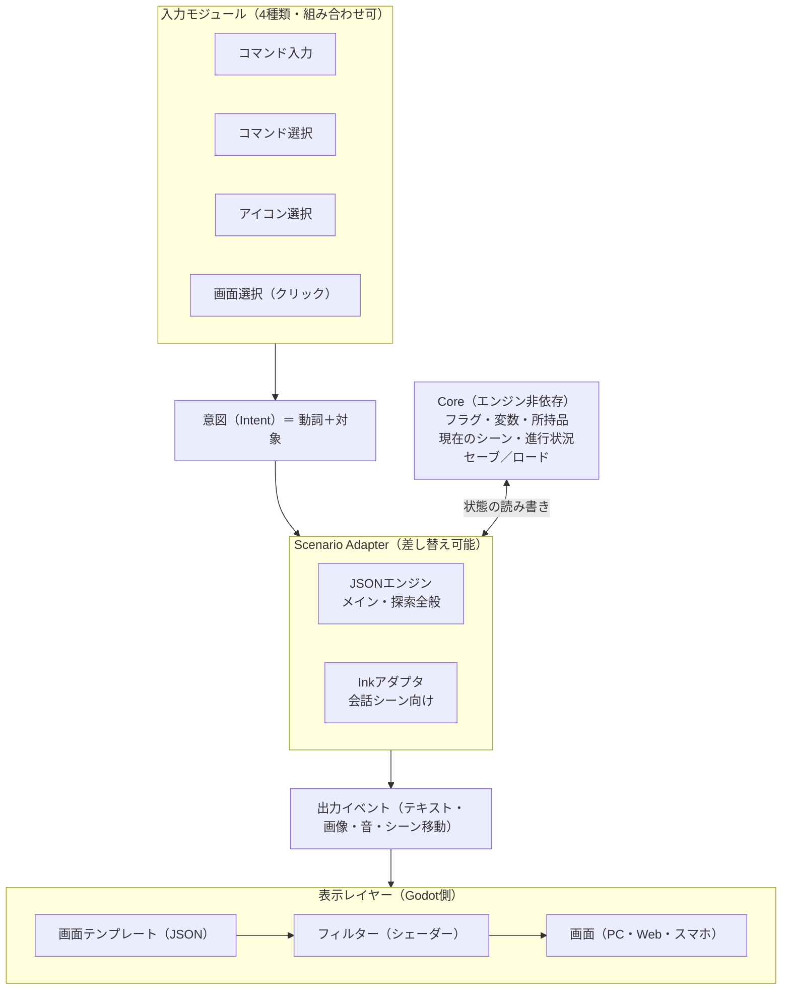

# adv80sGD 仕様書 v0.1

2026-11-01 時点 · 元ドキュメント: https://claude.ai/artifact/AfHSw5UrknPcJ8FewwWk7k

## 1. 概要

80年代のアドベンチャーゲームを制作するための汎用システムを、Godot 4上にモダンな構成で構築する。見た目は80年代、中身は現代的な設計とする。

**設計方針**

- **依存なし**：外部ライブラリやプラグインを使わず、Godot標準機能とGDScriptのみで実装する。
- **差し替え可能**：シナリオエンジン、入力方式、画面テンプレート、フィルターをすべて交換・自作できる。
- **入力の統一**：4種類のUIをどう組み合わせても、シナリオ側は単一の「意図（Intent）」形式だけを扱う。
- **データ駆動**：シナリオ、テンプレート、フィルター設定はJSONで記述する。

## 2. 技術基盤

エンジンはGodot 4、実装言語はGDScriptとする。GDScriptは全書き出し先（Web含む）に対応するため、マルチプラットフォーム要件を満たす。

| 項目 | 決定 | 理由 |
| --- | --- | --- |
| エンジン | Godot 4 | MITライセンス、ロイヤリティなし、2Dドット表示が標準で扱える |
| 実装言語 | GDScript | 全プラットフォームに書き出せる。C#はWeb書き出しに制約がある |
| 対象プラットフォーム | マルチ | PC、Web、スマートフォン |
| データ形式 | JSON | Godot標準のJSONクラスで読めるため自作パーサー不要 |
| 描画演出 | Godot標準シェーダー | フィルターを追加依存なしで実現できる |

Unityはライセンス体系の変更リスク、Unreal Engineは2D ADVには過剰であるため見送った。

## 3. アーキテクチャ

システムは入力モジュール、Core、Scenario Adapter、表示レイヤーの4層で構成する。



入力モジュールが生成した意図をScenario Adapterが処理し、Coreの状態を読み書きしながら出力イベントを返す。表示レイヤーはテンプレートとフィルターを通して画面に描く。

## 4. 入力システム

入力UIは、すべて同じ「意図（Intent）」に変換される。シーンごとに有効にするUIを複数選べる。基本の4種類に加えて、絵の中の対象を直接選ぶ3つの方式（4.5）を持つ。

| 入力UI | 操作例 | 生成される意図 |
| --- | --- | --- |
| コマンド入力 | `ドアを あける` と入力 | `{verb: OPEN, target: door}` |
| コマンド選択 | 「あける」→「ドア」を選ぶ（イラスト付き可） | 同上 |
| アイコン選択 | 開けるアイコン→ドアを選ぶ | 同上 |
| 画面選択 | 動詞を選んでから画面上のドアをクリック | 同上 |

### 4.1 意図（Intent）の基本形

```json
{
  "verb": "PUT",
  "slots": {
    "target": { "type": "item",   "id": "book" },
    "on":     { "type": "object", "id": "shelf" },
    "with":   { "type": "item",   "id": "gloves" }
  },
  "source": "parser",
  "ext": {}
}
```

- `verb`：動詞ID（必須）
- `slots`：引数を名前付きで持つ。スロット名と型は意図スキーマ（4.3）で動詞ごとに定義する
- `target`、`with`：標準スロット。2スロットで足りるゲームはこの2つだけを使う
- 値は型名つきで持つ（参照型は `{"type": "item", "id": "key"}`、基本型は `{"type": "number", "value": 1234}`）
- `source`：どのUIから来たか（ログや演出の切り替え用）
- `ext`：各層が自由に使える拡張領域。Coreは中身を解釈せずそのまま渡す

**方針：意図の細部は階層ごとに決め、Coreでは詰めない。** Coreが保証するのは上記の入れ物と、意図スキーマによる検証だけ。`ext` の使い方は入力モジュールとシナリオエンジンの間で取り決める。2スロットのゲーム向けに省略形も受け付け、Coreが受け取った時点で `slots` の形にそろえる：

```json
{ "verb": "USE", "target": "door", "with": { "type": "item", "id": "key" }, "source": "icon" }
```

### 4.2 パーサープロファイル

コマンド入力の解釈方法は「パーサープロファイル」として差し替えできる。自作も可能とする。

| プロファイル | 入力例 | 備考 |
| --- | --- | --- |
| 日本式（標準） | `ドア あける`、`ドアを あける` | 対象→動詞の順 |
| 英語式 | `OPEN DOOR` | VERB NOUNの順 |
| 動詞1語 | `あける` | 対象は画面選択などで補う |
| 自由文 | `古いドアを開けてみる` | 文の終わりから動詞を探し、知っている名詞を拾う |

**日本式プロファイルの仕様**

- 助詞（を、に、で）は、意図スキーマに `particles` があればスロットの振り分けに使い、なければ無視する。語順の入れ替えも許す。
- 同義語は辞書で定義する（しらべる、みる、ミル → LOOK）。
- ひらがなとカタカナは区別しない。

**英語式プロファイルの仕様**

- 最初に動詞、続けて名詞を書く。`look at`、`pick up` のような2語の動詞も辞書に書ける。
- 冠詞（the、a、an）は読み飛ばし、前置詞（辞書の `particles`）で名詞を区切る。
- 前置詞はスロットの振り分けには使わず、名詞を意図スキーマのスロットの順に、型が合うところへ入れる。
- 使うプロファイルはテンプレートの `inputs.parser_profile`（`ja`、`en`、`free`、または自作のパーサーのスクリプトのパス）で選ぶ。

**自由文プロファイル（`free`）の仕様**

- 空白で区切らない、ふつうの文を読む（「古いドアを開けてみる」「かぎでドアをあけてください」「部屋へ行ってみる」）。
- 文の終わりの言い回し（「てみる」「てください」「たい」「ます」「よう」「かな」、句読点など）を取り除く。
- 文の終わりから動詞を探す。辞書の言い換えそのもの、言い換えの最後の1文字を活用させた形（見た、使って、行って）、語幹＋活用の終わり（開けて、調べた）を動詞として読む。
- 残りの部分から、いま指せる名詞の呼び名を長い順に拾い、すぐ後の助詞を記録する。知らない語（「古い」「その」「よく」）は読み飛ばす。指せない名詞があれば、日本式と同じく「ここには ない」の返事にする。
- 同じ呼び名が複数の対象を指すときは、文の中のほかの語を呼び名に含む対象を先にする（「古いドア」なら、呼び名に「古い」を含むドア）。
- スロットへの振り分けは日本式と同じ（助詞と意図スキーマ）。動詞が見つからなければ、名詞だけなら「どうする？」、何も分からなければ「わからない」の返事にする。

### 4.3 意図スキーマ

意図スキーマは、動詞ごとに「どのスロットに、どの型の値をとるか」を宣言するJSON。入力モジュールの聞き返し、日本式パーサーの格の振り分け、シナリオ読み込み時の検証に使う。

**スロットの定義**

```json
{
  "schema_version": 1,
  "types": {
    "dial_number":  { "base": "number", "min": 0, "max": 9999 },
    "direction":    { "base": "enum", "values": ["north", "south", "east", "west"] },
    "phone_number": { "handler": "res://game/types/phone_number.gd" }
  },
  "verbs": {
    "PUT": { "slots": [
      { "name": "target", "type": "item",   "particles": ["を"] },
      { "name": "on",     "type": "object", "particles": ["に", "の上に"] },
      { "name": "with",   "type": "item",   "particles": ["で"], "required": false }
    ]},
    "USE":  { "target": "object", "with": "item?" },
    "LOOK": { "target": "object?" },
    "DIAL": { "with": "phone_number" }
  }
}
```

- 完全形（`slots` 配列）：スロット名、型、助詞、必須かどうかを並び順つきで書く。並び順は聞き返しやUIで選ばせる順番になる。
- 省略形：`"target": "object"` のようにスロット名と型だけを書く。型名の末尾の `?` は省略可を表す。2スロットのゲームはこちらで足りる。
- プロジェクト設定 `slot_mode` で `"named"`（任意のスロット名を許可、標準）と `"standard"`（target と with のみ）を選ぶ。`standard` のときにほかのスロットがあれば、読み込み時にエラーにする。
- 入力UIは扱えるスロット数を申告し、足りないスロットは聞き返しや次の選択で埋める。

| 分類 | 標準の型 | 値 |
| --- | --- | --- |
| 参照型 | `object`、`item`、`character`、`scene`、`topic` | シナリオに登録されたID。存在確認はシナリオ側で行う |
| 基本型 | `number`、`string`、`bool`、`enum`、`point`（画面座標） | 値そのもの |

**読み込み順と条件による切り替え**

スキーマは複数のファイルを重ねて使う。最初に読み込むファイル（`entry`）をプロジェクト設定で指定し、その上に条件つきの層を重ねる。

```json
"intent_schema": {
  "entry": "res://game/schema/base.json",
  "layers": [
    { "file": "res://game/schema/chapter2.json", "when": { "var": "chapter", "eq": 2 } },
    { "file": "res://game/schema/phone.json",    "when": { "scene": "phone_booth" } }
  ]
}
```

- 読み込み順：`entry` → `layers` のうち `when` を満たすもの（書いた順）→ 実行中のシナリオファイルが持つ `intent_schema`。
- 後から読んだ層が前の層を上書きする。単位は動詞・型ごと。値に `null` を書くとその動詞や型を取り除ける。
- 条件はシーン移動のときに評価する（標準）。フラグが変わったときにも評価し直すかは、プロジェクト設定で選べる。
- `when` の書き方はJSONシナリオの条件式と共通（5.8）。

**型の自作**

型は次の2通りで自作できる。

1. JSONだけで作る：`base` に既存の型を指定し、制約（min、max、values、pattern、長さなど）を足す。
2. GDScriptで作る：`handler` にスクリプトを指定する。スクリプトは型ハンドラーの基底クラスを継承し、下の処理を実装する。

| メソッド | 役割 |
| --- | --- |
| `parse(text, context)` | 入力された文字列を値に変換する（パーサー用） |
| `candidates(context)` | UIに出す候補を列挙する（コマンド選択・アイコン用） |
| `validate(value, context)` | 値が正しいか確かめる |
| `display(value, context)` | ログやメッセージに出す表示名を返す |

- 標準の型も同じ型ハンドラーの仕組みで実装し、自作の型と区別しない。

**型ハンドラーの基底クラス**

```gdscript
class_name AdvTypeHandler
extends RefCounted

func type_name() -> String
func parse(text: String, ctx: AdvTypeContext) -> Variant          # 読めなければ null
func candidates(ctx: AdvTypeContext) -> Array[Dictionary]         # [{value, label}]
func validate(value: Variant, ctx: AdvTypeContext) -> String      # 正しければ空文字、誤りなら理由のコード
func display(value: Variant, ctx: AdvTypeContext) -> String
func to_json(value: Variant) -> Dictionary                        # 意図に入れる形 {"type": …, …}
func from_json(data: Dictionary) -> Variant
```

- `to_json` と `from_json` は、意図の値を `{"type": "item", "id": "key"}` の形とやり取りするためのもの。セーブや巻き戻しで値を保存・復元するのに使う。
- `validate` は、正しければ空文字、誤りなら理由のコードを返す。プレイヤー向けの文は、辞書の `replies`（4.4）でコードごとに用意する。

| `AdvTypeContext` の中身 | 用途 |
| --- | --- |
| `adv` | `AdvContext`（状態、条件式の評価、素材、設定、表示名） |
| `verb`、`slot` | いまどの動詞の、どのスロットを埋めているか |
| `filled` | すでに埋まっている他のスロット（例：「つかう→鍵」まで決まっていれば、次の対象候補を絞れる） |
| `scene` | 現在のシーン |
| `options` | スキーマに書いた制約（`min`、`max`、`values`、`pattern` など） |
| `source` | 入力元のUI（`parser`、`select`、`icon`、`click`） |
| `lang` | 辞書の言語（`ja`、`en`） |

### 4.4 標準動詞セットと同義語辞書

フレームワークは、80年代の国産ADVでよく使われた動詞をもとにした標準動詞セットと、コマンド入力用の同義語辞書を同梱する。

| 動詞ID | 表示名 | 主な言い換え | スロット（4.3の省略形） | 区分 |
| --- | --- | --- | --- | --- |
| `LOOK` | みる | 見る、ながめる | `target: object?` | 基本 |
| `EXAMINE` | しらべる | 調べる、さがす、探す | `target: object?` | 基本 |
| `TAKE` | とる | 取る、ひろう、拾う | `target: object` | 基本 |
| `USE` | つかう | 使う | `target: item`、`with: object?` | 基本 |
| `TALK` | はなす | 話す、話しかける | `target: character` | 基本 |
| `ASK` | きく | 聞く、たずねる | `target: character`、`topic: topic` | 基本 |
| `MOVE` | いく | 行く、いどう、移動 | `target: scene` | 基本 |
| `OPEN`、`CLOSE` | あける、しめる | 開ける、閉める | `target: object` | 基本 |
| `ITEMS` | アイテム | もちもの、持ち物、しょじひん | なし（所持品の一覧を表示） | 基本 |
| `GIVE`、`SHOW` | わたす、みせる | 渡す、見せる | `target: character`、`with: item` | 拡張 |
| `PUSH`、`PULL`、`HIT` | おす、ひく、たたく | 押す、引く、叩く | `target: object` | 拡張 |
| `CALL` | よぶ | 呼ぶ | `target: character` | 拡張 |
| `THINK` | かんがえる | 考える、推理 | なし | 拡張 |
| `WAIT` | まつ | 待つ | なし | 拡張 |

「基本」は標準で有効な動詞、「拡張」はプロジェクトで有効にして使う動詞。表示名は辞書で変えられる。

```json
{
  "dictionary_version": 1,
  "lang": "ja",
  "normalize": { "kana": true, "width": true },
  "particles": ["を", "に", "で", "へ", "と", "から"],
  "verbs": {
    "LOOK":    { "label": "みる",     "words": ["みる", "見る", "ながめる"], "stems": ["み", "ながめ"] },
    "EXAMINE": { "label": "しらべる", "words": ["しらべる", "調べる", "さがす"], "stems": ["しらべ", "調べ", "さが"],
                 "default_reply": "とくに かわった ところは ない。" }
  },
  "nouns": { "door": ["ドア", "とびら", "扉"] },
  "replies": { "unknown_word": "その ことばは わからない。", "no_target": "そんな ものは ない。" }
}
```

**決定事項**

- **代用しない**：ある動詞の反応がシナリオにないとき、標準では別の動詞の反応を代わりに使わない（「しらべる」と「みる」も別々）。代用したい場合は、実装者が辞書の `fallback` で動詞ごとに指定できる。
- **活用形**：言い換えの一覧（`words`）に書いた形との完全一致と、語幹（`stems`）で始まるかの照合の両方を使う。完全一致を優先する。
- **照合前の整形**：ひらがなとカタカナ、全角と半角を区別しない（`normalize`）。
- **既定の返事**：動詞ごとの `default_reply` と、「わからない言葉」「対象がない」ときの返事（`replies`）を辞書に持たせ、シナリオで上書きできる。
- **名詞の言い換え**：`nouns` はシナリオ全体で使う名詞の言い換え。シーンごとの `names`（5.2）と合わせて使う。
- **重ね方**：プロジェクト → テンプレート → シナリオ の順に重ね、後のものが上書きする。
- **英語版**：英語式パーサー用に、同じ形式の英語版辞書（`lang: "en"`）も同梱する。`look`、`l`、`examine`、`x`、`inventory`、`i` のような略語も含める。
- **拡張の動詞の有効化**：辞書で `"extended": true` にした動詞は標準の一覧から外し、プロジェクト設定 `verbs` に書いたものだけを使う。

### 4.5 絵の中の対象を選ぶコマンド方式

海外のポイント＆クリック型のアドベンチャーゲームで使われてきた、絵の中の対象を直接選ぶ方式を3つ持つ。どれも生成するのは同じ意図で、シナリオの書き方は変わらない。`inputs.enabled` に書いて選ぶ（1つだけ書く。`parser` とは組み合わせられる）。

| 方式 | `inputs.enabled` | 操作 |
| --- | --- | --- |
| 動詞リスト＋クリック | `verb_click` | 出したままの動詞の一覧から動詞を選び、絵の中の対象（または持ち物）を選ぶ。「つかう かぎ → ドア」のように、2つ目の対象も続けて選ぶ |
| アイコン切り替え | `verb_cursor` | 右クリック（または一覧のボタン）でカーソルの動詞を順に切り替え、対象をクリックする。選んだ動詞は、切り替えるまで残る |
| コンテキスト | `context` | 動詞を選ばない。対象にカーソルを合わせると形が変わり、クリックするとその対象に合った動詞を実行する。右クリックは「みる」 |

- **コマンドの窓**：`verb_click` と `verb_cursor` は動詞の一覧、その下に持ち物を出したままにする。`context` は持ち物だけを出す。絵の中に範囲（`region`、`sprite`）を持たない物・人物・出口は「→ 名前」のボタンで窓に並べ、どの対象も選べるようにする。選びかけの文（「つかう かぎ …」）を窓の上に出す。
- **持ち物**：持ち物を押すと「持った」状態になり（動詞は `inputs.item_verb`、既定 `USE`）、続けて絵の中の対象や別の持ち物を選ぶ。対象のいらない使い方は、文の横の「○」で決める。もう一度押すか「×」でやめる。
- **コンテキスト型の動詞の決め方**：物・出口の `click`（動詞ID）→ 出口は `MOVE` → カーソルの種類（`cursor`。なければ人物は `talk`、ほかは `look`）から `inputs.context_verbs`（種類 → 動詞ID。既定は `talk`→`TALK`、`take`→`TAKE`、`exit`→`MOVE`）→ `inputs.click_verb`（既定 `EXAMINE`）。`verb_click` と `verb_cursor` で動詞を選ばずに対象を押したときも同じ。
- **右クリック**：選びかけをやめる → `verb_cursor` は次の動詞 → 対象や持ち物の上なら `inputs.context_alt_verb`（既定 `LOOK`）を実行する。
- **対象にならないものを押したとき**：選んだ動詞の対象にならないものを押しても、そのまま意図にして出す（シナリオや辞書の「できない」の返事が出る）。
- **カーソル**：選んでいる動詞に合わせてカーソルの種類を変える（`inputs.verb_cursors`：動詞ID → 種類。既定は `LOOK`・`EXAMINE`→`look`、`TALK`・`ASK`→`talk`、`TAKE`→`take`、`USE`・`OPEN` など→`use`、`MOVE`→`exit`）。テンプレートに `ui.cursors` がなければ、この方式の間はアドオンの標準のカーソル画像を使う。
- **マウス以外**：Tab（Shift で逆）、ゲームパッドの L・R で調べられる場所を順に選び、決定でクリックしたことにする。動詞と持ち物は、ほかの方式と同じくカーソルキーと決定で選べる。タッチは、短く押して離すとクリック、0.5秒の長押しを右クリックと同じ操作として扱う（絵の中と持ち物。押したまま動かしたときは長押しにしない）。
- **プロジェクト設定での上書き**：プロジェクト設定の `inputs` に書いた項目は、テンプレートの `inputs` を項目ごとに上書きする。テンプレートを変えずに、ゲームごとにコマンド方式を決められる。
- **入力機器**：プロジェクト設定の `input_devices`（`keyboard`、`mouse`、`gamepad`、`touch`）に書いた機器だけを受け付ける。書かなければすべて。`gamepad`・`touch` を外すとモダン機能の同名の機能も止める。`mouse` を外すとカーソルを隠す。

## 5. シナリオエンジン

プライマリは付属のJSONシナリオエンジン、セカンダリはInkとする。どちらもScenario Adapterを実装する形で接続し、他のシナリオエンジンも同じ方法で追加できる。

### 5.1 Scenario Adapter

意図を受け取り、出力イベントの列を返すインターフェース。

- 入力：意図、現在のゲーム状態
- 出力：テキスト表示、画像差し替え、効果音、シーン移動、選択肢や動詞リストの更新、フラグ変更など

出力イベントの形式と一覧は5.4を参照。

**メソッド定義**

GDScriptにはインターフェースがないため、基底クラス `AdvScenarioAdapter` を継承し、決まったメソッドを上書きする。

```gdscript
class_name AdvScenarioAdapter
extends RefCounted

func setup(ctx: AdvContext) -> Error
func load_sources(paths: PackedStringArray) -> Error
func start(entry: String) -> Array[Dictionary]
func handle_intent(intent: Dictionary) -> Array[Dictionary]
func query(what: String, args := {}) -> Variant
func save_state() -> Dictionary
func load_state(data: Dictionary) -> Error
func validate() -> Array[Dictionary]
```

| メソッド | 役割 |
| --- | --- |
| `setup` | 初期化。Coreから `AdvContext` を受け取る |
| `load_sources` | シナリオファイルを読み込む |
| `start` | 指定した場所から開始し、出力イベントを返す |
| `handle_intent` | 意図を処理して出力イベントを返す（中心となるメソッド） |
| `query` | UIやモダン機能からの問い合わせに答える（`hints`、`objective`、`notebook`、`flow`、`hotspots`、`topics` など） |
| `resume` | 上に積んだアダプタ（Inkなど）の処理が終わって戻ってきたときに、止めていた手順の続きを実行して出力イベントを返す |
| `save_state`、`load_state` | アダプタ内部の状態（Inkの呼び出し位置、会話の途中の位置など）を保存・復元する |
| `validate` | シナリオの確認結果を返す。コマンドラインの確認（5.6）がこれを呼ぶ |

`AdvContext` は、Coreがアダプタに渡す道具箱。

| メンバー | 主なメソッド | 用途 |
| --- | --- | --- |
| `state`（読み取り専用） | `get(名前, 既定値)`、`has(名前)`、`items()`、`scene()`、`visited(シーン)`、`talked(会話ID)`、`read(行ID)`、`chosen(選択肢ID, 項目ID)`、`tried(動詞, 対象)` | 状態を読む。5.8の組み込み条件と同じ名前にそろえる。書き換えは `state.set` イベントで行う |
| `eval` | `eval(条件)`、`compile(条件)` | 5.8の条件式を評価する。`compile` で事前に変換しておけば、毎回の評価が速くなる |
| `assets` | `has(種類, ID)` | 素材IDが実在するかを確かめる |
| `config` | `project()`、`template()`、`preset()`、`group()`、`feature(名前)` | 設定と、現在のテンプレート・機能の状態を読む |
| `labels` | `verb(ID)`、`noun(ID)` | 辞書（4.4）の表示名を引く |
| `rng` | `randi()`、`randf()`、`pick(配列)` | 乱数。アダプタはGodot標準の乱数を使わず、必ずこれを使う |
| `diag` | `warn(コード, メッセージ, 場所)` | 実行中に見つけた問題を報告する（開発中はエディタの一覧に表示） |

- **乱数はCoreが管理する**：乱数の状態をセーブデータに入れ、ロードや巻き戻しのあとも同じ結果を再現できるようにする。
- **アダプタ間の受け渡し**：アダプタは内部用の出力イベント `adapter.enter`（`adapter`、`entry`）を返して別のアダプタに処理を渡し、受け取った側は処理を終えたら `adapter.exit` を返す。Coreがこれを受けて処理中のアダプタを積み上げる。アダプタ同士は直接呼び合わない。

**決定事項**

- **同期で配列を返す**：メソッドはすぐに出力イベントの配列を返す。演出の終了待ちなどは表示レイヤーが `wait` に従って処理し、アダプタの中では待たない。
- **入力が必要な地点までまとめて返す**：`input` 待ちのイベント（`choice.show`、`input.request` など）までをまとめて返し、選ばれた結果は `CHOOSE` の意図として `handle_intent` に届く。
- **JSONとInkの受け渡し**：JSONアダプタが主となり、すべての意図を受け取る。Inkには、JSONの手順 `{ "ink": "ノット名" }` で明示的に処理を渡し、Inkの処理が終わったらJSONに戻る。処理中のアダプタはCoreが積み上げて管理する。受け渡しは出力イベント adapter.enter と adapter.exit で行い、Coreはこれを表示側へ渡さない（5.3）。
- **問い合わせ**：UIは `Core.query` に問い合わせ、Coreが自分で答えられない分だけをアダプタの `query` に回す（下の「問い合わせ」）。
- **保存**：セーブデータには、Coreの状態に加えて、アダプタごとの `save_state()` の結果を入れる。
- **確認**：`validate` をアダプタに持たせ、コマンドラインの確認がInkを含むすべてのシナリオ形式に同じように働く。

**問い合わせ（query）**

UIの問い合わせ先は `Core.query(名前, 引数)` に一本化する。`notebook.add`、`objective.set`、`hint.set`、`flow.mark` の内容はイベントとしてCoreが保存しているのでCoreが答え、シナリオの構造が必要な部分だけをアダプタに問い合わせて合成する。「試したコマンド」の記録は、Coreが意図を受け取るたびに自動で残す。

| 名前 | 引数 | 戻り値 | 答えるもの |
| --- | --- | --- | --- |
| `verbs` | — | `[{id, label, enabled, tried}]` | アダプタ（一覧）＋Core（`tried`） |
| `items` | — | `[{id, label, count, icon}]` | アダプタ（表示名とアイコン）＋Core（個数） |
| `hotspots` | `scene?` | `[{id, label, region, tried_verbs, new}]` | アダプタ（範囲と表示条件）＋Core（試した動詞） |
| `targets` | `verb`、`slot` | `[{type, id, label}]` | アダプタ（その場で選べる対象の候補。コマンド選択と聞き返しで使う） |
| `topics` | `character` | `[{id, label, new}]` | アダプタ（表示条件の評価）＋Core（選んだかどうか） |
| `hints` | `topic?` | `[{topic, stages, revealed}]` | Core |
| `objective` | — | `{id, text}` または `null` | Core |
| `notebook` | `category?` | `[{id, category, title, body}]` | Core |
| `flow` | — | `{nodes: [{id, label, chapter, reached, can_jump}], edges: [{from, to}]}` | アダプタ（分岐の構造）＋Core（到達したかどうか） |
| `chapters` | — | `[{id, label, unlocked}]` | アダプタ＋Core |
| `scene` | — | `{id, label}` | アダプタ |

- 戻り値は Dictionary と Array だけで作る（JSONにそのまま変換できる形）。
- 表示名（`label`）は装飾記法を含んだまま返し、描き方はUIが決める。
- 知らない名前の問い合わせには `null` を返す。自作の問い合わせは `x.名前` の形にする。

**確認結果（validate の戻り値）**

`validate` は診断情報の配列を返す。コマンドラインの結果をJSONで出力する場合（5.6）は、この配列に件数のまとめを付けた形にする。

```json
{
  "severity": "error",
  "code": "ASSET_NOT_FOUND",
  "message": "素材ID「hallway2」が見つからない",
  "file": "res://game/scenario/ch1.scenario.json",
  "path": "/scenes/hallway/objects/door/on/OPEN/then",
  "line": 42,
  "hint": "manifest.json か assets/bg/ を確認してください"
}
```

| 項目 | 内容 |
| --- | --- |
| `severity` | `error`、`warning`、`info`。`info` は誤りとは限らないものを知らせる区分で、コマンドラインの終了コードには影響しない |
| `code` | 英大文字の固定コード（翻訳しない） |
| `message` | 説明文。エディタの言語設定に合わせて日本語か英語 |
| `file`、`path` | 問題のあるファイルと、その中の場所（JSON Pointer形式）。場所の特定は `path` を基本にする |
| `line` | 行番号。分かる場合だけ付ける |
| `hint` | 直し方の手がかり（任意） |

| 標準のコード | 意味 | 区分 |
| --- | --- | --- |
| `JSON_PARSE` | JSONとして読めない | エラー |
| `SCHEMA_VIOLATION` | 構造がスキーマに合わない | エラー |
| `UNKNOWN_KEY` | 知らない項目がある | 警告 |
| `ASSET_NOT_FOUND` | 素材IDが存在しない | エラー |
| `UNKNOWN_VERB`、`UNKNOWN_TYPE`、`SLOT_MISMATCH` | 意図スキーマにない動詞・型、スロットが合わない | エラー |
| `COND_SYNTAX` | 条件式の文法の誤り | エラー |
| `UNKNOWN_VARIABLE` | 宣言されていない変数 | 警告 |
| `DUPLICATE_ID` | IDの重複 | 警告 |
| `MISSING_TARGET` | `call`、`goto`、`dialogue` で呼ぶ先がない | エラー |
| `FEATURE_DEPENDENCY` | 機能の依存が満たされず、自動で無効になる（10.1） | 警告 |
| `UNREACHABLE` | どこからも呼ばれない会話やシーン | 情報 |
| `INK_*` | Inkアダプタ固有の問題（INK_LOAD、INK_VERSION、INK_UNSUPPORTED、INK_EXTERNAL、INK_MISSING_KNOT。5.3） | アダプタが決める |
| `ALIAS_CYCLE` | エイリアスが自分自身を（ほかのエイリアスを通しても）呼んでいる（5.4） | エラー |
| `ALIAS_UNKNOWN` | 定義していないエイリアスを使っている（5.4） | エラー |
| `IF_UNCLOSED` | 文中の `[if]` と `[/if]` の数が合わない（5.4） | 警告 |
| `SUBSCENE_KIND`、`SUBSCENE_ARG`、`SUBSCENE_RETURN` | kind が sub でないシーンの呼び出し、宣言にない・足りない引数、sub でないシーンの `return`（6.9） | 警告 |
| `SUBSCENE_DEPTH` | サブシーンの呼び出しが深さの上限を超えた（実行時。6.9） | 警告 |
| `ENDING_UNKNOWN` | エンディングのシーンに `ending` がない、またはプロジェクト設定の `endings` にない（6.9） | 警告 |


### 5.2 JSONシナリオ（プライマリ）

シーン、対象、動詞ごとの反応を宣言的に書く。条件分岐はフラグで判定する。

```json
{
  "scene": "hallway",
  "image": "hallway.png",
  "objects": {
    "door": {
      "names": ["ドア", "とびら"],
      "region": [120, 40, 80, 140],
      "on": {
        "LOOK": "古びた木のドアだ。",
        "OPEN": {
          "if": "has_key",
          "then": { "goto": "room" },
          "else": "鍵がかかっている。"
        }
      }
    }
  }
}
```

- `names`：コマンド入力で認識する呼び名
- `region`：画面選択のクリック判定（x, y, 幅, 高さ。画像の層の中の座標で、元の解像度のピクセル）
- `click`：クリックしたときに使う動詞ID（コンテキスト型と画面選択。書かなければ 4.5 の決め方）
- `on`：動詞ごとの反応

**背景の重ね合わせ（`image` の配列）**

シーンの `image` は配列でも書ける。要素は素材IDか `{"id", "variant"?, "x"?, "y"?, "when"?}` で、`when` に合う要素だけを書いた順に重ね、1枚の背景にする。

```json
"image": [
  "hallway",
  { "id": "hallway_door_open", "when": "door_unlocked" },
  { "id": "lamp_glow", "x": 200, "y": 60, "when": "lamp_on" },
  { "id": "hallway", "variant": "night", "when": "night" }
],
"image_transition": "fade"
```

- **重ね方**：最初の画像の大きさの1枚に、後の画像を `x`・`y`（最初の画像の左上が原点）の位置に重ねる。透明な部分とカラーキーはそのまま抜ける。アニメーション画像（GIF・APNG・MNG、マニフェストの `grid`・`anims`）が入っているときは1枚にまとめず、要素ごとに重ねて動かす（要素の `anim` で再生するアニメーションを選べる。既定は `default`）。1枚だけの背景でも、アニメーション画像なら動かす。
- **条件が変わったとき**：コマンドを1つ実行するたびに条件を見直し、重ねるものが変わったら背景を描き直す。切り替え演出はシーンの `image_transition`（既定 `cut`）。シーンに入るときは、ほかの背景と同じくシーン移動の演出がかかる。
- **出力イベント**：`image.show` の `id` に、解決した配列（`when` を除いたもの）を渡す。`image.show` を直接書くときも配列を使える。重ねているものはセーブに含める。

### 5.3 Inkアダプタ（セカンダリ）

Inkはinkle社が公開している分岐ストーリー用のスクリプト言語（MITライセンス）。会話や選択肢の分岐に向く。

- 作者は `.ink` を書き、公式ツール inklecate でJSONに変換する。inklecateは制作時のみ使い、完成したゲームには含めない。
- 変換済みJSON（.ink.json）を再生する実行部分をGDScriptで自作する。inkle社のC#版の実行部分と同じ動きにそろえ、対応するinkVersionは19〜21とする。LIST も C# 版と同じ動きにする（項目の値、和・差・積、含む・含まない、比べる、`LIST_COUNT`・`LIST_MIN`・`LIST_MAX`・`LIST_VALUE`・`LIST_ALL`・`LIST_INVERT`・`LIST_RANGE`・`LIST_RANDOM`、`リスト名(値)`、項目と数の足し引き。並びと `LIST_RANDOM` の結果も C# 版にそろえる）。LIST の変数を Core の状態と受け渡すときは「項目名, 項目名」の文字列にする（Core から戻すときは、その文字列から作り直す）。RANDOM、SEED_RANDOM、シャッフルのシーケンスは、C#版と同じ乱数（.NET の System.Random と同じ手順）を使い、同じ種なら同じ結果になる。
- Inkの変数はCoreの状態（フラグ、変数）と同期する。Inkに入るとき、Inkのグローバル変数と同じ名前のCoreの変数の値をInkに写す。Inkの中で変わったグローバル変数は state.set でCoreに返す（プロジェクト設定 ink.sync_variables を false にすると返さない）。
- 意図はInkの外部関数または選択肢として受け渡す（下の「選択肢と意図」「外部関数」）。
- 想定する使い方：探索部分はJSON、会話シーンはInkのように、1本のゲームで両方を混在できる。会話もJSONだけで書けるようにし、Inkは任意とする。
- **読み込み**：プロジェクト設定のシナリオの一覧にある `.ink.json` はInkアダプタが読む。`.ink.json` だけのゲームではInkアダプタが主になる（最初から再生する）。複数の `.ink.json` を並べた場合は、指定したノットを持つ最初のファイルを使う。
- **受け渡しの流れ**：JSONの手順 `{ "ink": "ノット名" }` は出力イベント `adapter.enter` を出して止まる。CoreはInkアダプタを積んで `start` を呼ぶ。Inkが選択肢なしで止まる（`-> DONE`、`-> END`、終わりまで進む）と `adapter.exit` を出し、CoreはInkアダプタを外して下のアダプタの `resume` を呼ぶ。この2つのイベントは表示側へは渡さない。
- **行とタグ**：Inkの1行ごとに `text.show` を出す。`@話者ID 文章`（JSONの手順と同じ）か `# speaker:話者ID` で台詞にする。行IDは `# id:…` で書け、省略すると `ink:ノット名#本文のハッシュ` になる。`# voice:ID`、`# bg:ID`、`# bgm:ID`、`# se:ID` で声・背景・BGM・効果音を出し、`# {"image.show": {…}}` のようにJSONの手順と同じ書き方で出力イベントを出せる。そのほかのタグは `text.show` の `ext.tags` に入れる。
- **タグだけの行**：Inkでは、タグだけを書いた行は本文が空の1行になる（C#版と同じ）。アダプタはこの行の `text.show` を出さず、出力イベントになるタグ（`voice:`、`bg:` など）はその場で出す。それ以外のタグは次の行の `ext.tags` に回す。
- **動作の確かめ**：確かめ用の `.ink` をinklecateで変換したJSONをテストに使い、再生結果がinklecateの再生モード（`-p`）の出力と一字一句同じになることを確かめる。
- **選択肢と意図**：選択肢は `choice.show` で出し、項目のIDは `c0`、`c1`… とする。選択肢にタグ `# intent:動詞[:対象[:with]]`（`*` は何でも）をつけると、コマンド入力の意図でもその選択肢を選べる。`# hidden` は一覧に出さない（すべて hidden なら一覧を出さず、コマンド入力だけで進む会話になる）。intent タグのある選択肢を出している間は、コマンド入力も受け付ける（`pending_choice` の `accepts_intents`）。合う選択肢がない意図には、辞書の既定の返事を出して待ち続ける。
- **外部関数**：`has_item`、`item_count`、`item_add`、`item_remove`、`get_var`、`set_var`、`visited`、`talked`、`cond`（条件式）、`event`（種類, 引数のJSON）、`goto_scene`、`call_scene`（サブシーンの呼び出し。6.9）を標準で用意する。これ以外は、Ink側に同じ名前の関数があればそれを使い、なければ確認で `INK_EXTERNAL` を出す。
- **到達記録**：Inkに入るとき `state.mark`（talked、`ink:ノット名`）を出し、選んだ選択肢は chosen に `ink:ノット名#c…/c番号` で残す。
- **確認**：`INK_LOAD`（読めない）、`INK_VERSION`（未確認の版）、`INK_UNSUPPORTED`（読めない部分）、`INK_EXTERNAL`、`INK_MISSING_KNOT`（JSONから渡すノットがない）を出す。タグで書いた素材がなければ `ASSET_NOT_FOUND` を出す。

### 5.4 出力イベント

出力イベントは、シナリオエンジンが「何をするか」を伝える命令。Scenario Adapterは出力イベントを配列で返し、上から順に実行される。

```json
[
  { "type": "image.show", "args": { "layer": "bg", "id": "hallway", "transition": "wipe" } },
  { "type": "text.show",  "args": { "speaker": "ayumi", "body": "このドア、開かないわ。" }, "wait": "click" },
  { "type": "state.set",  "args": { "flag": "door_checked", "value": true } },
  { "type": "group", "args": { "events": [
      { "type": "image.show", "args": { "layer": "bg", "id": "room", "transition": "fade" } },
      { "type": "bgm.play",   "args": { "id": "theme2", "fade": 1.0 } }
  ]}, "wait": "end" }
]
```

| 項目 | 内容 |
| --- | --- |
| `type` | `分類.動作` の形の名前 |
| `args` | イベントごとの引数 |
| `wait` | 次のイベントに進む条件。`"none"`（すぐ進む）、`"click"`（クリック待ち）、`"end"`（演出の終了待ち）、秒数、`"input"`（選択や入力を終えるまで待つ）。省略すると種類ごとの既定値（下の表） |
| `id` | 既読判定や巻き戻しに使う識別子。省略するとシナリオ上の位置から自動で付ける |
| `log` | メッセージログに残すか。テキスト系の既定値は true |
| `ext` | 拡張領域 |

**イベント一覧（初期案）**

| 分類 | イベント | 用途 |
| --- | --- | --- |
| テキスト | `text.show`、`text.append`、`text.clear` | メッセージ表示（話者、本文、表示する窓） |
| 画像 | `image.show`、`image.hide`、`effect.play` | 背景や立ち絵の層、切り替え演出、フラッシュや揺れ。スプライトと装飾画像は sprite.show など（6.4）、マウスカーソルは cursor.set（6.5） |
| 動画 | `video.play`、`video.stop` | オープニングやイベントの動画、動く背景（6.6） |
| 音 | `bgm.play`、`bgm.stop`、`se.play`、`voice.play` | 音楽、効果音、ボイス |
| 状態 | `state.set`、`item.add`、`item.remove` | フラグ、変数、所持品の変更 |
| 進行 | `scene.goto`、`wait`、`group`、`choice.show`、`input.request`、`game.end` | シーン移動、待機、同時実行、選択肢、スロットの聞き返し |
| 入力UI | `verbs.update`、`hotspots.update`、`input.mode` | 動詞リスト、クリックできる範囲、有効にする入力UIの更新 |
| モダン機能 | `notebook.add`、`objective.set`、`hint.set`、`flow.mark`、`checkpoint` | 手帳、目的、ヒント、フローチャート上の到達記録、オートセーブや巻き戻しの区切り |
| システム | `template.switch`、`layout.set`、`save.request` | 旧表示と新表示の切り替え、名前付きレイアウトの切り替え、セーブ画面を開く |
| サブシーン | `scene.call`、`scene.return` | サブシーンの呼び出しと戻り（6.9。状態イベント） |
| 特殊シーン | `ending.reach`、`credits.roll`、`fin.show`、`opening.play`、`extras.open`、`notice.show`、`game.new`、`game.title`、`game.continue`、`game.quit`、`endings.open`、`chapters.open`、`settings.open` | エンディングの記録、スタッフロール、タイトルのメニューの操作（6.9） |
| システムシーン | `system.save`、`system.load`、`system.close`、`settings.set` | システムシーンの中のセーブ・ロード・閉じる・設定の変更（6.9） |

**決定事項**

- 状態の変更もイベントで流す。`state.set` などの状態イベントは表示レイヤーではなくCoreが受け取って反映する。アダプタはCoreの状態を読むだけで、直接は書き換えない。状態の変化がすべて記録に残るため、巻き戻し、ログ、デバッグに使える。
- 待ちは各イベントの `wait` で指定する。間を置きたいときは `wait` イベントも使える。
- 同時実行は2通りで書ける。`wait: "none"` で続けて流す方法と、`group` イベントで囲む方法。`group` の `wait` は中のイベント全体に対して働く。
- 自作イベントは `x.名前` の形で、処理するGDScriptのハンドラーと一緒に登録する。表示側が知らないイベントは警告を出して無視する。
- モダン機能はイベントから情報を得る。既読スキップは `text.show` の `id`、読み上げは本文、巻き戻しは `checkpoint` を使う。

**引数と既定の待ち方**

| イベント | 主な `args`（`?` は省略可） | 既定の wait |
| --- | --- | --- |
| `text.show` | `body`、`speaker?`、`window?`（既定 `main`）、`voice?`、`clear?`（既定 true） | `click` |
| `text.append` | `body`、`window?` | `click` |
| `text.clear` | `window?` | `none` |
| `image.show` | `layer`、`id`、`pos?`、`transition?`（省略時はテンプレートの既定、なければ `cut`）、`duration?`（秒） | 切り替え演出ありは `end`（テンプレートの既定の演出も含む）、`cut` は `none` |
| `image.hide` | `layer`、`id?`、`transition?`、`duration?` | 同上 |
| `sprite.show`、`sprite.set`、`sprite.hide`、`sprite.anim`、`sprite.effect`、`sprite.clear` | 6.4 の表を参照 | 6.4 の表を参照 |
| `cursor.set` | `kind` か `image`（null で自動に戻す。6.5） | `none` |
| `video.play`、`video.stop` | 6.6 の表を参照 | 6.6 の表を参照 |
| `effect.play` | `name`（`flash`、`shake`、`fade` など）、`duration?`、`params?` | `end` |
| `bgm.play` | `id`、`loop?`（既定 true）、`fade?`（秒）、`volume?` | `none` |
| `bgm.stop` | `fade?` | `none` |
| `se.play` | `id`、`volume?` | `none` |
| `voice.play` | `id`、`speaker?` | `none` |
| `state.set` | `name`、`value`、`op?`（`set`、`add`、`sub`、`mul`、`div`、`mod`、`min`、`max`、`toggle`。既定 `set`） | `none` |
| `item.add` / `item.remove` | `id`、`count?` | `none` |
| `scene.goto` | `scene`、`entry?`、`transition?` | `end` |
| `wait` | `seconds` または `until: "click"` | （それ自体が待ち） |
| `group` | `events` | `end`（中のイベントがすべて終わるまで） |
| `choice.show` | `choices`（`id`、`label`、`when?`）、`prompt?`、`cancel?` | `input` |
| `input.request` | `slot`、`prompt?` | `input` |
| `game.end` | `ending?` | （終了） |
| `verbs.update` | `verbs`、`mode?`（`replace`、`add`、`remove`） | `none` |
| `hotspots.update` | `objects`、`mode?` | `none` |
| `input.mode` | `enable`（`parser`、`select`、`icon`、`click`、`verb_click`、`verb_cursor`、`context` から選ぶ） | `none` |
| `notebook.add` | `id`、`category?`、`title`、`body` | `none` |
| `objective.set` | `id?`、`text` | `none` |
| `hint.set` | `topic`、`hints`（段階の順に並べた配列） | `none` |
| `flow.mark` | `node` | `none` |
| `checkpoint` | `id?`、`autosave?` | `none` |
| `template.switch` / `layout.set` | `template`、`transition?`（`layout.set` は `layout`、`transition?`） | `end` |
| `save.request` | — | `input` |
| `scene.call` | `scene`、`args`、`into?` | `end` |
| `scene.return` | `scene`（戻り先）、`value` | `end` |
| `ending.reach` | `id` | `none` |
| `credits.roll` | `items`・`lines`・`text` のどれか、`speed?`（1秒あたりの画素。既定 30）、`duration?`（秒）、`align?`、`pal?`、`size?`、`margin?`、`fill?`、`background?`（既定 true）、`skippable?`（既定 true）、`bgm?`（6.9） | `end` |
| `game.new` | `scene?` | （流れを切る） |
| `game.title`、`game.continue`、`game.quit`、`endings.open`、`chapters.open`、`settings.open` | — | （流れを切る） |
| `fin.show` | 「おわり」の画面の設定（6.9） | （流れを切る） |
| `opening.play` | `scene?` | （流れを切る） |
| `extras.open` | — | （流れを切る） |
| `notice.show` | `text`、`seconds?`（既定 2.5） | `none` |
| `system.save` | `slot` | `none` |
| `system.load` | `slot` | （流れを切る） |
| `system.close` | — | （流れを切る） |
| `settings.set` | `key`、`value` | `none` |

- **素材の指定**：`id` は素材マニフェスト（IDとファイルの対応表）のID、またはファイルパスのどちらでも書ける。`res://` で始まるか `/` を含む値はパス、それ以外はIDとして扱う。マニフェストの詳細は5.5。
- **音量**：`bgm.play`、`se.play` の音量は、イベントの `volume` と素材マニフェストの `volume` をかけ合わせ、さらにプレイヤー設定の音量をかける。BGM のループ位置はマニフェストの `loop_start`（秒）。鳴っている BGM はセーブに含める。
- **画像の層**：`layer` に使える名前と重なり順は、画面テンプレートの `layout` で定義する（第6章）。
- **wait 既定値の書き換え**：上の表の既定値は `event_defaults` で書き換えられる。優先順位は、イベント自身の `wait` → シナリオファイルの `event_defaults` → プロジェクト設定の `event_defaults` → 標準の既定値。
- **選択の結果**：`choice.show` で選ばれた結果は、意図 `{"verb": "CHOOSE", "slots": {"target": {"type": "choice", "id": "yes"}}}` としてシナリオに返す。
- **足りないスロットの聞き返し**：必須のスロットが足りない意図には、Core が文章の返事ではなく `input.request` を返す。引数には `slot`、`prompt` のほか、`verb`、`type`、途中まで埋めた `intent` を入れる。コマンド選択はそのスロットの候補を出し、コマンド入力は名詞だけで答えられる。
- **スキップとオート送り**：`click` 待ちは自動で進め、`end` 待ちは演出を短くするか飛ばす。`input` 待ちだけは、スキップ中でも必ず止まる。

```json
"event_defaults": {
  "text.show": { "wait": "click" },
  "se.play":   { "wait": "end" }
}
```

**本文の装飾記法**

本文の装飾（ルビ、色、表示速度、途中での待ちなど）は、「装飾記法プロファイル」として差し替えできる。どの記法も、読み込んだ時点で共通の内部表現に変換する。

| プロファイル | 内容 |
| --- | --- |
| BBCode拡張（標準） | GodotのRichTextLabelが解釈できるBBCodeをベースに、ルビや待ちなどを独自タグで足す |
| 独自記法 | 制作者が定義する記法。変換処理をGDScriptで書いて登録する |

- 使うプロファイルはプロジェクト設定で選び、シナリオファイルごとに上書きできる。
- 読み上げやログでは、装飾を取り除いた文字列を使う。

**BBCode拡張の独自タグ**

Godot標準のBBCodeタグ（`[b]`、`[color]`、`[wave]` など）に加え、ADVに必要な文字送りの制御と日本語向けの装飾を独自タグで補う。

| タグ | 動き | 例 |
| --- | --- | --- |
| `[w=秒]` | 指定した秒数だけ止まる | `待って[w=0.5]……誰？` |
| `[p]`、`[p=秒]` | クリックを待ち、同じ窓で続ける。秒数を書くと、クリックしなくてもその秒数で続ける | `ドアが開いた。[p]中は暗い。` |
| `[page]`、`[page=秒]` | クリックを待ち、次のページ（窓の先頭）から続ける。秒数は `[p=秒]` と同じ | |
| `[speed=文字数]…[/speed]` | 囲んだ範囲の表示速度（1秒あたりの文字数）を変える | `[speed=5]ゆっくり[/speed]` |
| `[instant]…[/instant]` | 囲んだ範囲を一度に表示する | |
| `[se=ID]` | その位置で効果音を鳴らす | `[se=knock]コン、コン。` |
| `[var=名前]`、`{名前}` | 変数の値を差し込む（主人公の名前など） | `[var=player]くん`、`{player}くん` |
| `[ruby=よみ]漢字[/ruby]` | ルビ | |
| `[em]…[/em]` | 傍点 | |
| `[pal=番号]…[/pal]` | テンプレートのパレットの番号で色を指定する | |
| `[gaiji=ID]` | 外字や小さなアイコンを文中に入れる（素材マニフェストのID） | `[gaiji=heart]` |
| `[blink]…[/blink]` | 点滅させる | |
| `[alias=名前 引数…]` | エイリアスを置き換える（下の「エイリアスと文中の条件」） | `[alias=greet あゆみ "こんにちは です"]` |
| `[if=条件]…[elif=条件]…[else]…[/if]` | 条件に合う部分だけを出す | `[if=money >= 10]ゆうふく[else]びんぼう[/if]` |

- **入れ子**：タグは入れ子にできる（例：`[speed=5][pal=2][ruby=かんじ]漢字[/ruby][/pal][/speed]`）。終了タグは内側から順に閉じる。交差した書き方（`[b][i]…[/b][/i]`）や、`[ruby]` の中に `[ruby]` を入れる書き方は、読み込み時にエラーにする。
- **変数の短い書き方**：`{名前}` は `[var=名前]` と同じ。文字としての `{` を出したいときは `{{` と書く。
- **ルビと傍点の表示方法**：テンプレートごとに `above`（文字の上）、`paren`（「漢字（かんじ）」の括弧表記）、`none`（表示しない）から選ぶ。既定値は `pc80` グループが `paren`、それ以外が `above`。
- **プレイヤー設定との関係**：`[speed]` にはプレイヤーが設定した文字速度の倍率をかける。既読スキップ中は `[w]` と `[p]` を無視する。
- **点滅**：`[blink]` は Godot の `[pulse]` で描く。
- **外字**：`[gaiji=ID]` は、素材の画像（種類 `image`）を文中に入れ、文字送りでは1文字として数える。画像はそのままの大きさで入れる（文字の大きさに合わせて描く）。カラーキーも効き、機種別の差し替えも使える。画面全体の減色フィルターは外字にもかかるが、マニフェストで `keep_colors: true` にした画像は減色せず、画像の色をそのまま出す（走査線などのほかのフィルターはかかる）。メッセージログと読み上げでは、マニフェストの `alt` の文字に置き換える（書かなければ何も出さない）。素材がなければ何も出さず、`validate` が `ASSET_NOT_FOUND` の警告を出す。

**エイリアスと文中の条件**

エイリアスは、タグや変数を組み合わせた文に名前を付けたもの。文中の `[alias=名前 引数…]` を、表示するときに置き換える。

```json
"aliases": {
  "hero": "[pal=6]{name}[/pal]",
  "greet": { "params": ["who", "words"], "text": "[alias=hero]は {arg.who}に「{arg.words}」と いった。" },
  "mood": "[if=money >= 10]ゆうふく[elif=money > 0]ふつう[else]びんぼう[/if]"
}
```

- **定義の場所**：シナリオの `aliases` と、プロジェクト設定の `aliases`。同じ名前ならシナリオが優先。値は文字列か `{params, text}`。
- **引数**：空白で区切る。空白を含む引数は `"…"` で囲む。`text` の中では `{arg.引数名}` で使う。足りない引数は空の文字列。
- **順番**：エイリアス → 条件 → 変数・装飾タグ。置き換えた結果の中の装飾タグや変数も効く。
- **入れ子**：エイリアスの中で別のエイリアスを使える。自分自身に戻る循環は `validate` が `ALIAS_CYCLE` のエラーにし、実行時もエラーを出して、循環したところで置き換えをやめる。知らない名前は `ALIAS_UNKNOWN`（実行時は消す）。
- **文中の条件**：`[if=条件]…[elif=条件]…[else]…[/if]`。条件は 5.8 の短い文字列の形。入れ子にできる。閉じていなければ `IF_UNCLOSED` の警告を出し、最後まで条件の中として扱う。
- **使える場所**：本文（JSON・Ink とも）、選択肢の文、エンディング一覧、スタッフロール、ヒント・手帳・目的の文。Core は本文をそのまま流し、表示するとき（ログと読み上げも同じ）に置き換える。

**ページめくり**

- **自動のページ分け**：文章の窓に入りきらない文章は、窓がいっぱいになったところで止め、ページ送り待ちの印を出してクリックを待つ。クリックすると、まだ出していない行を窓の先頭にして続ける（窓をスクロールさせず、ページ単位で入れ替える）。
- **文字送り中のクリック**：次の止まる位置（`[p]` などのタグか、ページの終わり）まで一度に出す。タグやページの終わりを越えて飛ばさない。
- **待ちの印**：クリック待ちの印をテンプレートの `ui.wait_mark`、ページ送り待ちの印を `ui.page_mark` で変えられる（6.1）。文字（`"▼"`）か、画像（スプライトシートやアニメーション GIF を使えば動く印になる）。既定は「▼」の点滅で、`page_mark` を省くと `wait_mark` と同じ形。
- **時間でめくる**：`[p=秒]`、`[page=秒]` と、`text.show` の `wait` に秒数を書いたときは、クリックしなくてもその秒数で進む（クリックすれば早く進む）。オート送り（モダン機能 `auto_advance`）が入っているときは、ページの終わり、`[p]`、`[page]`、クリック待ちのすべてで、プレイヤー設定の待ち時間（`auto_delay` ＋ 文字数 × `auto_per_char`）のあとに自動で進む。何も書かなければ、入力があるまで待ち続ける。
- 既読スキップ中は、ページの区切りでも止まらない。ロードしたときやテンプレートを切り替えたときは、最後のページを出す。
- **続きを足す**：`text.append` は、いまの文章の続きに本文を足し、足したところから文字送りをする。話者のある文章では「」の中に足す。ページはそのまま続け、窓に入りきらなければページをめくる。メッセージログでは同じ記録に足し、セーブにも続けた文章を残す。文章が出ていないときは、話者のない `text.show` と同じ。手順に書いた `text.show` と `text.append` には行のIDをつけ、既読スキップの対象にする（手書きの `id` があればそれを使う）。
- **読み上げとログ**：読み上げでは、ルビがある部分はルビの読みを読む。メッセージログには装飾を外した文字列を残し、ルビは括弧表記にする。
- **標準タグの制限**：テンプレートで使えるタグを制限できる。禁止されたタグは取り除いて表示する（例：80年代のテンプレートで `[font_size]` を禁止）。


### 5.5 素材マニフェスト

素材マニフェストは、素材のIDと実際のファイルを結びつけるJSON。基本はフォルダの決まりで自動登録し、マニフェストには例外だけを書く。

```json
{
  "manifest_version": 1,
  "base": "res://game/assets/",
  "assets": {
    "hallway": { "type": "image", "file": "bg/hallway.png",
                 "by_preset": { "88": "presets/88/bg/hallway.png", "MX2": "presets/MX2/bg/hallway.png" } },
    "ayumi":   { "type": "image", "variants": { "normal": "chara/ayumi_n.png", "smile": "chara/ayumi_s.png" } },
    "theme1":  { "type": "bgm",   "file": "bgm/theme1.ogg", "loop_start": 12.5 },
    "knock":   { "type": "se",    "file": "se/knock.wav" },
    "ui.cursor": { "type": "image", "file": "ui/cursor.png", "pivot": [0, 0] }
  }
}
```

| 項目 | 内容 |
| --- | --- |
| `type` | `image`、`bgm`、`se`、`voice`、`font`、`shader` など |
| `file` | 既定のファイル（`base` からの相対パス） |
| `by_preset` | 画面プリセットごとの差し替え。テンプレートを切り替えると、自動でその時代の素材に変わる |
| `variants` | 表情差分などの派生。`image.show` で `variant` を指定する |
| `color_key` | 透明にする色（カラーキー。"#ff00ff" かテンプレートのパレット番号）。アルファのない画像をスプライトや装飾画像に使うときに書く（6.4） |
| `grid`、`anims` | スプライトシートの切り方 [横の数, 縦の数] と、コマ送りアニメーション（名前 → {frames, fps, loop}）。アニメーション GIF は書かなくても default ができる（6.4） |
| `hotspot` | カーソル画像の指す位置 [x, y]（6.5） |
| 種類ごとの属性 | 画像は `pivot`（基準点）や `region`（切り出し範囲）、音は `loop_start`（ループの開始位置）や `volume` |

**決定事項**

- **機種別の差し替えを探す順番**：`98.640x400` のような完全一致 → 機種ID（`98`） → グループID（`pc80`） → `file`（既定）。
- **重ね方**：プロジェクト → 画面テンプレート → シナリオファイル の固定の順に重ね、後のものが同じIDを上書きする。フォントやUI部品などはテンプレートが持つ。アドオンが持つ標準の素材フォルダ（res://addons/adv80s/assets、標準のフォント）は、いちばん下（プロジェクトより前）に重ねる。
- **自動登録**：フォルダの決まりで素材を自動登録し、マニフェストに書いた内容が優先する（下の表）。
- **当時の画像形式**：MAG（16色・256色）は読む（アニメーション画像と同じく、エディタのインポートで変換する。6.4）。PI などほかの形式は読まないので、あらかじめ PNG など Godot が扱える形式に変換しておく。
- **IDの名前**：`ui.cursor` のようにドットで分類できる。`/` は使えない（パスと区別するため）。IDの名前空間は素材の種類ごとに別々で、同じ名前空間の中で重複したら警告する。
- **自動生成マニフェストのキー**：`manifest.auto.json` のキーは「種類:ID」（例：`image:hallway`、`se:door`）にする。種類ごとの名前空間を1つのファイルで表すため。手書きの `manifest.json` はIDだけでも書け、そのときの種類は `type` で決まる。
- **見つからない素材**：プロジェクト設定 `missing_asset` で選ぶ。既定は `"placeholder"`（警告を出し、画像は仮画像、音は無音で続行）で、`"error"`（エラーで止める）も選べる。

**自動登録のフォルダの決まり**

- エディタで作業している時点でフォルダを読み、「自動生成マニフェスト」（JSON）を書き出す。ゲームの実行中は自動生成マニフェストと手書きのマニフェストを読むだけで、フォルダは読まない。
- IDの名前空間は、画像、BGM、効果音、ボイス、フォント、フィルターで別々。同じ名前空間の中でIDが重複したら（例：`bg/door.png` と `cg/door.png`）警告する。
- ファイル名とフォルダ名は英小文字、数字、`_`、`-` を推奨し、それ以外の文字を含むと警告する。
- `_` や `.` で始まるファイルとフォルダは無視する（作業用ファイルを置けるようにするため）。
- プロジェクト、テンプレート、シナリオがそれぞれ素材フォルダを持ち、マニフェストと同じ順に重ねる。

| 決まり | 例 | 登録される内容 |
| --- | --- | --- |
| 種類は最上位のフォルダで決まる（対応表は下） | `bg/hallway.png` | 種類 `image` |
| IDは種類フォルダからの相対パス（拡張子なし、`/` は `.` に置き換え） | `bg/town/street.png` | ID `town.street` |
| `@` がないファイルは既定の差分、`@` 以降は差分名 | `chara/ayumi.png`、`chara/ayumi@smile.png` | ID `ayumi` の既定の差分と、差分 `smile` |
| `presets/プリセットIDまたはグループID/` の下は機種別の差し替え | `presets/88/bg/hallway.png`、`presets/pc80/bg/hallway.png` | ID `hallway` の `by_preset` に `88`、`pc80` を追加 |

種類フォルダの既定の対応表。プロジェクト設定 `asset_folders` で追加・変更できる。

| フォルダ | 種類 |
| --- | --- |
| `bg/`、`chara/`、`cg/`、`ui/` | 画像（`image`） |
| `bgm/` | BGM（`bgm`） |
| `se/` | 効果音（`se`） |
| `voice/` | ボイス（`voice`） |
| `font/` | フォント（`font`） |
| `movie/` | 動画（`video`。6.6） |
| `shader/` | フィルター（`shader`） |

### 5.6 自動生成マニフェストのエディタ機能

フレームワークのアドオンにエディタプラグインを含め、素材フォルダを読んで自動生成マニフェストを書き出す。Godot標準のエディタ拡張だけで作る。

| 項目 | 仕様 |
| --- | --- |
| 書き出すタイミング | ファイルが変わったとき（自動）、ゲームの書き出し直前（必ず）、手動ボタン |
| 置き場所 | 各素材フォルダ（プロジェクト、テンプレート、シナリオ）の `manifest.json` の隣に `manifest.auto.json` を置く |
| Gitでの扱い | コミットする。IDを並べ替えて書き出し、差分を読みやすくする |
| 確認する内容 | IDの重複、推奨外の文字、対応表にないフォルダ、シナリオから参照されている素材IDが実在するか |
| 結果の表示 | 問題点をエディタの一覧に表示する（警告とエラーを区別） |
| コマンドライン | エディタを開かずに生成と確認ができる（自動ビルド向け）。引数と終了コードは下の「コマンドライン実行」 |
| 生成ファイルがないとき | デバッグビルドに限り、警告を出したうえで実行中にフォルダを読んで補う。製品版では読まない |

- JSONは素材ではないファイルなので、書き出し設定で指定しないとゲームに含まれない。プラグインが書き出しの処理に割り込み、マニフェストを必ず含める。
- `.` で始まるフォルダはGodotが扱わないため、生成ファイルの置き場所には使わない。

**コマンドライン実行**

Godotのヘッドレスモードでツール用のスクリプトを実行し、`--` の後ろにフレームワーク用の引数を書く。素材フォルダを読む処理はエディタに依存しない部品として作り、エディタプラグインとコマンドラインの両方から同じ部品を呼ぶ。

```
godot --headless --path <プロジェクト> --script res://addons/adv80s/tools/manifest_cli.gd -- generate --strict
```

| 指定 | 動き |
| --- | --- |
| `generate`（既定） | 素材フォルダを読んで確認し、`manifest.auto.json` を書き出す |
| `check` | 確認だけ行い、ファイルは書き出さない |
| `check --up-to-date` | 書き出すはずの内容と、コミット済みの `manifest.auto.json` が一致するかも確かめる |
| `--root <パス>` | 対象の素材フォルダ（複数指定可）。省略時はプロジェクト設定にあるすべての素材フォルダ |
| `--strict` | 警告もエラーとして扱う |
| `--no-scenario-check` | シナリオの参照チェックを省く |
| `--report <ファイル>`、`--format text\|json` | 結果をファイルに出力する |
| `--quiet`、`--verbose` | 出力の量を変える |

終了コードは、Godot自身がエラーで終わったときの `1` と重ならない番号にする。

このほか `--project <ファイル>` でプロジェクト設定のファイルを指定できる。一度も読み込み（インポート）していないプロジェクトで実行したとき（CIで取り出した直後など）は、先に自動でインポートしてから、同じ引数で実行し直す。

| コード | 意味 |
| --- | --- |
| `0` | 成功（警告があっても `--strict` でなければ成功） |
| `10` | エラーがある |
| `11` | `--strict` 指定時に警告がある |
| `12` | `--up-to-date` 指定時に、コミット済みのマニフェストが古い |
| `20` | 引数の誤り |
| `30` | ファイルの読み書きの失敗など、ツール自体の不具合 |

| 確認した内容 | 区分 |
| --- | --- |
| 同じ名前空間でのIDの重複 | 警告 |
| 推奨外の文字、対応表にないフォルダ | 警告 |
| 手書きのマニフェストのJSONが壊れている | エラー |
| マニフェストに書かれたファイルが存在しない | エラー |
| シナリオが参照している素材IDが存在しない | エラー（ゲーム実行中は `missing_asset` の設定に従うが、ビルド時点では止める） |


### 5.7 会話の記法（JSON）

会話は「手順の配列」として書く。動詞への反応（`on`）にも同じ配列を書ける。短く書ける形と、何でも書ける形の両方を用意する。

```json
{
  "characters": {
    "ayumi": { "name": "あゆみ", "pal": 3 }
  },
  "dialogues": {
    "ayumi_first": [
      "部屋の隅に少女が立っている。",
      "@ayumi はじめまして。あなたが探偵さん？",
      { "choice": {
          "prompt": "どう答える？",
          "options": [
            { "label": "そうだ", "do": [ "@ayumi よかった……。", { "set": { "met_ayumi": true } } ] },
            { "label": "違う",   "do": [ "@ayumi そう……。" ], "once": true }
          ] } },
      { "if": "has_key", "then": [ { "say": "ayumi", "text": "その鍵……！", "id": "ayumi_key_01", "voice": "ayumi_key_01" } ] }
    ]
  }
}
```

シーン側からは `"TALK": { "dialogue": "ayumi_first" }` のように呼び出す。

| 書き方 | 意味 | 変換される出力イベント |
| --- | --- | --- |
| `"文章"` | 地の文 | `text.show` |
| `"@話者ID 文章"` | 台詞（短い書き方） | `text.show`（`speaker` 付き） |
| `{ "say": …, "text": …, "id": …, "voice": … }` | 台詞（IDやボイスを付けられる書き方） | `text.show` |
| `{ "choice": { … } }` | 選択肢。`when` で表示条件、`once` で一度選んだら消す | `choice.show` と、選ばれたときの分岐 |
| `{ "if": 条件, "then": […], "else": […] }` | 条件分岐 | — |
| `{ "set": { … } }` | フラグや変数の変更 | `state.set` |
| `{ "call": "会話ID" }` | 別の会話を呼ぶ（終わったら戻る） | — |
| `{ "goto": "会話ID" }` | 別の会話へ移る（戻らない） | — |
| `{ "image.show": { … } }` など | 出力イベントをそのまま書く（`{ "ink": "ノット名" }` と書くとInkに処理を渡し、終わったら戻る） | そのイベント |

**決定事項**

- **台詞の短い書き方**：`"@話者ID 文章"`。地の文の行頭に文字としての `@` を出したいときは `@@` と書く。
- **流れの制御**：`if` と `choice` による入れ子に加えて、`call` と `goto` を使える。
- **行のID**：自動で付けるのが基本で、本文の内容から作る（会話ID＋本文のハッシュ。同じ会話に同じ本文があれば出現順の番号を足す）。行を挿入してもずれないが、本文を直すと既読が外れる。ボイス付きの行など大事な行は `id` を手で書けば、そちらが優先する。
- **話者の定義**：`characters` に表示名、パレットの色、ボイスファイルの接頭辞などをまとめる。表示名には `{player}` のような変数も使える。
- **条件の書き方**：`if` や `when` の条件は、JSONシナリオの条件式の記法（5.8）。
- **選択肢の入力待ち**：選択肢を出している間は、ほかのコマンドを受け付けない。選択肢と項目の `id` は省略でき、項目は `o1`、`o2`…、選択肢は場所と項目の名前から自動で付ける。入力待ちの位置はセーブに含め、ロードすると同じ選択肢を出し直す。
- **「.」のない出力イベント**：`checkpoint`、`wait`、`group` も、短い書き方 `{"checkpoint": {}}` で書ける。

**話題を選ぶ会話（標準の仕組み）**

80年代のADVでよくある「きく → 事件について」のような話題選択は、意図スキーマで `ASK` 動詞に `topic` スロットを持たせて表す。会話側には話題の一覧と、それぞれを表示する条件を書く。

```json
"topics": {
  "ayumi": [
    { "id": "case", "label": "事件について", "dialogue": "ayumi_case" },
    { "id": "key",  "label": "鍵について",   "dialogue": "ayumi_key", "when": "has_key" }
  ]
}
```

- 話題を選ぶと、意図 `{"verb": "ASK", "slots": {"target": {"type": "character", "id": "ayumi"}, "topic": {"type": "topic", "id": "case"}}}` が生成される。`topic` は標準の参照型に加える。
- コマンド入力では「あゆみ 事件 きく」のように話題を入力でき、コマンド選択では「きく」を選ぶと話題の一覧が出る。

### 5.8 条件式と変数

条件式は、意図スキーマの `when`、会話の `if` と `when`、話題と選択肢の表示条件など、条件を書くすべての場所で共通の記法を使う。JSONの形を正式な形とし、短い文字列の形も使える。短い文字列は読み込み時にJSONの形へ変換する。

```json
// JSONの形
{ "all": [
    "has_key",
    { "var": "money", "ge": 100 },
    { "any": [ { "visited": "cellar" }, { "has": "lamp" } ] },
    { "not": { "scene": "hallway" } }
] }

// 短い文字列の形（上と同じ意味）
"has_key and money >= 100 and (visited(cellar) or has(lamp)) and not scene == hallway"
```

| 種類 | JSONの形 | 短い形 | 意味 |
| --- | --- | --- | --- |
| フラグ | `"has_key"` | `has_key` | 真偽値のフラグが true か |
| 比較 | `{ "var": "money", "ge": 100 }` | `money >= 100` | `eq`（等しい）、`ne`（等しくない）、`lt`（未満）、`le`（以下）、`gt`（より大きい）、`ge`（以上）、`in`（いずれかと一致） |
| かつ | `{ "all": [...] }` | `and`、`&&` | すべて満たす |
| または | `{ "any": [...] }` | `or`、`\|\|` | どれかを満たす |
| 否定 | `{ "not": ... }` | `not`、`!` | 満たさない |
| 組み込み条件 | `{ "has": "lamp" }` など | `has(lamp)` など | 下の表 |

| 組み込み条件 | 意味 |
| --- | --- |
| `has(アイテム)`、`count(アイテム)` | 所持しているか、いくつ持っているか |
| `scene` | 現在のシーン |
| `visited(シーン)` | そのシーンを訪れたことがあるか |
| `talked(会話ID)`、`read(行ID)` | その会話を見たか、その行を読んだか |
| `chosen(選択肢ID, 項目ID)` | その選択肢でその項目を選んだか |
| `preset`、`group` | 今の画面プリセットとグループ |
| `feature(機能名)` | そのモダン機能が有効か |

**変数の操作**

`state.set` の `op` は `set`、`add`、`sub`、`mul`、`div`、`mod`、`min`、`max`、`toggle`。計算式は次の2通りで書ける。

```json
{ "set": { "money": "= money - price * 2", "met_ayumi": true } }
{ "let": "money = money - price * 2; visits = visits + 1" }
```

- `set` の値が `=` で始まる文字列なら、計算式として扱う。
- `let` は「変数 = 式」を書く手順で、`;` で区切れば複数書ける。

**決定事項**

- **形式**：JSONの形が正式。短い文字列はフレームワーク独自の小さなパーサーで読む（GodotのExpressionは使わない）。
- **演算子**：`and`、`or`、`not` と `&&`、`||`、`!` の両方を使える。
- **入れ子**：条件は何重にでも入れ子にできる。JSONの形では `all`、`any`、`not` の中にさらに条件を書き、短い形では括弧 `( )` でまとめる。
- **変数の宣言**：任意。`variables` に型と初期値を書ける。読んでいるのに、宣言も set・let での変更もしていない変数は、コマンドラインの確認で警告する。
- **全シナリオで共通の変数と定数**：プロジェクト設定の `variables`（書き方はシナリオと同じ）と `constants`（名前 → 値）に書くと、すべての JSON シナリオと Ink のシナリオで使える。Ink では、同じ名前の `VAR` と値を受け渡す。シナリオファイルにも `constants` を書ける。
- **定数**：条件式、計算式、本文の `{名前}` で読める。書き換えようとすると、実行時は無視して警告し、`validate` はエラー `CONST_WRITE` を出す。定数はセーブに含めない（いつもプロジェクト設定とシナリオの値）。プロジェクト設定と同じ名前の変数・定数をシナリオで宣言すると、シナリオの宣言を使い、`validate` が警告する。
- **未定義の変数**：false、0、空文字として扱い、開発中（デバッグビルド）だけ警告を出す。

```json
"variables": {
  "money":   { "type": "int",  "default": 0 },
  "has_key": { "type": "bool", "default": false },
  "player":  { "type": "string", "default": "ゆうじ" }
}
```

## 6. 画面テンプレート

見た目は特定の機種に依存させず、テンプレートから選ぶ。テンプレートは「定義JSON＋素材フォルダ」で構成し、制作者が自作できる。

| 定義項目 | 内容 |
| --- | --- |
| display | 解像度、拡大方式（整数倍など） |
| palette | 使用できる色（色数の制限） |
| font | 表示フォント |
| layout | 画面の区割り（絵の窓、テキストの窓、コマンド欄、アイコン欄）と、画像の層の名前と重なり順 |
| inputs | 使う入力UIの組み合わせ |
| text | テキストの表示演出（1文字ずつ表示など） |
| filters | 画面全体に重ねるフィルター（第7章） |

### 6.1 テンプレート定義JSON

テンプレートの設定は1つのJSONファイルにまとめる。

```json
{
  "template_version": 1,
  "id": "pc98_classic",
  "name": "98 クラシック",
  "extends": null,

  "display": { "preset": "98", "scale": "integer", "aspect_correction": false },
  "palette": { "source": "preset" },

  "fonts": {
    "main": [
      { "asset": "dot16",        "size": 16 },
      { "asset": "pixelmplus12", "size": 12, "line_height": 16 }
    ],
    "readable": { "asset": "font.ud",    "size": 16 }
  },

  "layout": {
    "layers": ["bg", "char", "fg", "effect"],
    "regions": {
      "picture":  { "rect": [0,   0, 640, 280] },
      "message":  { "rect": [0, 280, 448, 120], "window": "main" },
      "commands": { "rect": [448, 280, 192, 120] }
    },
    "named": {
      "fullscreen_cg": { "regions": { "picture": { "rect": [0, 0, 640, 400] } } }
    }
  },

  "inputs": { "enabled": ["select", "parser"], "parser_profile": "ja" },

  "text": {
    "speed": 30, "markup": "bbcode_ext",
    "ruby": "paren", "emphasis": "paren",
    "denied_tags": ["font_size"]
  },

  "filters":     { "mode": "default", "list": [] },
  "transitions": { "default": "line_draw", "named": {}, "replace": { "fade": "dissolve" } },
  "features":    { "hint": false },
  "assets":      { "root": "assets/", "manifest": "manifest.json" },
  "ui": {
    "window_skin": { "type": "box", "border": 1, "pal": 7 },
    "cursor": "ui.cursor"
  }
}
```

| 項目 | 内容 | 関連する章 |
| --- | --- | --- |
| `id`、`name`、`template_version` | 識別子、表示名、形式のバージョン | — |
| `extends` | 継承元のテンプレートID | — |
| `display` | プリセット、拡大方式、縦横比補正 | 7.1 |
| `palette` | 使う色。`preset` ならプリセットの色、`colors` で独自に指定もできる | 7.1 |
| `fonts` | 通常のフォント（main）と、読みやすいフォント（readable、モダン機能で切り替える）。{asset, size, line_height} を1つ、または候補の配列で書く（下の「フォント」） | 第10章 |
| `layout` | 画像の層、画面の区割り、テキストの窓、名前付きのレイアウト | 5.4 |
| `inputs` | 使う入力UIとパーサープロファイル、絵の中の対象を選ぶ方式の動詞とカーソルの対応（4.5）。プロジェクト設定の `inputs` で上書きできる | 第4章 |
| `text` | 文字速度、装飾記法、ルビと傍点の表示方法、使えるタグの制限 | 5.4 |
| `filters` | フィルター（既定値か自由選択か） | 7.1 |
| `transitions` | 既定の演出、名前付きの組み合わせ、置き換え表 | 7.4 |
| `features` | モダン機能の既定値の上書き | 10.1 |
| `assets` | テンプレートが持つ素材フォルダとマニフェスト | 5.5 |
| `ui` | ウィンドウの見た目やカーソル | — |

**フォント**

- **候補の配列**：`fonts.main`・`fonts.readable` は `{asset, size, line_height}` を1つでも、候補の配列でも書ける。配列なら、素材が見つかった最初のものを使う。どれもなければOSのフォントを使う。`line_height` を書くと、小さいフォントもその行の高さで並べる（例：12ドットの文字を16ドットごと）。
- **標準のフォント**：アドオンに PixelMplus10・12 と Tekuplus（M+ FONT LICENSE）を同梱する（素材ID `pixelmplus10`、`pixelmplus12`、`tekuplus` とそれぞれの `_bold`）。
- **98 クラシック**：`dot16`（16ドット）→ `pixelmplus12` の順に探す。DotGothic16（OFL-1.1）は同梱しない。使うときは https://github.com/fontworks-fonts/DotGothic16 から入手し、素材フォルダの `font/dot16.ttf` として置く。
- **描き方**：`fonts.main` はドットのまま（アンチエイリアスなし）描き、`fonts.readable` はなめらかに描く。

**同梱のテンプレート**

- プリセットの全機種に1つずつ同梱する（ID は `機種IDの小文字_classic`、現代の機種は `_modern`。例 `x68k_classic`、`fc_classic`、`hd_modern`）。どれも `pc98_classic`（640x200 の機種は `pc88_classic`）を継承し、代表モードの解像度に合わせた区割り・フォント・色・窓を持つ。
- **区割り**：パソコンと現代の機種は絵の下に文章とコマンド（入力欄あり）、家庭用ゲーム機・携帯機と解像度の小さいパソコンは絵の右にコマンド、下に文章（入力欄なし、コマンド選択だけ）。
- **色**：パレットを持たないプリセットでは、文章などの色の番号のためにテンプレートが8色（`palette.source: colors`）を持つ。画面の減色はプリセットのまま。
- **窓**：家庭用ゲーム機・携帯機・WIN・現代の機種は、窓の枠をその時代らしい9分割の画像で描く。画像はテンプレートの素材フォルダ `assets/` に置き、すべてのテンプレートに素材フォルダとマニフェストを用意する。
- **追加の項目**：`ui.window_padding`（窓の内側の余白 [横, 縦]、既定 [8, 4]）、`inputs.command_columns`（コマンド選択の列の数、既定 2）。
- テンプレートを切り替えるときは、切り替え先の素材フォルダも重ねる。

**決定事項**

- **継承**：`extends` に別のテンプレートIDを書くと、その内容を元にして違う部分だけを書ける（例：「98 クラシック」を元に「98 ワイド」を作る）。項目ごとに上書きし、値に `null` を書くと取り除ける。
- **座標の単位**：`rect` などの座標は、そのテンプレートの元の解像度のピクセルで書く（`[x, y, 幅, 高さ]`）。
- **名前付きのレイアウト**：`layout.named` に別のレイアウトを定義し、出力イベント `layout.set` で切り替える（例：一枚絵の全画面表示）。窓を隠すときは、その区割りに `"visible": false` を書く（`null` は継承で「取り除く」の意味になるため使わない）。
- **ウィンドウの見た目**：パレットの色で単純な枠線を描く方式（`"type": "box"`）と、画像を使う方式（`"type": "nine_patch"`、9分割画像）の両方を用意する。
- **待ちの印**：`ui.wait_mark`（クリック待ち）と `ui.page_mark`（ページ送り待ち）。文字列なら、その文字の点滅。`{"text", "blink"?}` か `{"image", "anim"?, "blink"?, "color_key"?, "offset"?: [x, y]}`。画像はアニメーションがあれば `anim`（既定 `default`）を再生する。文章の窓の右下に置き、`offset` でずらす。
- **入力補完用のスキーマファイル**：テンプレート、シナリオ、意図スキーマ、素材マニフェストのJSON Schemaファイルを同梱する。VSCodeなどのエディタで入力補完や誤りの指摘に使う。ゲームの実行には使わない。

### 6.2 JSON Schemaファイル

テンプレートやシナリオなどをエディタで書くときの入力補完と誤りの指摘のため、JSON Schemaファイルを `addons/adv80s/schemas/` に同梱する。ゲームの実行には使わない。

| スキーマ | 対象 |
| --- | --- |
| `template.schema.json` | テンプレート定義（6.1） |
| `scenario.schema.json` | シナリオ（シーン、会話、話者、話題、変数） |
| `intent_schema.schema.json` | 意図スキーマ（4.3） |
| `manifest.schema.json` | 素材マニフェスト（5.5、自動生成のものも同じ） |
| `project.schema.json` | プロジェクト設定（機能、`event_defaults`、`missing_asset` など） |
| `effect_def.schema.json` | 自作のフィルター、切り替え演出、画面効果の設定定義（7.3、7.4） |

**決定事項**

- **バージョン**：JSON Schemaは draft-07 で書く（多くのエディタやツールで動きやすいため）。
- **結び付け方**：ファイル名の決まり（`*.template.json`、`*.scenario.json`、`manifest.json` など）で自動的に結び付ける VS Code の設定例（`.vscode/settings.json` の `json.schemas`）を同梱する。各JSONの先頭に `$schema` を書く方法も使える。
- **結び付けるファイル名**：シナリオ `*.scenario.json`、テンプレート `template.json` と `*.template.json`、意図スキーマ `*.intent_schema.json`、素材マニフェスト `manifest.json` と `manifest.auto.json`、プロジェクト設定 `adv80s.project.json`、自作のフィルターや演出 `*.effect.json`。エディタプラグインのツールメニューから、エディタの言語に合わせた設定を書き出せる。
- **プロジェクト設定のファイル**：`res://adv80s.project.json` に置く。使うテンプレート、シナリオ、素材フォルダ、`asset_folders`、`missing_asset`、`event_defaults`、`features` などをまとめる。
- **確かめる範囲**：構造（項目名、型、選べる値）はスキーマで確かめる。短い文字列の条件式や台詞の短い書き方の文法は、コマンドラインの確認（`validate`）で確かめる。
- **知らない項目**：書き間違いを見つけるため警告にする。ただし、自作イベント（`x.名前`）、`ext`、自作のフィルターなどの引数は自由に書ける。
- **説明文の言語**：日本語版と英語版のスキーマを用意し（`schemas/ja/`、`schemas/en/`）、既定は日本語版を使う。英語環境では英語版を使う。エディタプラグインは、Godotのエディタの言語設定に合わせて、結び付け先のフォルダを切り替えた設定例を書き出せる。
- **スキーマの検証（CI）**：同梱するサンプルのJSONがスキーマに合っているかをCIで確かめられる仕組み（外部の検証ツールを使う設定例）を用意する。標準では使わず、必要なときだけ有効にする。ゲーム本体とフレームワークの実行には、このツールは不要。

### 6.3 エディタでの編集

アドオンのエディタプラグインは、エディタの上の切り替え（2D、3D、Script の並び）に「adv80s」画面を足す。プロジェクト設定、画面テンプレート、素材マニフェスト（手書きの `manifest.json`）を、同梱の JSON Schema（6.2）から作ったフォームで作成・編集する。

- **フォーム**：スキーマにある項目は書いていなくても並べ、足す・消すができる。説明（description）を表示し、型を選べる項目（anyOf、oneOf）は型を切り替えられる。形の決まっていない値は JSON の文字列で編集する。
- **一覧から選ぶ項目**：ID やファイルを書く項目は、使えるものの一覧から選ぶ。プロジェクト設定の `template`・`templates`（テンプレートのID）と `scenarios`（`*.scenario.json`・`*.ink.json`）、テンプレートの `extends`（自分以外のテンプレートのID、「（なし）」で null）、`display.preset`（機種と「機種.画面モード」）、`fonts` の `asset`（フォントの素材ID）。いまの値が一覧になければ、その値も残して並べる。
- **確認**：編集のたびに、スキーマと、参照先があるか（テンプレートの継承元とプリセット、シナリオ、素材フォルダ、マニフェストに書いたファイル）を確かめ、一覧からその項目へ移れる。
- **JSON**：編集中の JSON を並べて表示し、直接書き換えてフォームに戻せる。保存すると JSON を整形して書き出す。
- **新規**：テンプレートは ID と元にするテンプレート（extends）を選んで `res://game/templates/<ID>/template.json` に作り、プロジェクト設定の `templates` に加える。プロジェクト設定とマニフェストは、まだないファイルを開いて保存すれば作れる。
- **素材ファイルから追加**：マニフェストでは、選んだ素材ファイルの項目（`種類:ID` → `{type, file}`）を足し、`loop_start` や機種別の差し替えを書き足せる。
- **変数の一覧**：JSON シナリオの変数（宣言したもの、宣言せずに読み書きしているもの。読む場所・書く場所つき）、Ink の変数・定数・リスト（シナリオの `.ink.json` と同じ名前の `.ink` と、そこから INCLUDE しているものを読む。元の `.ink` がなければ `.ink.json` のグローバル変数）、条件式の組み込みの名前を一覧で見られる。JSON と Ink で同じ名前の変数（同期するもの）と、読んでいるのに宣言も変更もない変数には印をつける。
- **継承した値**：テンプレートの編集では、書いていない項目に元のテンプレート（extends を解決したもの）の値を出し、中身も開いて見られる。足すと、その値の写しから上書きを始める。
- アドオンの中のテンプレートとマニフェストは読むだけにする（直すときは extends して自分のテンプレートを作る）。

### 6.4 スプライトと装飾画像

背景などの層（`image.show`、層ごとに1枚）とは別に、名前（スプライトID）を付けた画像をいくつでも置き、重ねられる。アイテムや人物の絵、窓の飾りなどの装飾画像も、同じ仕組みで扱う。

- **層**：スプライトは層に置く。絵の窓の中の層（テンプレートの `layout.layers`。座標は絵の窓の左上が原点で、窓の外は切り取る）と、画面全体の層（`layout.screen_layers`、既定 `["back", "front"]`。名前が `back` で始まる層は窓（絵の窓と文章の窓）の後ろ、それ以外は窓の前。座標は画面の左上が原点）。同じ層の中の重なりは `z`（大きいほど手前。同じなら後から置いたものが手前）。背景の画像もその層のいちばん奥にある。
- **透明**：PNG などのアルファをそのまま使う。アルファのない画像は、カラーキー（指定した色を透明にする）で抜く。カラーキーはマニフェストの `color_key`（`"#ff00ff"` か、テンプレートのパレット番号）か、`sprite.show` の `color_key` で指定し、読み込むときに一度だけ抜く。`image.show` の画像にも効く。
- **変えられるもの**：位置 `x`・`y`、基準点 `anchor`（`top_left`、`top`、`top_right`、`left`、`center`、`right`、`bottom_left`、`bottom`、`bottom_right`）、拡大縮小 `scale`（数か `[横, 縦]`）、回転 `rotation`（度）、不透明度 `opacity`（0〜1）、反転 `flip`（`h`、`v`、`hv`）、合成 `blend`（`normal`、`add`、`multiply`）、色を掛ける `tint`、`visible`。ドットを崩さないため、位置は整数ピクセルにそろえ、拡大は最近傍で描く（`smooth: true` でなめらかに描く）。
- **動き（トゥイーン）**：`sprite.set` に `duration`（秒）と `ease`（`linear`、`in`、`out`、`in_out`）を書くと、今の値からなめらかに変える。`loop`（回数、`-1` で終わりなし）と `yoyo`（行って戻る）で繰り返せ、`path`（座標の配列）で順に移動できる（浮かぶ、点滅する、歩いて横切るなど）。
- **コマ送りアニメーション**：マニフェストに、並べた画像（スプライトシート）の切り方 `grid` とアニメーション `anims` を書く（`{"grid": [4, 1], "anims": {"walk": {"frames": [0, 1, 2, 1], "fps": 8, "loop": true}}}`）。連番の差分（`name@1`、`name@2`…）を `frames` に並べてもよい。`sprite.show` の `anim` か `sprite.anim` で再生する。
- **アニメーション画像（GIF、APNG、MNG）**：素材の画像に `.gif`、`.apng`（アニメーション PNG。拡張子が `.png` のものは普通の PNG として扱う）、`.mng` を使える（背景、スプライト、装飾画像、カーソルのどれにも）。Godot にはこれらを読む機能がないため、アドオンの読み込み部品（エディタのインポート）がエディタ上で Godot の画像の並びに変換する（書き出したゲームは元の形式を読まない）。静止画は普通の画像として扱い、アニメーションは各コマと表示時間、繰り返し回数をコマ送りアニメーション `default` にし、出すだけで元のとおりに動く（コマごとに違う表示時間もそのまま使う）。透明色・アルファはそのまま透明にする。
  - **GIF**：87a・89a。コマの重ね方（残す・背景に戻す・前に戻す）、インターレース、繰り返し回数（NETSCAPE2.0）に対応する。背景に戻すときは透明にする。
  - **APNG**：コマの重ね方（dispose）と合成（blend）に対応する。
  - **MNG**：MNG-LC・MNG-VLC の範囲（中に入った PNG・JNG のコマ、`FRAM` の表示時間、`TERM` の繰り返し、`MHDR` の時間の単位）に対応する。差分（Delta-PNG）などそれ以外の機能を使ったファイルは読まず、インポートと `validate` がエラー `ASSET_UNSUPPORTED` を出す。
  - **MAG**：当時の画像形式 MAG（`MAKI02`）の `.mag` を、同じ読み込み部品で読む（静止画）。16色と256色に対応し、ヘッダーの左右の範囲で切り出す。パレットの色はそのまま使う（減色はテンプレートのフィルターでかける）。200ライン用の画像（画面モードのフラグ）も縦に伸ばさずに読む（縦横比はテンプレートの表示で合わせる）。それ以外（MAKI01 など）は読まず、インポートがエラー `ASSET_UNSUPPORTED` を出す。
- **効果**：`sprite.effect` で、そのスプライトだけに効果をかける（`flash`、`shake`、`blink`、`mono`、`sepia`、`silhouette`、`mosaic`、自作のシェーダー）。表示と消去には切り替え演出を書ける（`transition`。書かなければ演出なし）。`fade` と `fade_color` は不透明度を変え、そのほかの演出（`wipe`、`dissolve`、`iris`、`mask` など）は、そのスプライトの見えている四角の中だけにかける。テンプレートの置き換え（`transitions.replace`）もスプライトに効く。動画のスプライトは `fade` にする。減色など画面全体のフィルターは、スプライトを置いたあとの画面にかかる。
- **調べられる場所との結び付け**：シーンの物に `"sprite": "スプライトID"` を書くと、そのスプライトの見えている範囲が調べられる場所（クリックの範囲、カーソルの形、調べられる場所の表示）になる。スプライトが動けば範囲も動き、消えれば範囲も消える（透明な部分は範囲に入れない）。
- **シーンに置くスプライト**：JSON シナリオのシーンに `"sprites": [{ "id": "key", "image": "key", "layer": "fg", "x": 120, "y": 180, "when": "not got_key" }]` のように書くと、シーンに入ったときに条件に合うものを出す。条件はコマンドを処理するたびに見直し、合わなくなったものは消し、合うようになったものは出す（アイテムを取ると絵から消える、など）。出すときと消すときの切り替え演出も書ける（`show`、`hide`）。
- **消えるとき**：シーンの `sprites` で出したものは、シーンを移ると消える。イベントで出したものは `sprite.hide`・`sprite.clear` で消すまで残る（`"keep": false` を書くとシーンを移ると消える）。
- **セーブ**：表示中のスプライトの状態（画像、位置、大きさ、不透明度、アニメーション）はセーブと巻き戻しに含め、読み込んだときに出し直す。途中のトゥイーンは終わりの値で戻し、繰り返すものは繰り返しを始め直す。
- **確認**：`validate` は、画像の素材ID、アニメーションの名前、層の名前、物が結び付けたスプライトID があるかを確かめる。

| イベント | 引数 | 既定の `wait` |
| --- | --- | --- |
| `sprite.show` | `id`、`image`（素材ID）、`variant?`、`layer?`（既定 `char`）、`x`、`y`、`anchor?`、`z?`、`scale?`、`rotation?`、`opacity?`、`flip?`、`blend?`、`tint?`、`color_key?`、`anim?`、`transition?`、`duration?`、`keep?`、`mute?`、`volume?`（動画のとき） | 切り替え演出があれば `end`、なければ `none` |
| `sprite.set` | `id`、変える項目（上と同じ）、`duration?`、`ease?`、`loop?`、`yoyo?`、`path?` | `duration` があれば `end`（繰り返しは `none`） |
| `sprite.hide` | `id`（配列も可）、`transition?`、`duration?` | `sprite.show` と同じ |
| `sprite.anim` | `id`、`anim`（`null` で止める）、`loop?` | `none` |
| `sprite.effect` | `id`、`name`、`duration?`、`params?` | `end` |
| `sprite.clear` | `layer?`（省略するとすべて） | `none` |

### 6.5 マウスカーソル

- **種類**：カーソルは種類で指定する。`default`（通常）、`look`（調べられる物）、`talk`（話せる人物）、`take`、`use`、`exit`（出口・移動先）、`wait`（演出中など、操作を受け付けない間）、`next`（クリック待ち）、`text`（入力欄）。自作の種類も書ける。
- **形**：テンプレートの `ui.cursors` に種類ごとの形を書く。画像（素材ID と、指す位置 `hotspot: [x, y]`。マニフェストにも書ける）か、OS標準の形（`arrow`、`pointing_hand`、`cross`、`help`、`move`、`busy`、`ibeam`）。書いていない種類は `default` を使い、`default` もなければOS標準の矢印。画像は画面の拡大率に合わせて整数倍に拡大する（ドットを崩さない）。カラーキーも使える。
- **自動の切り替え**：調べられる場所にマウスを重ねると、その場所の `cursor`（物と出口に書ける）を使う。書いていなければ、人物は `talk`、出口は `exit`、ほかは `look`。演出中は `wait`、クリック待ちは `next`、入力欄の上は `text`。
- **シナリオからの指定**：出力イベント `cursor.set`（`kind` か `image`、`null` で自動に戻す）で、演出の間などに形を固定できる。セーブにも含める。
- ゲームパッドやキーボードで操作している間はカーソルを隠し、マウスを動かすとまた出す。
- 80年代の機種のテンプレートは、既定では `ui.cursors` を持たない（OS標準の矢印のまま）。`ui.cursors` を書いたテンプレートだけが形を変える。

### 6.6 動画

オープニングやイベントの動画を再生できる。絵の窓や画面全体で流すほか、スプライトとして置いて動く背景や飾りにも使える。

- **形式**：Godot が標準で再生できる Ogg Theora（`.ogv`、音声は Vorbis）だけを使う（依存なしのため）。MP4、WebM、AVI などは、制作時に変換ツール（ffmpeg など）で `.ogv` にしてから置く。変換ツールはゲームに含めない。`validate` とマニフェストの自動生成は、`movie/` にある `.ogv` 以外の動画に警告 `ASSET_UNSUPPORTED` を出す。
- **素材**：種類フォルダ `movie/` に置き、種類は `video`。機種別の差し替え（`presets/`）も画像と同じように使える。
- **流す場所**：`video.play` の `area` が `picture`（既定。絵の窓いっぱい）か `screen`（画面全体。窓より前）。動画の縦横比を保って入る大きさにし、余白は黒にする（`fit`: `contain`、`cover`、`stretch`）。スプライトとして置くときは `sprite.show` の `image` に動画の素材IDを書き、位置や拡大縮小などは画像のスプライトと同じ。
- **画面のフィルター**：動画にも減色や走査線などのフィルターがかかる（その時代らしい見た目になる）。`filters: false` で外せる。
- **待ち方と飛ばし**：既定は再生が終わるまで待つ（`wait: end`）。`skippable`（既定 true）なら、クリックや決定ボタンで飛ばせる。既読スキップ中は、一度見た動画を飛ばす（見た動画は進行の記録に残す）。`loop: true` の動画は待たずに流し続け、`video.stop` で止める。
- **音**：動画の音は BGM の音量に従う（プレイヤー設定で BGM の音量を変えると、流している動画の音量も変わる）。画面全体や絵の窓で流すとき、BGM は既定で一時停止し、終わったら再開する（`bgm`: `pause`、`keep`、`stop`）。スプライトの動画は既定で音を出さない（`sprite.show` の `mute: false` で出す。音量は `volume` とマニフェストの `volume` をかけたもの）。
- **切り替え演出**：`video.play` の `transition` で、動画が現れるときと、終わったときや飛ばしたときに消えるときに演出をかける（7.4 の演出をすべて使える。`filters: false` のときも同じ）。繰り返しの動画は演出を待たずに次へ進み、`video.stop` の `transition` で消す。スキップ中は演出をかけない。
- **セーブ**：終わりを待つ動画の再生中はセーブできない。繰り返しの動画とスプライトの動画はセーブに含め、読み込んだときに最初から流し直す。

| イベント | 引数 | 既定の `wait` |
| --- | --- | --- |
| `video.play` | `id`（素材ID）、`area?`（`picture`、`screen`）、`fit?`、`loop?`、`skippable?`、`volume?`、`bgm?`、`filters?`、`transition?` | `loop` なら `none`、それ以外は `end` |
| `video.stop` | `transition?` | 切り替え演出があれば `end`、なければ `none` |

### 6.7 セットアップ画面

エディタの「adv80s」画面の種類に「セットアップ」を持つ。新しいゲームの初期設定をまとめて行う。プロジェクト設定（`adv80s.project.json`）がまだないプロジェクトでは、最初にこの画面を出す。

| 項目 | 内容 | 書き込み先 |
| --- | --- | --- |
| ゲームID | ほかのゲームと重ならない文字列（英小文字で始まる英小文字・数字・`_`、2〜64文字）。タイトルから候補を作る | プロジェクト設定 `game_id` |
| タイトル | ゲームの名前。ウィンドウのタイトルにも使う | プロジェクト設定 `title`、Godot の `application/config/name` |
| 画面テンプレート | 同梱と自作のテンプレートから選ぶ | プロジェクト設定 `template` |
| コマンド方式 | テンプレートのまま、コマンド選択、コマンド入力、選択＋入力、動詞リスト＋クリック、アイコン切り替え、コンテキスト | プロジェクト設定 `inputs.enabled`（「テンプレートのまま」は書かない） |
| 入力デバイス | キーボード、マウス、ゲームパッド、タッチ（複数） | プロジェクト設定 `input_devices` |

- **同時に作るもの**（作成先のフォルダ、既定 `res://game`）：素材フォルダ `assets/` と種類フォルダ（`bg`、`chara`、`sprite`、`ui`、`bgm`、`se`、`voice`、`font`、`movie`）、空の `assets/manifest.json`、シナリオのフォルダ `scenario/` と最初のシナリオ `scenario/main/`（シナリオ共通の設定 `_scenario.scenario.json` と最初のチャプター `chapter1.scenario.json`。6.8）、エントリポイントのメインシーン `main.tscn`（AdvPlayer だけを置いたシーン）。プロジェクト設定の `scenarios` と `asset_roots` が空なら、作ったものを書く。シナリオのフォルダはプロジェクト設定の `ext.adv80s_editor.scenario_root` に書く（シナリオエディタが使う）。
- **Godot の設定**（選べる）：メインシーンを実行するシーンにする。画面の大きさをテンプレートの解像度に合わせ（小さい解像度は整数倍のウィンドウ）、ストレッチを `canvas_items`・`keep`・整数倍にする。
- **上書きしない**：すでにあるファイルは残す。プロジェクト設定は、上の表の項目だけを書き換え、ほかの項目は残す。何度実行してもよい。
- **確認**：コマンド方式に必要な入力機器（コマンド入力はキーボード、アイコン切り替えはマウスかタッチ）と、テンプレートの窓（入力欄、コマンドの窓）があるかを確かめ、足りなければ作成できない。
- **ゲームIDとセーブ**：セーブデータにゲームIDを入れ、読み込むときに違っていれば読まない（`GAME_MISMATCH`）。ゲームIDのないセーブデータ、ゲームIDを決めていないプロジェクトでは確かめない。

### 6.8 シナリオエディタ

エディタの「adv80s」画面の種類に「シナリオエディタ」を持つ。HyperCard のように、カードを開いていってシナリオを作る。データは JSON シナリオのファイルのまま（ゲームはこれまでどおり読む）。

```
フォルダ › ゲーム（シナリオの一覧） › シナリオ（チャプターの一覧） › チャプター（シーンの一覧） › シーン
                                                                              ├ セリフエディタ（JSON・Ink）
                                                                              └ コマンドエディタ
```

**ファイルの置き方**

```
<シナリオのフォルダ>/               既定 res://game/scenario（プロジェクト設定 ext.adv80s_editor.scenario_root）
  <シナリオID>/                     シナリオ
    _scenario.scenario.json         シナリオ共通の設定（start、characters、variables、items、verbs、assets など）
    <チャプターID>.scenario.json    チャプター（チャプターの設定、scenes、dialogues）
    ink/<名前>.ink、<名前>.ink.json Ink のセリフ
  <ファイル>.scenario.json          フォルダに分けていない古い形のファイル（「フォルダの外のファイル」というシナリオのチャプターとして見せる）
```

- **表示名と並び順**：シナリオとチャプターの表示名は、それぞれのファイルの `ext.adv80s_editor.name` に書く。並び順は、シナリオはプロジェクト設定の `ext.adv80s_editor.scenario_order`、チャプターはシナリオ共通の設定の `ext.adv80s_editor.chapter_order`、シーンはチャプターのファイルの `scenes` に書いた順。ゲームは `ext` を読まない。
- **元に戻す**：画面の右上の「元に戻す」「やり直す」（Ctrl+Z、Ctrl+Shift+Z・Ctrl+Y）で、エディタで行った操作（保存、作る、複写、削除、名前・ID の変更、並べ替え、移す）を1つずつ戻す。ファイルを書き換える前の中身を、操作ごとにまとめて覚えておく（エディタを閉じると消える。最大100）。文字を書く欄の中では、その欄の元に戻すを使う。
- **プロジェクト設定との同期**：作る・複写・削除のたびに、プロジェクト設定の `scenarios` を書き直す（シナリオの順に、共通の設定、チャプター、Ink の `.ink.json`）。シナリオのフォルダの外のファイルと、フォルダの直下の古い形のファイルは、元の順のまま残す。開始シーン `entry` が空か、もうないシーンなら、最初のシナリオの `start` にする。
- **シナリオのフォルダ**：プロジェクト設定に書いてあればそれを使う（セットアップで作ったゲーム）。なければ `scenarios` の最初のファイルの場所から決め、それもなければ最初に入力してもらう。パンくずの「フォルダ」でいつでも変えられる。

**一覧（ゲーム・シナリオ・チャプター）**

- **左：共通の設定**。タブで分ける：初期設定・変数・コマンド・セリフ・アセット・その他（ゲームの段は、ほかにタイトル・おわり・おまけ・システム）。素材の ID を書く項目（タイトルの背景と曲、おまけの画像と曲、おわりの画面の画像など）は素材の一覧から、シーンの ID を書く項目（オープニング、システム画面、次のシーンなど）はシーンの一覧から選べる。一覧の最後の「（手で入力…）」で、一覧にない値も書ける。画像の ID の項目は、項目名の横に選んだ絵の小さな見本を出す（出力イベントの引数のフォームでも）。曲・効果音・ボイスの ID の項目には ▶ を付け、押すと試しに鳴らす（もう一度押すと止める）。素材・シーン・持ち物の ID が見つからない（打ち間違いなど）ときは、項目を赤字にして、項目名の説明に「〜が見つかりません」と出す。右上の「ID の確認」で、プロジェクト設定とシナリオのファイルすべて、Ink のソース（タグ `# bg:ID` など、JSON のタグ、`call_scene("…")`・`goto_scene("…")`）の見つからない ID を下に一覧にする（もう一度押すか「隠す」で隠す。ダブルクリックでそのシーンを開く）。一覧は上の「種類」「ファイル」で絞り込める。一覧の行を選び、下の「直す ID」で候補を選んで「選んだ行を直す」「同じ ID をまとめて直す」で書き換えられる（ファイルごとに書き、元に戻せる）。まとめて直すときは、書き換える場所を出して確かめてから書く。「書き出す…」で、いま出している一覧を CSV（UTF-8、BOM つき）かテキストに書き出す。一覧を出しているあいだは、エディタでファイルを書いたとき（元に戻す・やり直すも）に自動で確かめ直す。エディタの外で書き換えたファイル（プロジェクト設定、シナリオ、Ink のソース）は、エディタの窓に戻ったときに見つけて読み直す（書きかけがあれば画面はそのままで、ID の確認だけ）。デバッグ実行では、起動時の確認で見つからなかった ID（シナリオの素材・行き先と、プロジェクト設定の素材）をデバッグコンソールの `ids` で一覧にする（開いたときに件数を出す）。デバッグ実行中は F8・デバッグの「読み直す」ボタン・コンソールの `reload` で、プロジェクト設定・シナリオ・素材の一覧（フォルダを読み直す）を読み直す。遊んでいる状態と画面はそのまま（システム画面の中では読み直さない）。Shift+F8・`reload enter`、またはプロジェクト設定 `debug.reload_reenter` で、読み直したあといまのシーンに入り直す（入ったときの手順を動かす。サブシーンの呼び出しは終わる）。`debug.auto_reload`（コンソールの `autoreload on/off`）で、プロジェクト設定・シナリオ・素材フォルダのファイルを見張り（`debug.watch_interval` 秒ごと。既定 1）、保存したら自動で読み直す（遊んでいる途中なら、次に入力を待つときに）。シナリオエディタの右上の「保存で読み直す」でも `debug.auto_reload` を入・切でき、実行中のゲームは2秒ほどでそれに合わせる。読み直したときは、変わったファイル（足した・消したも）の名前をお知らせ（「読み直しました：a.json ほか 2 件」。名前を出す数は `debug.notice_files`、既定 2、0 で出さない）と Godot の出力、コンソールの `reload` に出す。デバッグの「エディタで開く」ボタン・コンソールの `edit [シーン]` で、エディタのシナリオエディタにいまのシーンを開かせる（エディタから実行したときだけ。デバッガを通して知らせる）。会話の中なら、その会話（JSON の dialogue）を開き、Ink の中ならそのノットの行まで移る。シナリオエディタの「▶ このシーンから実行」で、開いているシーンからゲームを動かす（デバッグビルドだけ。タイトルやオープニングを飛ばす。頼みは user:// のファイルで渡し、30秒より古いものは使わない）。外の書き換えと自動の読み直しは、ファイルの更新時刻に加えて大きさも見るので、1秒の中の二度目の書き換えも大きさが変われば気づく。その下の「実行：」の列で、実行のときに入れるフラグ・変数・持ち物のひな形（プロジェクト設定 `debug.run_presets`、「ひな形…」で書く・消す）を選べ、「履歴 ▾」で最近の実行（10 件。シーン・会話・ノット・ひな形）を選ぶとすぐもう一度動かす（ひな形はそのときの値で）。会話の画面の「▶ ここから実行」は、JSON の会話なら選んでいる手順から（「もし」の「そうなら」「そうでないなら」や選択肢の項目の中の手順からも。条件は見ず、その中を終えたら外の続きへ）、Ink ならカーソルのあるノット（ステッチ）から始める（入ったときの手順は動かさない。背景・スプライト・曲はふつうに入ったときと同じ。会話が見つからなければふつうに入る）。履歴の「★ お気に入りの印…」で印を付けた実行は、いつも上に並び、10 件に数えず、「履歴を消す」でも残る。会話の画面の「設定を先に」に印を付けると、JSON の会話の途中から実行するとき、通り道のそれぞれの段で始める場所より前にある「設定する」（set・let）を先に動かす（「もし」の中までは見ない）。あわせて「条件も」に印を付けると、前にある「もし」も、中を「設定する」と「もし」だけに絞って動かす（条件はそれまでに設定した値で見る。文・選択肢は出さない。中に「設定する」のない「もし」は飛ばす）。先に動かした「設定する」で入った値は、実行のお知らせ（「先に設定：a = 1、b = true …ほか 3」、4 つまで）とメッセージログ（全部）に出す（プロジェクト設定 `debug.pre_set_notice`・`debug.pre_set_log` を false にすると、それぞれ出さない。既定は両方 true。お知らせを出しておく秒数は `debug.pre_set_seconds`。0 でクリックするまで、書かなければほかのお知らせと同じ。出す位置は `debug.pre_set_position`（top_right・top_left・bottom_right・bottom_left・top・bottom・center。書かなければほかのお知らせと同じ）。見た目は `debug.pre_set_style`（fg・bg・border・se・icon。書いたものだけほかのお知らせの見た目から変える））。デバッグのお知らせ（シーンから実行・先に設定・読み直し・エディタで開く・ひな形にしました など）はまとめて `debug.notice_style`（fg・bg・border・se・icon・position・seconds。書いたものだけ）の見た目で出し、「先に設定」は pre_set_style・pre_set_position・pre_set_seconds がその上に効く。ひな形には組（`group`）を付けられ、「実行：」の一覧では組なし、そのあと組ごとに見出し（「組：名前」）を付けて並ぶ。一覧の横の「絞り込み」で名前か組の一部に合うものだけ並べる（選んでいるものは合わなくても出す）。組はひな形の窓の「組」で書け、複製・書き出し・読み込みでも付いたまま。一覧の組の見出し（「▾ 組：名前」）を選ぶと組をたたみ（「▸ 組：名前（数）」。選んでいるものだけは出す）、もう一度選ぶと開く。たたんだ組はパソコンごとに覚える（`user://adv80s_run_ui.json`）。「組…」の窓で、組の名前を変える（空にすると組を外す）・組のひな形だけを書き出す・組のひな形をまとめて消す（確かめてから。元に戻せる）。「組…」の窓の「↑ 上へ」「↓ 下へ」で、「実行：」の一覧での組の並びを変える（プロジェクト設定 `debug.run_group_order` に書く。書いていない組はそのあとに名前の順。元に戻せる。組の名前を変えても並びの場所はそのまま）。窓の下の一覧で、その組に入れるひな形に印を付けて「この中身にする」（印を外したものは組から外れ、ほかの組のものに印を付けるとこの組へ移る。元に戻せる）。デバッグのお知らせは種類ごとに `debug.notices`（run_from・pre_set・reload・editor・preset・auto_reload）を false にすると出さない。動かしている間はデバッグコンソールの `notice`（一覧）・`notice 種類 on/off`・`notice on/off`（全部）・`notice reset [種類]`（設定に戻す）で切り替えられ、設定より先に効く（保存はしない）。`notice save` でコンソールで切り替えた種類をプロジェクト設定 debug.notices に書くようエディタへ渡す（`user://adv80s_game_settings.json`。エディタはデバッガの知らせか、窓に戻ったときに書く。元に戻せる）。「組…」の窓の下の「この組のひな形で：」でひな形を選んで「▶ 実行」すると、そのひな形でいまのシーンから動かす。「実行：」の一覧と組の窓では、それぞれのひな形に最後に使った時（「〔今日〕」「〔3日前〕」「〔2週前〕」「〔未使用〕」など。一覧では日時も添える）を出す（パソコンごとに覚える）。「実行：」の「使った順」に印を付けると、それぞれの組の中を最後に使った順に並べる（使っていないものは下。組の並びはそのまま。パソコンごと）。「片付け…」の窓は、使っていない日数（既定 30 日以上。「一度も使っていないものも」で未使用も）のひな形を並べ、印を付けたものを一つの組（既定「使っていない」）に寄せるか、まとめて消す（確かめてから。どちらも元に戻せる）。デバッグコンソールの `noticestyle キー 値`（fg・bg・border・se・icon・position・seconds）でデバッグのお知らせの見た目をゲームの中で試せ（ためしのお知らせを出す。`noticestyle test` でも出す。`noticestyle reset [キー]` で戻す）、`noticestyle save` で debug.notice_style に書くようエディタへ渡す（notice save と同じ仕組み。元に戻せる）。`noticestyle game キー 値`（position・fg・bg・border・se・seconds・margin・icon_size・max・overflow・click_close・log）で、ふつうのお知らせ（遊ぶ人が見るもの）の見た目も試せ、`noticestyle game save` でプロジェクト設定のいちばん上の notice_style に書くようエディタへ渡す。「実行：」の並べ方は「名前の順」「使った順」「作った順」から選ぶ（作った順は新しいものが上。ひな形は作った時刻 `created` を持つ。書きかえても変わらない。時刻のわからない古いものは下）。「片付け…」の窓の「探す組」で、すべての組・組なし・一つの組から探す。片付けの窓の下に、印を付けたひな形の中身（「a = 1、b = true ／ 持ち物 key × 2」）を並べ、それぞれの行のツールチップにも出す。ひな形の窓の名前の下に、作った日時と最後に使った日時を出す。コンソールの `noticestyle [game] keep 名前` で試している見た目に名前を付けて取っておき（パソコンごと。`user://adv80s_notice_styles.json`。デバッグのお知らせとふつうのお知らせは別々）、`use 名前` で試し、`next` で名前の順に一つずつ切り替えて見比べる。`list` で一覧、`drop 名前` で消す。シナリオエディタの上の「見た目…」の窓で、取っておいた見た目（ふつう・デバッグ）を選び、いまの設定との違い（「（いま …）」）を見て、「プロジェクト設定に書く」で書いたキーだけを notice_style・debug.notice_style に書く（元に戻せる）。片付けの窓の「二つを比べる」に印を付けると、印を二つ付けたひな形の違うところだけを並べる。ひな形の窓には、最後に使った場所（シーンと、途中から始めたなら会話・ノット）も出す（パソコンごと）。「見た目…」の窓では、取っておいた見た目の名前を変える（同じ名前があれば変えない）・消す（「一つ戻す」（段階55までは「消したのを戻す」）で最後に消した一つを戻す。同じ名前がもうあれば「（戻す）」を付けて戻す）こともできる。ひな形の窓の「比べる：」の「いつもの始まり（ひな形なし）」で、ひな形を使わずに始めたときとの違い（ひな形にある変数だけを、宣言の初めの値・Ink の VAR と比べる。宣言のないものは「なし」。持ち物は 0 個と比べる）と、いつもの開始シーン・最後に使った場所を並べる。ひな形の窓の「そこから動かす」で、そのひな形を最後に使った場所（シーン・会話の手順・ノット・設定を先に）からもう一度動かす（保存してある中身で。場所だけ覚えている古い記録はシーンから）。いつもの始まりと比べるときは、ひな形にない変数で初めの値のあるものも、違いの下に薄く並べる（名前の順に 20 まで。あとは「…ほか n」）。「実行：」の一覧を右クリックすると（閉じたままなら選んでいるひな形、開いた一覧ならその行のひな形）、「そこから動かす」「いまのシーンから実行」「ひな形を開く…」「複製」のメニューを出す（使ったことがない・シーンを開いていないときは押せない）。「見た目…」の窓の「いまの設定を取っておく」で、プロジェクト設定のいまの notice_style（デバッグは debug.notice_style）を名前の欄の名前（空なら「いまの設定」。同じ名前があれば「名前 2」…）で取っておく（書いていなければ取っておかない）。薄く並べた「ひな形にない変数」はそれぞれ押せ、押すとその変数をいつもの値で窓のフラグと変数の欄に足す（保存はしない。足すと違いを並べ直す）。「実行：」の右クリックのメニューの「組を変える…」で、組なし・いまある組・新しい組（名前を書く）から選んでひな形を移す（元に戻せる）。「見た目…」の窓の「比べる：」で、取っておいたほかの見た目を選ぶと、二つの違うところだけを並べる（片方にしかないキーは「なし」。比べている方を選ぶと二つを入れかえる）。比べているときは違う行を押せ、押すとそのキーの値を右（比べる相手）から左（選んでいる見た目）へ写す（右になければ左から消す。左が空になるなら写さない。「一つ戻す」で写す前に戻せる）。見た目を選び直す・比べる相手を変えると、窓の下の前の知らせは消す。薄い「ひな形にない変数」の終わりの「［全部足す］」で、ひな形にない変数（並べきれなかったものも）を名前の順にいつもの値でまとめて足す（保存はしない）。見た目を比べているときの「［全部写す］」で、選んでいる見た目を比べる相手と同じ中身にする（「一つ戻す」で一度に戻せる）。ひな形の窓の違いの行も押せ、押すと比べている相手（ほかのひな形か、いつもの始まり）の値を窓の欄へ写す（相手になければ窓から消す。行を書きかえ、「#」の行や並びはそのまま。保存はしない）。「［全部写す］」で違うところを全部写す。ひな形の書き出しには組と作った日時のほか、書き出すひな形の組の並び（group_order）も入れ、読み込むと、このプロジェクトになかった組をその順に組の並びの終わりへ足す（group_order のない古いファイルは並びを変えない）。ひな形の窓の「写す前に戻す」で、最後の写す・足す（一つずつ・全部とも）の前の欄に戻す（一つだけ。手で書きかえたところもその時点に戻る。窓を開き直すと忘れる）。読み込む窓の一覧には、それぞれのひな形の組（このプロジェクトにない組なら「（新しい組）」）も出す。片付けの窓の「二つを比べる」の違いの行には「← 左へ」（右の値を左へ）・「右へ →」（左の値を右へ）を付け、押すとそのひな形に写して保存する（相手になければ消す。元に戻せる）。その下の「［← 全部左へ］」「［全部右へ →］」で違うところを全部写す（一度の「元に戻す」で全部戻る）。片付けの窓を開いたまま元に戻す・やり直すなどでプロジェクトが変わると、一覧と中身を並べ直す（印はそのまま）。読み込む窓の「読み込む組」で、読み込むひな形をまとめて入れる組を選べる（ファイルの組のまま・組なし・いまある組・新しい組。一覧の組の説明もそれに合わせる。新しい組は組の並びの終わりへ足す）。ひな形の窓も、開いたままプロジェクトが変わると比べる相手の一覧・違い・日時を並べ直す（書いている中身と、まだある比べる相手はそのまま）。読み込む窓の「読み込む組」は、読み込んだときの選びをパソコンごとに覚え、次に開いたときに選んでおく（その組がもうなければ「新しい組」にその名前を入れる）。ひな形の名前の一覧（片付け・組・書き出す・読み込む）は窓の幅に合わせ、長い名前は「…」で切って全文を説明に出す。「組を変える…」の新しい組の欄は「新しい組…」を選んだときだけ出す。右クリックのメニューの「いまのシーンから実行」は、シーンを開いているときだけ押せる。読み込む窓の行の説明には、ファイルのひな形の中身（同じ名前がこのプロジェクトにあれば、いまの中身も）を出す。ひな形の窓を広げると、違いの欄が多めに伸びる。ゲームの中の「ひな形にするものを選ぶ」窓は、長い変数名を「…」で切り（全文は説明に）、値の欄の幅を残す。お知らせ（デバッグのお知らせも）は、画面の幅（左右の margin を除く）に収まらない長い文を折り返す。幅はテンプレートの画面の大きさで決め、GB（160×144）のような小さい画面でも収まる。折り返した文の高さが後から決まっても、お知らせどうしは重ならないよう並べ直す。片付け・組・書き出す・読み込むの窓は、広げると一覧が伸びる。ひな形の窓は Ctrl+Enter で保存、Ctrl+Z で「写す前に戻す」（文字の欄に自分の取り消しが残っているときはそちらが先）、Esc でやめる。片付けの窓は Ctrl+Z で元に戻す・Ctrl+Y（Ctrl+Shift+Z）でやり直す、読み込む窓は Ctrl+Enter で読み込む、見た目の窓は Ctrl+Z で「一つ戻す」。メニュー・セーブ・ログの窓の地の色は ui.window_skin の fill を使うが、文字の色（text.color）と明るさが近すぎるとき（GB は 98 の fill 0 を受け継いで文字と同じ色になっていた）は、文字の色といちばん見分けやすいパレットの色にする。ログの見出し・「ひょうじ」・文はテンプレートの文字の色で書き、色の少ないパレット（6 色以下）では入力・お知らせの行も文字の色にする。メニュー・セーブ・ログの窓はプリセットの見える範囲（FC などは上下 8 を隠す）に置く。ログの「ひょうじ」は小さい画面でも画面の中に置き、コマンドの一覧は窓より長い文字を「…」で切る（全文は説明に）。お知らせも見える範囲の中に並べ、画像を見る画面の絵・見出し・枚数も見える範囲に置く。デバッグのお知らせは debug.notice_style の layer で出す場所を選べる：auto（書かなければこれ。見える範囲の幅が 320 より狭ければゲームの画面の外）・screen（ゲームの画面の中）・window（ゲームの画面の外。ウィンドウの大きさの層に、デバッグのボタンの下から並べ、幅は 480 まで）。ゲームの外の層ではウィンドウの文字で出るので、GB のような小さい画面でもゲームの画面を覆わず読める。コンソールの noticestyle layer でも試せる。タイトル画面は、題名が見える範囲の幅に入らなければ文字を小さくし、メニューが下へはみ出すなら上へ寄せ、それでも入らなければ流せる（選んだ項目に付いて流れる）。フローチャート・チャプターのないゲームでそれらを開くと「ありません」と出す。タイトルのメニューが流せるときは、上・下にまだ項目があることを ▲・▼ で知らせる（題名の色）。ゲームの画面の外に出したデバッグのお知らせも、クリックで消える。エディタの「組を変える」「書き出す」の窓も Ctrl+Enter で決められる。項目を並べる画面（システムメニュー・設定・ヒント・手帳など）は、キーで選んだ項目に付いて流れ、窓より長い項目は「…」で切る（全文は説明に）。ひな形の窓の「書き出す…」は書き出すひな形を選ぶ窓（初めは全部に印、「全部」「なし」）を出してから、選んだもの（全部に印なら全部）をファイル（.json、`{format: "adv80s_run_presets", version, presets}`）に書き、「読み込む…」はそれ（またはひな形の辞書だけの JSON）を選んでから、読み込むものを選ぶ窓（それぞれ「新しい」「同じものがあります」「中身が違う：『名前（読み込み）』で足す」と、実際に付く名前を出す。同じものは印なしで押せない。窓の「中身が違うものは上書きする」に印を付けると、中身が違うものは「（読み込み）」で足さずその名前のまま上書きする。このときはその名前の中身とだけ比べ、印を付けた上書きのものについて、いまの中身 → 読み込む中身の違いを窓の下に並べる）で印を付けたものを足す（同じ名前で同じ中身は飛ばし、中身が違えば「名前（読み込み）」で足す。元に戻せる）。ゲームの「ひな形に」の一覧では、変数の値（JSON として読めればその値、読めなければ文字）と持ち物の個数をその場で書きかえて送れる。一覧の下の「足す」で、まだゲームで書かれていない変数・持ち物も足せる（印を付けて足す。同じ名前があれば値を書きかえる。持ち物の個数は空なら 1）。それぞれの行の「×」で一覧から外せる（送らない。ゲームの値は変えない。外したものはまた足せる）。「外したものを戻す」で、外した行を外したときの値と印のまままとめて戻す（その間に同じ名前を足し直していれば、それはそのまま）。「送っても閉じない（続けて送る）」に印を付けると、送ったあとも窓を閉じず、名前を次の番号（「名前 2」「名前 3」…）にしておく。印を付けたとき組の欄が空なら、いまの名前を組にする（続けて送ったものはエディタで一つの組にまとまる）。ひな形の窓の「複製」は、窓に書いている中身を「名前 のコピー」（あれば「のコピー 2」…）で保存し、その写しをもとと比べた形で開く。ゲームの「ひな形に」の一覧は名前の一部で絞り込め（大文字・小文字は区別しない）、「全部」「なし」は見えているものだけに効く（隠れたものの印は残り、送るときに入る）。ひな形の窓の「比べる：」でほかのひな形を選ぶと、値の違うところだけを並べる（窓に書いている中身と比べ、書きかえると並べ直す。数は 3 と 3.0 を同じと見る）。デバッグ実行中のゲームの「ひな形に」ボタンは、いまの変数・持ち物の一覧を出し、印を付けたものだけをひな形にする（初めは全部に印。何も選ばなければ送らない。Esc で閉じる）。コンソールの `preset [名前]` は全部をすぐ送る。こうしていまのフラグ・変数（定数は除く）・持ち物をひな形にでき、シナリオエディタはデバッガの知らせか、窓に戻ったときに取り込む（同じ名前は上書き。元に戻せる）。すでに読み込んだ画像は、出し直したときに新しくなるとは限らない。チャプターのシーンのカードには、シーンの種類（タイトル・オープニング・エンディング・システム・サブシーン）も出す。中身はその段のファイル（ゲームはプロジェクト設定、シナリオは `_scenario.scenario.json`、チャプターはチャプターのファイル）を、JSON Schema のフォームで書く。セットアップで決めた値はそのまま出る。「アセットエディタ…」でマニフェストの編集へ、「式エディタ…」で式を書いて確かめられる。

| タブ | ゲーム（プロジェクト設定） | シナリオ・チャプター |
| --- | --- | --- |
| 初期設定 | title、game_id、template、templates、entry、lang、seed、input_devices、features | start（シナリオだけ）、flow、chapters |
| 変数 | variables、constants | variables、constants、items |
| コマンド | verbs、inputs、dictionaries、slot_mode、intent_schema | verbs、nouns、replies、particles、topics、intent_schema |
| セリフ | event_defaults、hint_topics | characters、event_defaults |
| アセット | asset_roots、asset_folders、missing_asset | assets |
| その他 | ほかの項目（save、transitions、effects、ext など） | ほかの項目（ext など） |

- **開始シナリオ**（ゲームの一覧だけ）：設定の上の一覧で選ぶと、プロジェクト設定の `entry` を、そのシナリオの `start` にする。カードでは開始シナリオに「▶」を付ける。
- **右：カード**。1枚が1つのシナリオ・チャプター・シーン。クリックで選ぶ（Ctrl+クリックで足す・外す、Shift+クリックで範囲、Ctrl+A ですべて）。ダブルクリック（Enter）で次の一覧へ。ドラッグで並べ替える（カードの右半分に落とすと後ろ、左半分なら前）。シーンのカードには背景の小さな絵を出す（チャプター・シナリオは最初のシーンの背景）。
- **新規作成**：「＋ 新規作成」で、名前と ID を聞いて作る。ID は名前から作ったものを先に入れておき、書き換えられる（英小文字・数字・`_`・`-`。英数字にできない名前なら `scenario`・`chapter`・`scene`、同じ ID があれば `_2` などを付ける）。使えない ID や使われている ID なら作れない。新しいシナリオには、最初のチャプターと開始のシーンも作る。
- **右クリックのメニュー**：開く・名前を変更（F2）・ID を変更…・新規作成・複写…（選んだものを、それぞれいくつ作るか）・別のシナリオへ複写…（チャプター）／別のシナリオ・チャプターへ複写…（シーン）・削除（Delete）。「フォルダの外のファイル」のチャプターには「シナリオのフォルダの形に移す…」もある。
- **名前の変更**：表示名だけを変える。ID は変えない。
- **ID の変更**：シーンと会話の ID を変えると、すべての JSON シナリオのファイルの参照（複写と同じもの）と、プロジェクト設定の `entry` も書き換える。チャプターはファイル名、シナリオはフォルダ名を変える。Ink の中の `goto_scene("…")` などは書き換えない。
- **古い形のファイルを移す**：フォルダの直下のファイルを `<ID>/_scenario.scenario.json`（`start`、`variables`、`characters`、`items`、`verbs`、`topics`、`flow`、`chapters` など、シナリオ全体の項目）と `<ID>/chapter1.scenario.json`（`scenes`、`dialogues` など）に分ける。シーン1つのファイルは `scenes` の形にする。素材フォルダの相対パスは `res://` のパスにする。
- **複写**：シーンと会話の ID は新しくし（`_copy`、`_copy_2`…）、複写したものの中の参照を付け替える。付け替えるもの：`scenes`・`dialogues`・`exits` のキー、`goto`、`call`、`dialogue`、`start`、`scene`、`scene.goto` の行き先、条件の `visited(…)`・`talked(…)`・`scene == …`。複写したものの外への参照はそのまま。
- **削除**：シナリオはフォルダごと、チャプターはファイルを、OS のごみ箱へ移す。シーンはチャプターのファイルから消す。

**シーン**

- **左：シーン共通の設定**：名前、背景（`image`）、もの（`objects`）、出口（`exits`）、スプライト（`sprites`）など。手順（`first`、`enter`、`on` と、もの・出口の `on`）はコマンドエディタで書くので、ここには出さない。
- **範囲を絵で決める…**：背景の上をドラッグして、もの・出口の範囲（`region`）を決める（元の解像度のピクセル）。左の一覧で、もの・出口を選ぶ。「範囲を消す」で `region` を書かない形にする。
- **式の項目**：設定のフォームの条件式の項目（`when` など）と `let` には「式…」のボタンを出し、式エディタで書ける（一覧の画面のフォームも同じ）。
- **右上：セリフ**。このチャプターの会話（`dialogues`）と、このシナリオの Ink の一覧。JSON か INK を選んで「セリフを作成」で作る。ダブルクリックでセリフエディタへ。
- **右下：コマンド**。「入ったとき」（`enter`）、「初めて入ったとき」（`first`）、シーン全体の動詞（`on`）、もの・出口の動詞の一覧。「コマンドを作成」で作る。ダブルクリックでコマンドエディタへ。

**セリフエディタ**

- **JSON**：会話ID と手順（下の手順のエディタ）。会話ID を変えて保存すると、ID の変更と同じく、呼んでいる手順（`call`、`talked(…)` など）も書き換える。
- **Ink**：`.ink` の文章をそのまま書く。「Ink をコンパイル」で、エディタ設定 `adv80s/inklecate_path` の inklecate を使って `.ink.json` を作り、プロジェクト設定に加える。手順からは `{"ink": "ノット名"}` で呼ぶ。

**コマンドエディタ**

- **対象**：入ったとき・初めて入ったとき・シーン全体・もの・出口。「＋ もの」「＋ 出口」でシーンに足せる。
- **動詞**：標準の動詞、プロジェクト設定とシナリオの `verbs`。「使うもの」を書くと `USE+ドア` のような組み合わせの反応になる。
- **手順のエディタ**：手順を木で並べる。列は「種類・内容・条件」。種類は、地の文、台詞（`@話者 文章`）、条件分岐（そうなら／そうでないなら）、選択肢と選択肢の項目（出す条件 `when`）、変数の計算（`let`）、移動（`goto`）、会話の呼び出し（`call`）、Ink のノット、演出・システム（出力イベント。`{"extras.open": {}}` のような1つの名前の手順。名前は一覧から選び、引数はイベントごとのフォームで書く。素材・シーン・持ち物の ID は一覧から選ぶか「（手で入力…）」で書く。自作のイベント `x.名前` は JSON で書く）、そのほか（JSON）。並べ替え・削除ができ、「JSON」で手順の JSON を直接書き換えられる。木で書けない形はそのほか（JSON）として残し、書き換えずに保存する。
- **木の下の専用の欄**：選んだ行の、木の列に出さない項目を書く。台詞は `id`・`voice`（どちらかを書くと `{"say", "text", "id", "voice"}` の形で保存する）、選択肢は `id`、選択肢の項目は `id`・`once`。

**式エディタ**

- 複数行のテキストで、条件式（`if`、`when`）と変数の計算（`let`。1行に1つ）を書く。
- 打つと候補を出す（自前の一覧。Ctrl+Space でも）：変数・定数・リスト（JSON と Ink）、アイテム、組み込み（`has(…)`、`visited(…)` など）。`visited(` の中ならシーン、`talked(`・`read(` の中なら会話、`has(`・`count(` の中ならアイテム、`feature(` の中なら機能だけを出す（括弧を開いた直後から出す）。打った途中の名前で始まるものを先に、含むものを後に並べる。↑↓で選び、Enter・Tab で入れる（関数なら `(` まで入れて、引数の候補を続けて出す）。Esc で閉じる。
- 書いた式はその場で確かめ、誤りがあれば理由を出して決定できないようにする。候補にない名前は注意として出す（新しい変数なら問題ない）。

- **保存**：画面ごとの「保存」か Ctrl+S。ほかの画面へ移るときは、書いたものを保存してから移る。

### 6.9 特殊シーン・システムシーン・サブシーン

シーンの `kind` で、メインとは違う画面や、呼び出して戻ってくるシーンを作る。

| kind | 用途 |
| --- | --- |
| `normal` | 標準 |
| `title` | タイトル画面。`menu` を選択肢として出す |
| `opening` | オープニング |
| `ending` | エンディング。入ると `ending` のIDを見た記録に付ける |
| `sub` | サブシーン（`call_scene` で呼び、`return` で戻る） |
| `system` | システムシーン（セーブ・ロードなどの画面を JSON で作る） |

- タイトル・オープニング・エンディング・システムのシーンでは、選択肢を出しているときだけ選択肢を選べる（コマンドの一覧と入力欄は出さない）。

**タイトル画面**

プロジェクト設定 `title_screen` で選ぶ。

| 値 | 動き |
| --- | --- |
| `""`（既定） | タイトルなしで、開始シーンから始める |
| `"template"` | テンプレートで作るタイトル画面（背景、ゲームの題名、メニュー） |
| シーンID | タイトルのシーン（kind `title`）から始める |

- **テンプレートのタイトル画面**：背景はプロジェクト設定 `title_image`（なければテンプレートの `title.image`）、題名は `title`。メニューは `title_menu`（既定 `["new", "continue", "chapters", "endings", "opening", "extras", "settings", "quit"]`）。オープニングは見返せるときだけ出す。つづきからはセーブがあるとき、チャプターは `chapter_select` が使えるとき、エンディングは `endings` があるときだけ出す。
- **タイトルのシーン**：`menu` に `{label, do, when?, once?, id?}` を並べる。選んだ項目の手順が終わると、またメニューを出す。手順では次の出力イベントを使う。

| イベント | 動き |
| --- | --- |
| `game.new` | はじめから（始める前の状態に戻して、開始シーンか `scene` から） |
| `game.continue` | ロードの画面を開く |
| `game.title` | タイトルへ戻る（始める前の状態に戻す） |
| `game.quit` | 終わる |
| `endings.open`、`chapters.open`、`settings.open` | エンディング一覧、チャプター選択、設定を開く |

- `title_screen` があるとき、システムメニューに「タイトルへ」を出す。

**オープニング**

- プロジェクト設定 `opening` にオープニングのシーン（kind `opening`）のIDを書くと、起動したときに最初に流す。終わったら（手順を最後まで進めて選択肢もなければ）、シーンの `next`、なければタイトル（`title_screen`）か開始シーンへ進む。
- シーンの `replay` で、2回目からの流し方を選ぶ。見たかどうかは全プレイ共通の記録（`AdvProgress.openings`）に、オープニングを抜けたときに付ける。

| replay | 2回目から |
| --- | --- |
| `always`（既定） | 毎回流す |
| `once` | 流さずに、`next`（なければタイトルか開始シーン）へ進む |
| `skippable` | 流すが、Esc・右クリック・ゲームパッドの B で飛ばせる。Ctrl・F3 で早送り（読んだ文章のスキップ）。画面の右上に案内（プロジェクト設定 `opening_hint`）を出す |

**シーンの BGM と切り替え演出**

- どのシーンにも `bgm`（ID か `{id, fade, loop, volume}`。同じ曲が鳴っていればそのまま。`null` で止め、`bgm_fade` でフェード）と、入るときの切り替え演出 `transition` を書ける。タイトル・オープニング・エンディングのシーンでも同じ。サブシーンから戻ったときは、呼び出し元の `bgm` を鳴らし直す。
- テンプレートのタイトル画面は、プロジェクト設定 `title_bgm`（なければテンプレートの `title.bgm`）を鳴らし、`title_transition`（なければテンプレートの `title.transition`）で出す。はじめから・おわるでは同じ演出で消し、はじめからでは BGM を `title_bgm_fade` 秒（既定 0.5）で止める。

**エンディングとエンディング一覧**

- プロジェクト設定 `endings` に `[{id, label, hint?}]` を並べる。
- kind `ending` のシーンの `ending` にIDを書く。入ると、全プレイ共通の記録（セーブとは別。`AdvProgress`）に、最初に見た時刻と回数を付ける。`endings` にないIDは `ENDING_UNKNOWN`。
- エンディング一覧（システムメニュー、タイトル、`endings.open`）は、見た数 / 全体の数、見たものは `label`（2回以上なら回数）、見ていないものは「？？？」と `hint` を出す。

**スタッフロール**

`credits.roll` は、行を縦に並べて下から上へ流す。クリック・スキップで最後まで飛ばせる（`skippable: false` で飛ばせない）。

```json
{ "credits.roll": { "items": [
    { "text": "スタッフ", "pal": 6, "size": 24 },
    { "image": "logo", "scale": 2, "gap": 16 },
    { "text": "げんさく　なまえ", "align": "left" }
  ], "speed": 30, "bgm": "staff_roll" } }
```

- 行は `items`（なければ `lines`、なければ `text` を改行で分けたもの）。要素は文字列か `{text, pal, size, align, image, scale, gap}`。`image` は素材の画像ID（`text` もあれば、画像の下に文を出す）、`size` は文字の大きさ（画素）、`gap` はその行の前の空き（画素）。
- 全体の引数：`speed`（1秒あたりの画素。既定 30）、`duration`（秒。書けばその時間で流し終える）、`align`・`pal`・`size`（行の既定）、`margin`（左右の余白。既定 16）、`fill`・`background`（背景）、`bgm`（流し始めに鳴らす）。

**「おわり」の画面**

エンディングのシーン（kind `ending`）を最後まで進めて、選択肢も移動もなければ「おわり」の画面を出す。出力イベント `fin.show` でも出せる。

```json
"fin": { "text": "おわり", "pal": 7, "size": 32, "image": "fin_bg", "transition": "fade",
         "advance": ["click", "key", 10], "min_time": 1.0, "then": "title" }
```

- **設定の重ね方**：プロジェクト設定 `fin` → エンディングのシーンの `fin` → `fin.show` の引数。`false` なら出さない（`show: false` と同じ）。既定は出す。
- **見た目**：`text`（既定「おわり」。装飾記法とエイリアスも使える）、`pal`、`size`、`text_y`（縦の位置。画面の高さに対する割合、既定 0.45）、`image`（背景）、`fill`（背景の色）、`transition`（出るとき・消えるときの切り替え演出）。
- **閉じる条件** `advance`（いずれかで閉じる。既定 `["click", "key"]`）：

| 値 | 閉じるとき |
| --- | --- |
| `"click"` | クリック、決定キー、ゲームパッドの A、タッチ |
| `"key"` | どのキー・ボタンでも（Esc も） |
| `"key:Enter"` など | そのキーだけ（Godot のキーの名前） |
| 秒数 | その時間がたったら |
| `"trigger:名前"` | GDScript から `AdvPlayer.fire_trigger("名前")` を呼んだら |

- `min_time`（既定 1.0 秒）がたつまでは、キーやクリックでは閉じない（押したままで飛ばさないため）。
- **閉じたあと** `then`：`"title"`（既定。タイトルへ。タイトルがなければ開始シーンから）、`"new"`（はじめから）、`"quit"`（終わる）、`"stay"`（そのまま）、シーンID（そのシーンへ。特殊シーンも可。`reset: true` なら始める前の状態に戻してから）。
- 出したとき AdvPlayer は `fin_shown` シグナルを出す。
- **複数の行と画像**：`items`（スタッフロールの `items` と同じ書き方。`{text, pal, size, align, image, scale, gap}` か文字列）を書くと、`text` の代わりに画面の縦の真ん中に並べる。`lines`、`margin`、`line_gap` も使える。
- **クリアデータのセーブ**：`save_prompt: true` なら、閉じたあと「クリアデータを セーブしますか？」（`save_prompt_text` で変えられる）と聞き、はいならセーブ画面（`system_scenes` の差し替えも効く）を開く。セーブの `meta` に `clear: true`、`ending`（エンディングID）、`resume` が入り、一覧に「クリア」と出る。クリアデータをロードすると、変数などを引き継いで `save_resume` のシーン（なければ開始シーン）から始まる。既定は聞かない（`false`）。
- **クリアデータで引き継ぐもの** `save_carry`：`"all"`（全部引き継ぐ。既定）、`"none"`（全部引き継がない。始める前の状態から）、または `{"vars": …, "items": …, "visited": bool, "talked": bool, "notebook": bool, "chosen": bool}`。`vars`・`items` は `"all"`、`"none"`、名前・IDの配列。書かなかったものは引き継がない。

**オープニングを見返す**

- テンプレートのタイトル画面のメニュー `opening`、エンディング一覧の「オープニングを みる」（タイトルから開いたときだけ）、出力イベント `opening.play {scene?}` で見返せる。
- 見返すときは始める前の状態に戻して流し、いつでも Esc などで飛ばせる。終わったら・飛ばしたら・ほかのシーンへ進んだらタイトルへ戻る。
- 見返せる条件はプロジェクト設定 `opening_replay`：

| 値 | 見返せるとき |
| --- | --- |
| `"seen"`（既定） | 一度見たことがある |
| `"always"` | いつでも |
| `"never"` | 見返せない |
| `"any_ending"` | エンディングを1つでも見た |
| `"all_endings"` | `endings` のエンディングをすべて見た |
| `{"endings": [ID…], "seen": true, "when": 条件式}` | 書いたエンディングをすべて見ていて、（`seen` なら）見たことがあり、条件式にも合う |

- タイトルのシーンでは `sys.opening_replay`（見返せるか）と `sys.endings_seen`（見たエンディングの数）が読める。メニューの項目に `"when": "sys.opening_replay"` と書く。

**見たエンディングでタイトルを変える**

- 全プレイ共通の記録から、`sys.endings_seen`（見た数）、`sys.endings_total`（`endings` の数）、`sys.all_endings`（すべて見たか）、`sys.ending_<ID>`（そのエンディングを見たか）を読める（タイトルを始めるときに入れる）。
- **タイトルのシーン**：シーンの `variants` に `[{when, image, bgm, bgm_fade}]` を並べる。入ったとき、`when` に合うものを順に重ねて（後ろほど優先）背景と BGM を差し替える。どのシーンでも使える。
- **テンプレートのタイトル画面**：プロジェクト設定 `title_variants` に `[{when, image, bgm, transition, menu, labels}]` を並べる。`menu` は並べる項目（`new` など）、`labels` は項目 → 文言。プロジェクト設定 `title_labels` でも文言を変えられる。
- **タイトルのシーンのメニュー**：`variants` に `menu`（シーンの `menu` と同じ形）を書くと、メニューごと差し替える。

```json
"variants": [
  { "when": "sys.endings_seen >= 1", "image": "title_night" },
  { "when": "sys.all_endings", "image": "title_dawn", "bgm": "true_theme" }
]
```

**おまけ（ギャラリーと音楽）**

```json
"extras": {
  "show": true, "when": "sys.all_endings",
  "gallery": [ { "id": "cg_01", "label": "であい" }, { "id": "cg_02", "label": "わかれ", "when": "sys.ending_good", "hint": "グッドエンドで" } ],
  "music": [ { "id": "theme", "label": "メインテーマ" } ],
  "menu": [ "gallery", "music", "endings", "opening" ]
}
```

- プロジェクト設定 `extras`。`show: false` なら出さない。`when`（既定 `"sys.all_endings"`）に合えば、テンプレートのタイトル画面の項目 `extras`、出力イベント `extras.open` で開ける。タイトルのシーンでは `sys.extras`（開けるか）が読める。
- 項目は `{id, label, when?, hint?}`。`when` がなければ、一度でも出した画像・鳴らした曲（全プレイ共通の記録 `AdvProgress.seen`）なら開く。開いていない項目は「？？？」と `hint`。
- ギャラリーは選んだ画像を画面いっぱいに出す（クリック・キーで戻る）。音楽は選んだ曲を鳴らし、閉じると開く前の曲に戻す。
- 文言は `title`、`gallery_label`、`music_label`、`endings_label`、`opening_label` で変えられる。
- **並べる項目**：`menu` に `"gallery"`、`"music"`、`"endings"`（エンディング一覧）、`"opening"`（オープニングを見返す）を並べた順に出す（既定 `["gallery", "music"]`）。出せない項目（中身のない gallery・music、`endings` のないプロジェクトの endings、見返せないときの opening）は出さない。opening はタイトルから開いたときだけ。
- **めくれる画像**：ギャラリーの項目に `images`（画像の並び）を書くと、まとめて一つの項目になる。どれかを見ていれば開き、見た画像だけをめくる（`when` で開いた項目は全部）。次へ：左クリック・決定・→・↓、前へ：←・↑、閉じる：Esc・右クリック。最後の画像で次へ進むと閉じる。
- **見本の画像**：`thumbnails`（既定 true）なら、ギャラリーの開いている項目の左に小さな見本を出す。見本は項目の `thumb`、なければ見た最初の画像。開いていない項目は同じ大きさの空き。
- **曲の説明**：音楽の項目の `desc`（文字の書き方が使える）を、鳴らしている間「いま：」の下に出す。`music_desc: false` で出さない。
- **特典**：項目に `bonus: true` を書くと特典になる。特典は数に入れず、`when`（既定はギャラリーなら `sys.gallery_all`、音楽なら `sys.music_all`）で開く。`hidden`（既定 true）なら開くまで一覧に出さず、`false` なら「？？？」と `hint` で出す。`extras.bonus: false` で特典を使わない。
- **開き具合の値**：`sys.gallery_opened`、`sys.gallery_total`、`sys.gallery_all`、`sys.music_opened`、`sys.music_total`、`sys.music_all`（特典を除いて数える）。おまけの画面とタイトルで読め、ほかの項目やタイトルの条件にも使える。
- **特典のお知らせ**：特典が新しく開いたら、画面の右上に「おまけが ふえました」（`notify_text`）を少しの間出す。知らせた特典は進行の記録に残し、二度は知らせない。`notify: false` で出さない。画像を出した・曲を鳴らした・エンディングを見たときに確かめる。
- **タイトルに開いた数**：`title_count: true` なら、テンプレートのタイトル画面の「おまけ」に「（開いた数 / 全部の数）」を足す（特典を除く、ギャラリーと音楽の合計）。タイトルのシーンでは `sys.extras_opened`・`sys.extras_total` を文章に `{sys.extras_opened}` のように書ける。
- **お知らせ**：出力イベント `notice.show`（`text`、`seconds`）で、シナリオからいつでも出せる。プロジェクト設定 `notices` に場面ごとの文言を書くと、その場面で自動で出す（書かなかった場面は出さない。`enabled: false` で全部止める）：`item_add`・`item_remove`（`{name}`・`{count}`）、`notebook_add`（`{title}`）、`objective_set`（`{text}`。目的を消したときは出さない）、`hint_set`（`{topic}`）、`autosave`。いくつか出ているときは、上の位置なら下へ、下の位置なら上へ並べる。
- **お知らせの見た目**：テンプレートの `notice` に、プロジェクト設定 `notice_style` を重ねる。`position`（`top_right`（既定）・`top_left`・`bottom_right`・`bottom_left`・`top`・`bottom`・`center`）、`fg`・`bg`・`border`（パレットの番号。`border: -1` で枠なし）、`se`（出すときの効果音）、`seconds`（既定 2.5）、`margin`（既定 12）、`icon_size`（絵の大きさ。既定 24）、`log`（メッセージログにも残すか。既定 false）、`click_close`（クリックで消せるか。既定 true）、`log_mark`・`log_color`（ログでの印と色。既定「◆ 」と 5）。
- **お知らせの消え方**：`seconds` の秒数で消える（`0` なら時間では消えず、クリックで消す）。`click_close` ならお知らせの上のクリックで消え、そのクリックは文字送りには使わない。
- **ログでの見分け**：ログに残したお知らせは種類 `notice` の記録になり、ログの画面では印（`log_mark`）と色（`log_color`）で出す。お知らせがあるときは、ログの画面の右上の切り替え（Tab キーでも）で「すべて・ぶんしょう・おしらせ」を出し分ける。開いたときの表示は `log_filter`（`all`・`text`・`notice`）。
- **出す数の上限**：`max`（既定 5。0 で上限なし）を超えたら、古いお知らせから消す。消え方は `overflow`（`instant`：すぐ（既定）、`fade`：すっと）。消えたあとは隙間を詰めて並べ直す。
- **お知らせごとの位置**：`notice.show` と `notices` の項目の `position` で、そのお知らせだけ別の位置に出せる（位置ごとに並べる）。
- **ログの切り替えの文言**：`log_labels`（`{all, text, notice}`。書かなかったものは既定の「ひょうじ：すべて」など）。
- **お知らせの絵とログ**：`notice.show` の `icon`（絵の素材ID）・`log`（この知らせだけログに残すか）。`notices` の項目は文言か `{text, icon, log}`。持ち物のお知らせは、`icon` がなければ持ち物の `icon`（シナリオの `items` の新しい項目）を出す。おまけのお知らせの絵は `extras.notify_icon`。
- **記録を消す（デバッグ）**：デバッグコンソールの `progress`（記録の数）、`read clear`（既読）、`flow clear`（フローチャートとチャプター選択の到達点）、`openings clear`（見たオープニング）、`progress clear`（すべて）、`extras`（開き具合）、`extras clear`（見た画像・聞いた曲・知らせた特典の記録を消す）、`extras unlock`（全部見た・聞いたことにする）、`endings clear`（見たエンディングの記録を消す）。デバッグビルドだけ。
- **音楽の鳴らし方**：「さいせい」で切り替える。`one`（1曲をくりかえす。既定）、`next`（開いている曲を順に鳴らし、最後で止まる）、`all`（順に鳴らし、最後から最初に戻る）。選んだ鳴らし方はプレイヤー設定 `music_mode` に残る。初めの鳴らし方は `extras.music_mode`。

**システムシーン**

プロジェクト設定 `system_scenes` で、セーブ・ロード・設定・ログの画面を差し替える。値は `.tscn` のパスか、システムシーン（kind `system`）のID。

```json
"system_scenes": { "save": "sys_save", "load": "sys_save", "settings": "res://game/ui/settings.tscn" }
```

- **`.tscn`**：一番上のノードに `AdvSystemScreen` を継いだスクリプトを付ける。開くと `player` と `mode`（`save`・`load`・`settings`・`log`）が入り、`_on_opened()` が呼ばれる。`slots()`、`save(slot)`、`load_slot(slot)`、`get_setting(key)`、`set_setting(key, value)`、`log_entries()`、`close()` を使える。Esc・右クリックでも閉じる。
- **JSON のシステムシーン**：開くといまの状態を取っておき、閉じると戻す（シーンの中で変えた変数やログは捨てる）。中では `sys.` で始まる値が読める。

| 値 | 内容 |
| --- | --- |
| `sys.mode` | `save`・`load`・`settings`・`log` |
| `sys.slot_count` | セーブ枠の数 |
| `sys.slot_<枠>`、`sys.slot_<枠>_exists`、`sys.slot_<枠>_label` | 枠の説明（日時とシーン名）、セーブがあるか、枠の名前（枠は `01`、`quick`、`auto1` など） |
| `sys.<設定のキー>` | `text_speed`、`bgm_volume` などの設定の値 |
| `sys.feature_<キー>` | モダン機能が入っているか |

- 使う出力イベントは `system.save {slot}`（開く前の状態をセーブする）、`system.load {slot}`（閉じてからロードする）、`system.close`、`settings.set {key, value}`（`features.<キー>` でモダン機能を切り替える）。
- Esc・右クリックで閉じる。中ではオートセーブ、到達点、既読、巻き戻しの記録をしない。実行中（文章の表示の途中など）に開こうとしたときは、標準の画面を出す。

**サブシーン**

サブシーンは、引数を受け取って呼び出し元に戻るシーン（サブルーチン）。

```json
"shop": {
  "kind": "sub",
  "params": { "price": { "default": 3 }, "item": { "default": "パン", "required": false } },
  "enter": [ "{arg.item}は {arg.price}えん。", { "return": "=arg.price * 2" } ]
}
```

```json
{ "call_scene": "shop", "args": { "price": "=money + 5" }, "into": "result" }
```

- **引数**：`params` は名前 → 既定値か `{default, required, description}`。`args` で渡した値を既定値に重ねる。`"="` で始まる文字列は呼び出し元で計算する。中では `arg.名前`（式でも、文中の `{arg.名前}` でも）で読む。宣言にない引数・足りない必須の引数は `SUBSCENE_ARG`。
- **戻る**：`{"return": 値}`。値は `into` の変数に入る（`"="` で始まる文字列は式、なければ `null`）。呼び出し元の背景とスプライトに戻し、`call_scene` の次の手順から続ける。
- **画面**：呼んだサブシーンの `image` とスプライトに置き換える。
- **入れ子と上限**：サブシーンの中から別のサブシーンを呼べる（自分自身も）。深さの上限はプロジェクト設定 `subscene_max_depth`（既定 10。0 で無制限）。超えた呼び出しは `SUBSCENE_DEPTH` の警告を出して飛ばす。
- **goto**：サブシーンの中で `goto` すると、呼び出しはすべて終わる（戻らない）。
- **セーブ**：呼び出しの途中でもセーブ・ロードできる（呼び出しの記録 `frames` と、戻ったあとの続きを状態に入れる）。
- 状態イベント `scene.call {scene, args, into}`、`scene.return {scene, value}` で、Core が呼び出しの記録を付ける。
- **Ink から呼ぶ**：Ink の外部関数 `call_scene(サブシーンID, 引数, 戻り値を入れる変数)`。行き先を文字列で書いたものは、確認で JSON のシーンがあるか（`MISSING_TARGET`）、kind が sub か（`SUBSCENE_KIND`）を確かめる。シナリオエディタの Ink のエディタでは、`call_scene("` のあとにサブシーンの候補を、`goto_scene("` のあとにすべてのシーンの候補を出す。引数は `"price=7; item=ミルク"`（値は数・true・false・`=式`、ほかは文字列）か JSON。呼んだ行のあとで Ink を止め、Core が JSON のアダプタを上に積んでサブシーンを実行する（内部イベント `adapter.call`）。`return` で戻ると Ink の続きから進み、戻り値の変数は Ink の同じ名前の `VAR` にも写る。呼び出しの途中でもセーブ・ロードできる。
- Ink からタイトルやエンディングの操作をするときは、`event("game.title", "")` などの外部関数か、タグ `# {"game.title": {}}` で出力イベントを出す。

## 7. フィルター

フィルターは画面全体に後からかけるエフェクトで、Godot標準のシェーダーで実装する。テンプレートで複数を順番に重ねられる。

```json
"display": { "width": 640, "height": 200, "scale": "integer" },
"filters": [
  { "type": "scanline", "gap": 0.85 },
  { "type": "palette", "mode": "digital8" },
  { "type": "crt", "curvature": 0.02, "vignette": 0.2 }
]
```

### 7.1 プリセット

画面テンプレートは、機種と画面モードを組み合わせたプリセットから始められる。IDは `機種ID.モード名` の形で、機種IDだけを指定するとその機種の代表モードを使う。機種は略称で表記する。

```json
"preset": "98"            // 代表モード
"preset": "X68K.512x512"  // モードを明示
```

各プリセットは、解像度、色数とパレット、ピクセルの縦横比、既定のフィルターを持つ。

| グループ | 機種ID | 既定のフィルターの例 |
| --- | --- | --- |
| 80年代パソコン（`pc80`） | 88、98、SX1、SX1T、SX1TZ、F7、F77A、MX、MX2、M2P | 走査線、減色、CRT |
| 90年代パソコン（`pc90`） | X68K、FTNS、MTR、VGA、WIN | 薄いCRT、またはなし |
| 家庭用ゲーム機（`console`） | FC、PCE、SFC、PS1、PS2 | テレビ風のにじみ、走査線 |
| 携帯機（`handheld`） | GB、GBC、GBA | 液晶の網目、GBは4階調 |
| 現代（`modern`） | HD、FHD、4K | なし |

**画面モード一覧**

ADVでよく使われた主なモードだけを収録する。それ以外のモードが必要な場合は、プリセットを自作して補う。モード名は `幅x高さ` とし、同じ解像度で色数違いがあるときだけ `幅x高さ_色数` とする（例：`MX2.256x212_256`）。太字が代表モード。

| ID | モード（色） | 縦横比（補正時） |
| --- | --- | --- |
| 88 | **640x200（512色中8色）**、640x400（512色中2色） | 0.83（640x200は縦2倍表示） |
| 98 | **640x400（4096色中16色）**、640x400_8（デジタル8色）、640x200（8色） | 0.83 |
| X68K | **768x512（65536色中16色）**、512x512（65536色）、256x256（65536色） | 0.89 |
| SX1 | **640x200（8色）**、320x200（8色） | 0.83（640x200は縦2倍表示） |
| SX1T | **640x400（8色）**、640x200（8色） | 0.83 |
| SX1TZ | **320x200（4096色）**、640x400（8色）、640x200（8色） | 0.83 |
| F7 | **640x200（8色）** | 0.83（縦2倍表示） |
| F77A | **320x200（4096色）**、320x200_262144（26万色）、640x400（8色）、640x200（8色） | 0.83 |
| FTNS | **640x480（1677万色中256色）**、640x480_16（4096色中16色）、320x240（32768色） | 1.0 |
| MX | **256x192（固定16色）** | 1.0 |
| MX2 | **256x212（512色中16色）**、256x212_256（256色）、512x212（512色中16色） | 1.10 |
| M2P | **256x212（19268色）**、256x212_12499（12499色＋16色）、256x212_16、256x212_256、512x212 | 1.10 |
| MTR | M2Pと同じ | 1.10 |
| FC | **256x240（見える範囲は224行、約52色中25色）** | 8:7 |
| PCE | **256x224（512色中482色）**、336x224、512x224 | 8:7 |
| SFC | **256x224（32768色中256色）**、512x448（インターレース） | 8:7 |
| PS1 | **320x240（1677万色）**、256x224、640x480（インターレース） | 1.0 |
| PS2 | **640x480（480i・480p、RGBA各8ビット）**、1920x1080（1080i）、1280x1024（VESA） | 1.0 |
| GB | **160x144（4階調）** | 1.0 |
| GBC | **160x144（32768色中56色）** | 1.0 |
| GBA | **240x160（32768色）** | 1.0 |
| VGA | **640x480（262144色中16色）**、320x200（256色） | 1.0 |
| WIN | **640x480（1677万色中256色）**、640x480_65536、800x600、800x600_65536、1024x768、1024x768_65536、1280x1024、1280x1024_65536（解像度だけのモードは1677万色中256色、_65536は65536色） | 1.0 |
| HD、FHD、4K | **1280x720**、**1920x1080**、**3840x2160**（フルカラー） | 1.0 |

- 縦横比補正の既定値は「補正しない」。ドットを正方形のまま整数倍で表示する。表の縦横比は、補正を有効にしたときに使うピクセルの縦横比（横÷縦、4:3画面を前提とした目安）。補正するときは、横は整数倍のまま縦を伸ばす。
- 640x200のモードは、補正の有無にかかわらず縦2倍表示を基本にする。
- PS2の色は、RGBA各8ビット（1677万色＋8ビットのアルファ）として扱う。すべてのモードに共通。

参考：[98の画面モード](https://necretro.org/PC-9801) · [88のアナログ8色](https://game.watch.impress.co.jp/docs/kikaku/1614970.html) · [SX1系](https://hachibitto.com/jvcc/articles/view_article.php?id=208) · [F77A](https://akiba-pc.watch.impress.co.jp/docs/column/retrohard/1165452.html) · [X68K](https://gamicus.fandom.com/wiki/Sharp_X68000) · [FTNS](https://breezewiki.discard.no/gamicus/wiki/FM_Towns) · [M2PのSCREEN 10〜12](https://msx.org/wiki/SCREEN) · [PCE](https://8bitworkshop.com/docs/platforms/pce/index.html) · [FC](https://archive.nesdev.org/NESTechFAQ.htm) · [SFC](https://gamicus.fandom.com/wiki/Super_Nintendo_Entertainment_System) · [GBC](https://giantbomb.com/game-boy-color/3045-57/)

VGA：[640x480の16色（e-Words）](https://e-words.jp/w/VGA.html) · [320x200の256色](https://en.wikipedia.org/wiki/Mode_X)

PS1・PS2：[PS1の仕様（Wikipedia）](https://ja.wikipedia.org/wiki/PlayStation_(%E3%82%B2%E3%83%BC%E3%83%A0%E6%A9%9F)#%E4%BB%95%E6%A7%98) · [PS2の仕様（Wikipedia）](https://ja.wikipedia.org/wiki/PlayStation_2#%E4%BB%95%E6%A7%98)

PS2の色：[RGB 32ビット（RGBA 8ビット）](https://www.d-colors.net/game/ps2/)

**フィルターの選び方**

フィルターは「既定値」と「自由選択」の2方向で指定できる。

```json
"preset": "88",
"filters": { "mode": "append", "list": [ { "type": "crt", "curvature": 0.02 } ] }
```

| `mode` | 動き |
| --- | --- |
| `default`（省略時） | プリセットの既定のフィルターをそのまま使う |
| `append` | 既定のフィルターに `list` を足す |
| `replace` | 既定のフィルターを使わず `list` だけを使う |
| `none` | フィルターを使わない |

- `filters` を配列で書いた場合は `replace` と同じ扱いにする。
- プレイヤーが設定画面で切り替える場合も、同じ考え方で既定値と自由選択を選べる。

### 7.2 フィルターの種類（初期案）

- 走査線
- 減色（パレットで色数を制限）
- ディザ
- 縦横比補正
- CRTの曲面と周辺の暗さ
- にじみ
- RGBマスク
- 単色モニター（グリーンやアンバー）

### 7.3 設計上の要点

- 走査線は画面上のピクセル単位ではなく、元の画像の1行単位で入れる。ウィンドウの大きさに関係なく線がずれない。
- 自作フィルターは「シェーダーファイル＋設定項目を定義したJSON」で追加できる。定義ファイル（`*.effect.json`）はプロジェクト設定の `effects` に並べて登録する。シェーダーは、画面を読み直す canvas_item シェーダーとして書き、標準のフィルターの後ろに重ねる。
- プレイヤーが設定画面でフィルターを無効にできる（見やすさとアクセシビリティのため）。

### 7.4 切り替え演出と画面効果

切り替え演出は `image.show`、`image.hide`、`scene.goto`、`template.switch` の `transition` に、画面効果は `effect.play` の `name` に指定する。`duration` を省略したときの既定値は0.5秒（`line_draw` だけは1秒あたりの行数 `speed` で指定する）。

**切り替え演出（`transition`）**

| 名前 | 動き | 主な引数 | 時代 |
| --- | --- | --- | --- |
| `cut` | すぐに切り替える（既定） | — | 共通 |
| `fade` | 前後の画像を重ねながら徐々に切り替える | `duration` | 現代 |
| `fade_color` | いったん単色にしてから切り替える | `color`（既定は黒）、`duration` | 共通 |
| `wipe` | 一方向から塗り替える | `direction`、`softness`（0なら境目がくっきり） | 共通 |
| `blinds` | すだれ状に切り替える | `direction`、`count` | 80年代 |
| `line_draw` | 上から1行ずつ描いていく（当時の遅い描画の再現） | `speed`（1秒あたりの行数）、`direction` | 80年代 |
| `interlace` | 1行おきに描いてから、残りの行を埋める | `duration` | 80年代 |
| `plane_draw` | 色の面（青→赤→緑）を順に重ねて描く（デジタル8色機の描画の再現） | `order`、`duration` | 80年代 |
| `mosaic` | モザイクを強めて切り替え、元に戻す | `max_size`、`duration` | 90年代 |
| `dissolve` | 点がまだらに入れ替わる（ディザ模様か乱数） | `pattern`、`duration` | 共通 |
| `blocks` | 四角いブロック単位で入れ替わる | `size`、`order`、`duration` | 共通 |
| `iris` | 円形に開く、または閉じる | `center`、`duration` | 共通 |
| `mask` | 白黒のマスク画像に従って切り替える（いわゆるルール画像） | `image`、`softness`、`duration` | 現代 |

**画面効果（`effect.play`）**

| 名前 | 動き | 主な引数 |
| --- | --- | --- |
| `flash` | 画面を一瞬光らせる | `color`、`count`、`duration` |
| `shake` | 画面を揺らす | `axis`、`amplitude`（ピクセル）、`duration` |
| `invert` | 色を反転させる | `duration` |
| `tint` | 色味を変える（セピア、夜など） | `color`、`amount`、`duration` |
| `palette_cycle` | パレットの色を順に回す（水面や光の点滅など） | `range`、`speed` |
| `scroll` | 画像をスクロールさせる | `direction`、`distance`、`duration` |
| `zoom` | 拡大・縮小する | `scale`、`center`、`duration` |
| `raster` | 1行ずつ横にずらして波打たせる | `amplitude`、`wavelength`、`speed` |

**決定事項**

- 切り替え演出と画面効果は、元の解像度の画面にかけ、そのあとにフィルターを通す。減色フィルターが有効なら、`fade` もその時代の色数で段階的に変わる。
- ルール画像による切り替え（`mask`）を標準で入れる。マスク画像も素材マニフェストのIDで指定できる。
- `palette_cycle` は、減色フィルターがパレットで色を決めているときだけ使える。パレットの番号の範囲（`range`）を `speed` 段/秒で回す。`duration` が 0 なら止めるまで続け、`speed: 0` で止める。
- 自作は、フィルターと同じく「シェーダーファイル＋設定項目を定義したJSON」で追加する。

**自作まわりの追加案**

- **名前付きの組み合わせ**：演出と引数の組み合わせに名前を付けて登録できる（例：`door_open` ＝ `wipe`、右向き、0.8秒）。プロジェクトとテンプレートで定義し、シナリオからは名前だけで呼べる。プロジェクト設定とテンプレートの `transitions.named` に書き、同じ名前ならテンプレートが優先する。
- **テンプレートごとの既定の演出**：`transition` を省略したときに使う演出をテンプレートで決められる（例：88のテンプレートでは `line_draw`）。
- **時代に合わない演出の置き換え表**：テンプレートに「この演出はこちらで代用する」という表を持たせられる（例：80年代パソコンでは `fade` を `dissolve` に置き換える）。同じシナリオを旧表示と新表示で切り替えても、それぞれの時代らしい演出になる。
- **GDScriptによる自作**：シェーダーだけでは書きにくい演出（ブロックの入れ替わる順番を処理で決めるものなど）は、型ハンドラーと同じ考え方でGDScriptのハンドラーも登録できる。
- **スキップ中の扱い**：既読スキップ中は、切り替え演出を `cut` に、画面効果を省略または短縮する。

## 8. セーブデータ

正式な保存形式は暗号化できるバイナリとし、デバッグ用にテキスト（JSON）でも読み書きできるようにする。どちらも同じ内部データ（Dictionary）から変換する。

| 形式 | 用途 | 使うGodot標準機能 |
| --- | --- | --- |
| バイナリ（HMAC＋任意でAES） | 製品版の保存 | `var_to_bytes`、`HMACContext`、`AESContext` |
| テキスト（JSON） | デバッグ、手動編集 | `JSON.stringify`、`JSON.parse_string` |

- ファイル先頭にヘッダー（識別子、形式バージョン、保護レベル）を置き、読み込み時に形式を自動判別する。
- 形式バージョンを持たせ、古いセーブを新しい形式へ移行できるようにする。
- テキスト形式の読み書きは、デバッグビルドまたは設定フラグで有効にしたときだけ許可する。
- セーブの設定は、プロジェクト設定の `save` にまとめる（`protection`：`hmac` / `hmac_aes` / `none`、`on_tamper`：`reject` / `warn`、`text_format`、`dir`、`slots`、`key_provider`：`embedded` / `per_user` / スクリプトのパス）。
- オートセーブは、出力イベントをひとまとまり実行し終えた時点で行う（Core が状態をまとめて適用するため）。
- セーブデータには、プロジェクト設定の `game_id`（6.7）を入れる。読み込むときにゲームIDが違えば読まない（`GAME_MISMATCH`）。
- 保存対象：Coreの状態（フラグ、変数、所持品、現在のシーン）、Inkの状態（すべてのアダプタの状態と積み上げの順番）、メッセージログ。表示設定などプレイヤー設定は別ファイルにする。

### 8.1 改ざん検知と暗号化

標準の方式は「HMACで改ざんを検知し、必要ならAES暗号化を重ねる」とする。保護レベルはプロジェクト設定で選ぶ。

| 保護レベル | 内容 | 想定する用途 |
| --- | --- | --- |
| 検知のみ（標準） | HMAC-SHA256の署名を付ける。中身は読めるが、書き換えは検出できる | 一般的なオフラインADV |
| 検知＋暗号化 | AESで暗号化したうえでHMACを付ける | ネタバレになる情報を含むなど、中身を読まれたくない場合 |
| なし | 署名も暗号化もしない | 開発中、デバッグ |

```
[ヘッダー] 識別子 / 形式バージョン / 保護レベル / IV（暗号化時のみ）
[本体]     var_to_bytes のデータ（暗号化時は AES-CBC で暗号化）
[署名]     ヘッダーと本体に対する HMAC-SHA256（32バイト）
```

- 読み込み時は先に署名を検証し、一致しなければ本体を復号・解釈しない。
- 署名が一致しないときの扱い（読み込みを拒否、警告したうえで読み込むなど）はプロジェクト設定で選べる。警告したうえで読み込めるのは、暗号化していないセーブだけ。
- HMAC用とAES用には別の鍵を使う（1つの元鍵から用途別に導出してよい）。
- 鍵は「KeyProvider」から受け取る。標準はプロジェクトに埋め込んだ鍵で、プレイヤーごとの鍵やPCK暗号化との併用は差し替えで対応する。鍵の平文をファイルにそのまま置かない。
- 鍵はリリース後に変えない。変えるとそれまでのセーブが読めなくなる。
- 鍵がないとき、開発中（デバッグビルド）は仮の鍵を使って警告する。製品版ではセーブできない。
- 注意：鍵はゲーム内にあるため、改ざんを完全には防げない。目的は「気軽な改ざんの防止」と位置づける。

**KeyProvider**

鍵は基底クラス `AdvKeyProvider` を継承した部品から受け取る。

```gdscript
class_name AdvKeyProvider
extends RefCounted

func get_master_key() -> PackedByteArray        # 元鍵（32バイト）
func derive(purpose: String) -> PackedByteArray # 用途別の鍵（基底クラスに実装済み）
func key_id() -> String                         # 鍵の識別子（鍵そのものは含まない）
func is_available() -> bool                     # 鍵を用意できるか
```

- **用途別の鍵**：`derive("hmac")` と `derive("aes")` は、元鍵から HMAC-SHA256 で別々の鍵を作る。
- **鍵の識別子**：セーブのヘッダーに `key_id`（鍵から作ったハッシュの先頭部分）を入れる。違う鍵で保存されたセーブを読もうとしたとき、「改ざん」ではなく「鍵が違う」と区別して知らせる。

| 標準のKeyProvider | 動き |
| --- | --- |
| `AdvEmbeddedKeyProvider`（標準） | プロジェクトに埋め込んだ鍵を使う。エディタプラグインに「鍵を生成」ボタンを用意し、乱数で鍵を作る。ゲームの中では平文のまま置かない |
| `AdvPerUserKeyProvider` | 元鍵に、その端末で最初に作った乱数を混ぜる。セーブを他の端末に持ち出せなくなる |

- **埋め込む鍵の保管場所**：元鍵だけをGitの管理対象から外した別ファイル（`master.key`）に置き、CIでは環境変数から渡せるようにする。リポジトリを公開しても鍵は公開されない。

## 9. メッセージログ

80年代のADVにはなかった機能だが、現代のプレイヤー向けに標準搭載する。当時の再現を優先するゲームでは、テンプレートまたはゲーム設定で無効にできる。

- 記録対象：出力イベントのうちテキスト表示、プレイヤーの入力（入力した文字列、選んだコマンド）
- 表示：テンプレートの見た目に合わせたログ画面。スクロールでさかのぼる
- 保存：セーブデータに含める（件数の上限を設定できる）
- 拡張の候補：ログからの音声再生、その時点への巻き戻し（第10章）
- 標準のキー操作：F2 オート送り、F3 スキップの切り替え、F4 ログ、F5 クイックセーブ、F9 クイックロード、Esc セーブ・ロードの画面、Ctrl（押している間）スキップ、F1・右クリック・ゲームパッドの Start メニュー、F6 調べられる場所の表示。コマンド入力の文字と重ならないようにファンクションキーを使う。

## 10. モダンなADV機能の候補

カジュアルモードを除く14機能を採用する。どれもプロジェクト、テンプレート、実行時の3段階でオン・オフできる（10.1）。

| 機能 | 内容 | 採用例 | 採用 |
| --- | --- | --- | --- |
| 段階式ヒント | 詰まったときに弱いヒントから順に出す | Monkey Island 2 SE（3段階）、Thimbleweed Park（電話で聞く） | 採用 |
| カジュアルモード | 謎を簡略化した難易度 | Return to Monkey Island | 見送り |
| 目的の確認 | 今やるべきことをメニューで確認できる | The Inner World: The Last Wind Monk | 採用 |
| 調べられる場所の表示 | キーを押すと操作できる場所を強調し、ピクセル探しをなくす | Deponia、Yesterday | 採用 |
| 試したコマンドの表示 | 新しい選択肢と試した選択肢を区別する | Elroy and the Aliens | 採用 |
| オートセーブ | 自動保存と、過去の地点からの再開 | Yesterday | 採用 |
| 既読スキップ・オート送り | 読んだ文章を飛ばす、自動で文章を送る | 国産ADV・ノベルゲームの定番 | 採用 |
| 巻き戻し | メッセージログからその時点に戻る | ノベルゲームに多い | 採用 |
| フローチャート・チャプター選択 | 分岐や章を図で見て、そこから再開する | マルチエンディング作品 | 採用 |
| 手帳・推理メモ | 集めた情報や人物を自動で記録する | 推理ADVに多い | 採用 |
| 旧表示と新表示の切り替え | 遊びながら画面の見た目を切り替える。本システムではテンプレートとフィルターの即時切り替えで実現できる | Monkey Island 2 SE | 採用 |
| 読みやすいフォントへの切り替え | ドットフォントから読みやすいフォント（UDフォント等）に切り替える | The Last Door、Verne | 採用 |
| 文字の表示調整 | 文字サイズ（x1、x1.5、x2）、文字色（パレットの色）、背景の不透明度（100〜25%）、表示速度を変える | The Dark Pictures: House of Ashes | 採用 |
| 読み上げ | 文章を音声で読み上げる。Godot標準の読み上げ機能を使えば依存なしで実現できる | A Familiar Fairytale | 採用 |
| コントローラー・タッチ操作 | マウス以外での対象選択。マルチプラットフォームでは実質必須 | 家庭用機向け移植作品 | 採用 |

参考：
[Return to Monkey Islandのヒントとカジュアルモード](https://www.gamesradar.com/return-to-monkey-island-will-have-a-hint-system-to-help-out-stuck-players) ·
[Thimbleweed Parkのヒント](https://retronauts.com/article/576/thimbleweed-parks-modernizations-make-for-an-extremely-digestible-adventure-game) ·
[ホットスポット表示（MobyGames）](https://mobygames.com/group/17620/game-feature-hotspot-highlighting) ·
[Yesterdayレビュー](https://bit-tech.net/reviews/gaming/pc/yesterday-review/2/) ·
[The Last Doorのアクセシビリティ](https://thegamekitchen.com/reducing-accessibility-barriers-on-an-adventure-game/) ·
[House of Ashesのアクセシビリティ](https://gamepur.com/?p=243886)

### 10.1 機能の有効化

各機能はプロジェクト、テンプレート、実行時の3段階で切り替える。後の段階が前の段階を上書きするが、プロジェクトで禁止した機能は後の段階で有効にできない。

| 段階 | 設定場所 | 役割 |
| --- | --- | --- |
| プロジェクト | プロジェクト設定JSON | ゲームとして提供する機能を決める（許可・禁止と既定値） |
| テンプレート | テンプレート定義JSON | 見た目の時代設定に合わせた既定値を上書きする |
| 実行時 | プレイヤー設定画面 | 許可された範囲でプレイヤーがオン・オフする |

```json
// プロジェクト設定
"features": {
  "hint":    { "allow": true, "default": true },
  "hotspot": { "allow": true, "default": false },
  "rewind":  { "allow": false }
}
// テンプレート定義
"features": { "hint": false }
```

- 実行時の切り替え結果はプレイヤー設定ファイル（第8章）に保存する。
- 別の機能に依存する機能がある（巻き戻しはメッセージログ、旧表示と新表示の切り替えは複数のテンプレート）。依存先が無効なら依存元も無効にする。
- 機能のキー名と依存関係は下の表。

**機能のキー名と依存関係**

第10章で採用した14機能と、メッセージログ（第9章）、フィルターの無効化（7.3）のキー名。1つの機能に2つの役割があるものは、別々に切り替えられるようキーを分ける。

| 機能 | キー | 依存するもの | 既定 |
| --- | --- | --- | --- |
| メッセージログ | `message_log` | — | オン |
| 段階式ヒント | `hint` | — | オフ |
| 目的の確認 | `objective` | — | オフ |
| 調べられる場所の表示 | `hotspot` | — | オフ |
| 試したコマンドの表示 | `tried_marks` | — | オフ |
| オートセーブ | `autosave` | — | オン |
| 既読スキップ | `skip` | — | オン |
| オート送り | `auto_advance` | — | オン |
| 巻き戻し | `rewind` | 機能：`message_log` | オフ |
| フローチャート | `flowchart` | — | オフ |
| チャプター選択 | `chapter_select` | — | オフ |
| 手帳・推理メモ | `notebook` | — | オフ |
| 旧表示と新表示の切り替え | `era_switch` | 条件：テンプレートが2つ以上登録されている | オフ |
| 読みやすいフォント | `readable_font` | 条件：テンプレートに `fonts.readable` がある | オフ |
| 文字の表示調整 | `text_options` | — | オン |
| 読み上げ | `tts` | 条件：実行環境が読み上げに対応している | オフ |
| コントローラー操作 | `gamepad` | — | オン |
| タッチ操作 | `touch` | 条件：タッチ操作ができる端末 | オン |
| フィルターの無効化 | `filter_toggle` | — | オン |
| 画面の写真 | `screenshot` | — | オフ |
| 画面の録画 | `recording` | — | オフ |

- **既定の考え方**：80年代の手触りを崩す機能（ヒントや調べられる場所の表示など）はオフ、遊びやすさと見やすさに関わる機能はオン。プロジェクトとテンプレートで変えられる。
- **依存が満たされないとき**：その機能を自動で無効にし、設定画面にも出さない。開発中は `validate` が警告 `FEATURE_DEPENDENCY` を出す。
- **依存先を無効にしたとき**：プレイヤーがメッセージログを切ると巻き戻しも一緒に切れることを、設定画面で表示する。
- **細かい設定**：各機能は `options` で細かい設定を持てる。
- **ヒントの話題**：表示名はプロジェクト設定 `hint_topics`（話題 → 表示名）に書く。`hint.set` で中身が変わると、最初の段階からになる。
- **フローチャートとチャプター**：シナリオの `flow`（点 `nodes` と線 `edges`）と、出力イベント `flow.mark` で記録する到達で作る。到達したときの状態を残し、そこから再開できる。チャプターはシナリオの `chapters`（`node` に到達すると選べる）。
- **進行の記録**：到達した点と読んだ行は、セーブとは別の、全プレイ共通のファイルに置く。既読スキップは、プレイやセーブをまたいでも効く。
- **入力機器の切り替え**：`gamepad`・`touch` をオフにすると、その機器の操作（ゲームパッドのボタンとスティック、タッチと、タッチから作られるマウスの操作）を画面の部品に届く前に止める。キーボードとマウスは止めない。
- **文章の表示調整**：プレイヤー設定の `text_size`（倍率）、`text_color`（パレットの番号、-1 でテンプレートの色）、`window_opacity`（文章の窓の背景）に残す。ドットのフォントは整数倍でないと形が崩れるため、倍率は x1、x1.5、x2 から選ぶ（x1.5 は読みやすいフォント向け）。

```json
"features": {
  "hint":     { "allow": true, "default": false, "options": { "max_stages": 3 } },
  "autosave": { "allow": true, "default": true,  "options": { "slots": 3, "on": ["checkpoint", "scene"] } },
  "rewind":   { "allow": true, "default": false, "options": { "max_steps": 100 } }
}
```


### 10.2 画面の写真と録画（段階68・69）

デバッグのため（不具合の様子を残す）と、配信や SNS に載せるための機能。ゲームを作る人が、配布アプリに残すかどうかを決められる。

- **使えるとき**：デバッグ実行中はいつも使える（プロジェクト設定 `debug.capture: false` で止めると、配布アプリと同じ決め方になる）。配布アプリでは、モダン機能 `screenshot`・`recording` が入っているときだけ。既定はどちらもオフ。`allow: false` で禁止すると、遊ぶ人も入れられない。
- **遊ぶ人の切り替え**：プロジェクト設定の `features` に `screenshot`・`recording` を書いたときだけ、設定の画面に「がめんの しゃしん」「ろくが」の切り替えを出す（`options.menu: false` で出さない）。書かなければ、ゲームを作る人が決めたままになる。
- **キー**：写真は F7、録画は F10（押すたびに始める・止める）。`options.key` で変えられる（`"Home"`、`"F11"` などキーの名前）。メニューやログを開いていても使える。
- **写すもの**：`options.source` が `window`（既定）なら、窓の全体を見えているとおりに（フィルターも）写す。`screen` なら、元の解像度の画面をフィルターの前で写す（画面の外に重ねる部品は写らない）。`options.scale` で倍率（1 より大きいと点のまま拡大、小さいとなめらかに縮める）。
- **写真**：PNG。`options.folder`（既定 `user://screenshots`）に `prefix_年月日_時分秒.png` で保存する。同じ名前があれば `_2` を付ける。撮るときはデバッグのボタンを隠し、お知らせは撮ったあとに出す。
- **録画**：AVI（映像は 1 コマずつの JPEG（MJPEG）、音は 16 ビットの PCM）。外部のライブラリなしで書けて、多くの再生ソフトと ffmpeg で読める。`options.fps`（既定 30）、`quality`（JPEG の質、既定 0.85）、`audio`（音も録るか、既定 true）、`max_seconds`（既定 600、0 で決めない）。ファイルが 1.9 GB になっても止める。保存先は `options.folder`（既定 `user://recordings`）。
- **録画の仕組み**：決まった速さでコマを取り、JPEG にしてファイルに書くのは別のスレッドで行う。間に合わなかったコマは前のコマで埋め、音とずれないようにする。音はマスターのバスに `AudioEffectCapture` を足して取り、止めたら外す。録画中は窓の大きさが変わっても、始めたときの大きさにそろえる。幅と高さは偶数にする（動画の変換ソフトのため）。
- **録画中のしるし**：画面には出さない（動画に写らないように）。`options.indicator` が `title`（既定）なら、窓の名前の頭に「● REC」を付ける。始めたときのお知らせも出さず、止めたときに「ろくがを ほぞんしました」を出す。
- **お知らせ**：デバッグ実行中はデバッグのお知らせ（種類 `capture`。`debug.notices.capture: false` で出さない）、配布アプリではふつうのお知らせ。`options.notice: false` でどちらも出さない。
- **デバッグコンソール**：`shot`（コンソールを閉じてから撮る）、`rec [start|stop]`、`capture`（保存先と録画の様子）、`capture open shot|rec`（フォルダを開く）。

- **MP4（段階69）**：`options.format: "mp4"` で、次の順に決める。
  1. **登録した書き出し**：差し込み部品が `AdvCapture.register_encoder("mp4", 作る関数)` で登録した `AdvVideoEncoder` があり、その環境で使えるなら、それで直接書く。OS のエンコーダー（Windows の Media Foundation、Mac・iOS の AVFoundation、Android の MediaCodec）を使う部品を想定する。本体は依存を持たないため、この部品は `addons/adv80s` の外に置く。
  2. **ffmpeg で変える**：パソコン（Windows・Mac・Linux）で ffmpeg が見つかれば、AVI で録ってから、止めたあと ffmpeg で MP4（H.264＋AAC）に変える。ゲームは止めずに別のプロセスで変え、終わったら「ろくがを ほぞんしました」を出して AVI を消す（`keep_avi: true` で残す）。変えられなければ AVI を残して知らせる。ゲームを閉じても ffmpeg は最後まで続く（そのときは AVI も残る）。
  3. **どちらもない**：AVI のまま録る（Web、スマートフォン、ゲーム機、ffmpeg のないパソコン）。
- **ffmpeg を探す場所**：`options.ffmpeg` を書けばそこだけ（相対パスはゲームの実行ファイルのフォルダから、名前だけなら PATH から）。書かなければ、実行ファイルの隣の `ffmpeg(.exe)`、次に PATH。ffmpeg は同梱しない。同梱するときは、作る人が ffmpeg のライセンスを確かめる（libx264 を含むものは GPL）。
- **H.264 の選び方**：その ffmpeg の `-encoders` を見て、`libx264`・`h264_mf`・`h264_videotoolbox`・`libopenh264` の順で、あるものを使う（LGPL の ffmpeg でも OS のエンコーダーで書ける）。`quality` は libx264 なら crf（28〜16）、ほかはビットレート（2〜12 Mbps）にする。JPEG の色はフルレンジなので、ふつうの動画の範囲（tv）の yuv420p に直す。`ffmpeg_args` を書けば、映像の引数はそれを使う。
- **書き出しの受け口**：`AdvVideoEncoder` の `extension`・`is_available`・`open(パス, 幅, 高さ, fps, 音のサンプル数)`・`add_video(Image)`・`repeat_video`・`add_audio(PackedVector2Array)`・`size`・`close`。open から close まで、どれも録画のスレッドから順に呼ぶ。本体の AVI も `AdvAviEncoder` としてこの形で書く。

```json
"features": {
  "screenshot": { "allow": true, "default": true, "options": { "key": "F7", "source": "window" } },
  "recording":  { "allow": true, "default": false, "options": { "fps": 30, "max_seconds": 300, "source": "screen", "scale": 2, "format": "mp4" } }
}
```

## 11. 未決事項と次のステップ

未決事項はすべて決定した。以降は実装を進めながら、必要に応じて仕様を更新する。

- [x] 意図の方針（細部は階層ごとに決める。引数は名前付きスロット）
- [x] セーブデータの形式（暗号化可能なバイナリ＋デバッグ用JSON）
- [x] 第10章の候補から採用する機能の選定（カジュアルモード以外の14機能）
- [x] セーブの暗号鍵の扱い（HMACで改ざん検知＋任意でAES。鍵はKeyProviderで差し替え）
- [x] 意図スキーマの記述形式（名前付きスロット、条件つきの層、型ハンドラー）
- [x] 出力イベントの形式（共通の形、状態変更もイベント、wait と group、装飾記法プロファイル）
- [x] 画面プリセットの構成（機種＋画面モード、フィルターは既定値と自由選択）
- [x] 各プリセットの画面モード一覧（主なモードのみ、縦横比補正は既定で無効）
- [x] 各イベントの `args` と `wait` 既定値（素材はIDとパスの両対応、層はテンプレートで定義、既定値は書き換え可）
- [x] 素材マニフェストの形式（自動登録＋例外を記述、機種別の差し替え、固定順の重ね）
- [x] 自動登録のフォルダの決まり（エディタ時に生成、種類ごとの名前空間、グループID、英小文字推奨）
- [x] 自動生成マニフェストを書き出すエディタ機能（自動＋書き出し前＋手動、素材フォルダごとに配置、参照チェック、コマンドライン対応）
- [x] コマンドライン実行の引数と終了コード（generate と check、生成し忘れの検出、終了コード0・10〜12・20・30）
- [x] 切り替え演出（`transition`）と画面効果（`effect.play`）の標準一覧（ルール画像あり、フィルターより前、既定0.5秒）
- [x] BBCode拡張の独自タグ一覧（入れ子対応、ルビの表示はテンプレートごと、変数は `{名前}` も可）
- [x] 会話をJSONで書くときの記法（`@話者ID` の短い書き方、call と goto、行 ID は本文から自動＋手書き優先、話題選択を標準化）
- [x] Scenario Adapterのメソッド定義（基底クラス、同期で配列を返す、JSON主体でInkへ明示的に受け渡し、query、validate）
- [x] `query` の問い合わせ名と戻り値の一覧（Coreに一本化、11種類、試したコマンドはCoreが記録、JSONに変換できる戻り値）
- [x] `AdvContext` と `validate` の戻り値の詳細（乱数はCoreが管理、受け渡しは内部イベント、場所はJSON Pointer、info あり）
- [x] JSONシナリオの条件式の記法（JSONが正式＋短い文字列、入れ子対応、変数は任意で宣言、計算式は `=` または `let`）
- [x] 標準動詞セットと日本式の同義語辞書（ITEMSを追加、代用は実装者が指定、活用は一覧＋語幹、英語版も同梱）
- [x] テンプレート定義JSONの完全なスキーマ（継承、元の解像度の座標、名前付きレイアウト、枠は box と nine_patch）
- [x] JSON Schemaファイルの作成方針（6種類、draft-07、ファイル名と `$schema` の両方、日本語と英語、CIは任意）
- [x] 機能のキー名の一覧と依存関係（19キー、依存が満たされなければ自動で無効化と警告、options あり）
- [x] KeyProviderのインターフェース定義（用途別の鍵、鍵の識別子、標準2種類、鍵はGit外のファイルと環境変数）
- [x] 型ハンドラーの基底クラスと `context` の中身（to_json と from_json を追加、validate は理由のコードを返す）
