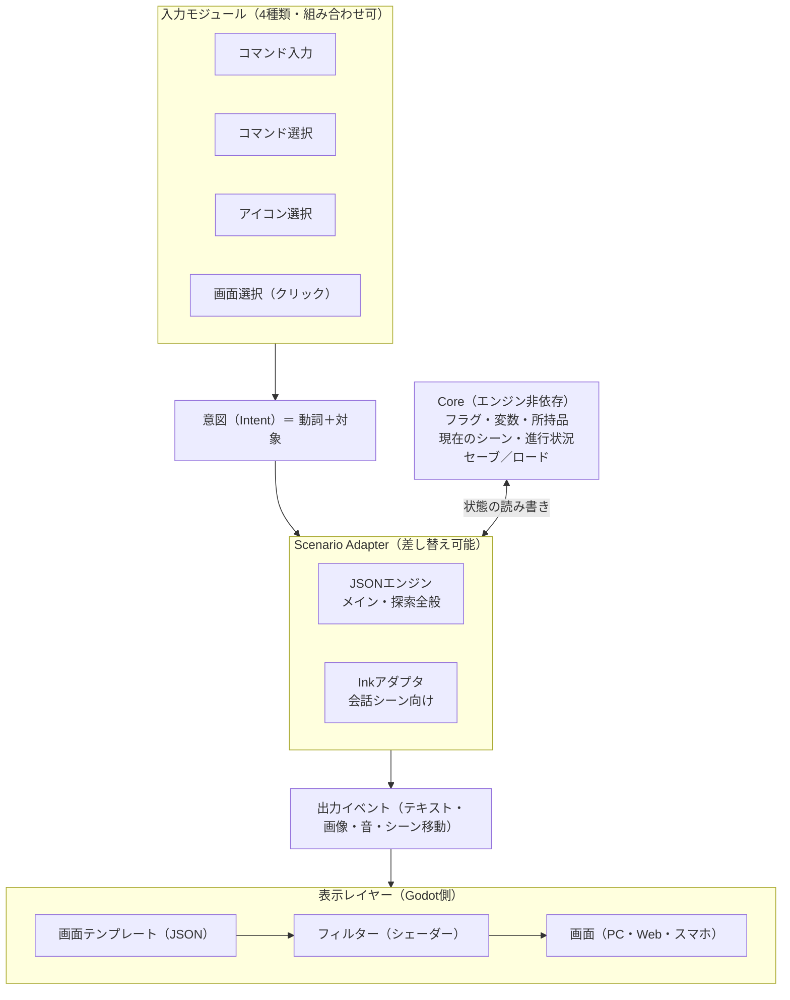

# adv80sGD 仕様書 v0.1

2026-11-01 時点 · 元ドキュメント: https://claude.ai/artifact/AfHSw5UrknPcJ8FewwWk7k

## 1. 概要

80年代のアドベンチャーゲームを制作するための汎用システムを、Godot 4上にモダンな構成で構築する。見た目は80年代、中身は現代的な設計とする。

**設計方針**

- **依存なし**：外部ライブラリやプラグインを使わず、Godot標準機能とGDScriptのみで実装する。
- **差し替え可能**：シナリオエンジン、入力方式、画面テンプレート、フィルターをすべて交換・自作できる。
- **入力の統一**：4種類のUIをどう組み合わせても、シナリオ側は単一の「意図（Intent）」形式だけを扱う。
- **データ駆動**：シナリオ、テンプレート、フィルター設定はJSONで記述する。

## 2. 技術基盤

エンジンはGodot 4、実装言語はGDScriptとする。GDScriptは全書き出し先（Web含む）に対応するため、マルチプラットフォーム要件を満たす。

| 項目 | 決定 | 理由 |
| --- | --- | --- |
| エンジン | Godot 4 | MITライセンス、ロイヤリティなし、2Dドット表示が標準で扱える |
| 実装言語 | GDScript | 全プラットフォームに書き出せる。C#はWeb書き出しに制約がある |
| 対象プラットフォーム | マルチ | PC、Web、スマートフォン |
| データ形式 | JSON | Godot標準のJSONクラスで読めるため自作パーサー不要 |
| 描画演出 | Godot標準シェーダー | フィルターを追加依存なしで実現できる |

Unityはライセンス体系の変更リスク、Unreal Engineは2D ADVには過剰であるため見送った。

## 3. アーキテクチャ

システムは入力モジュール、Core、Scenario Adapter、表示レイヤーの4層で構成する。



入力モジュールが生成した意図をScenario Adapterが処理し、Coreの状態を読み書きしながら出力イベントを返す。表示レイヤーはテンプレートとフィルターを通して画面に描く。

## 4. 入力システム

4種類の入力UIは、すべて同じ「意図（Intent）」に変換される。シーンごとに有効にするUIを複数選べる。

| 入力UI | 操作例 | 生成される意図 |
| --- | --- | --- |
| コマンド入力 | `ドアを あける` と入力 | `{verb: OPEN, target: door}` |
| コマンド選択 | 「あける」→「ドア」を選ぶ（イラスト付き可） | 同上 |
| アイコン選択 | 開けるアイコン→ドアを選ぶ | 同上 |
| 画面選択 | 動詞を選んでから画面上のドアをクリック | 同上 |

### 4.1 意図（Intent）の基本形

```json
{
  "verb": "PUT",
  "slots": {
    "target": { "type": "item",   "id": "book" },
    "on":     { "type": "object", "id": "shelf" },
    "with":   { "type": "item",   "id": "gloves" }
  },
  "source": "parser",
  "ext": {}
}
```

- `verb`：動詞ID（必須）
- `slots`：引数を名前付きで持つ。スロット名と型は意図スキーマ（4.3）で動詞ごとに定義する
- `target`、`with`：標準スロット。2スロットで足りるゲームはこの2つだけを使う
- 値は型名つきで持つ（参照型は `{"type": "item", "id": "key"}`、基本型は `{"type": "number", "value": 1234}`）
- `source`：どのUIから来たか（ログや演出の切り替え用）
- `ext`：各層が自由に使える拡張領域。Coreは中身を解釈せずそのまま渡す

**方針：意図の細部は階層ごとに決め、Coreでは詰めない。** Coreが保証するのは上記の入れ物と、意図スキーマによる検証だけ。`ext` の使い方は入力モジュールとシナリオエンジンの間で取り決める。2スロットのゲーム向けに省略形も受け付け、Coreが受け取った時点で `slots` の形にそろえる：

```json
{ "verb": "USE", "target": "door", "with": { "type": "item", "id": "key" }, "source": "icon" }
```

### 4.2 パーサープロファイル

コマンド入力の解釈方法は「パーサープロファイル」として差し替えできる。自作も可能とする。

| プロファイル | 入力例 | 備考 |
| --- | --- | --- |
| 日本式（標準） | `ドア あける`、`ドアを あける` | 対象→動詞の順 |
| 英語式 | `OPEN DOOR` | VERB NOUNの順 |
| 動詞1語 | `あける` | 対象は画面選択などで補う |
| 自由文 | `古いドアを開けてみる` | 将来拡張 |

**日本式プロファイルの仕様**

- 助詞（を、に、で）は、意図スキーマに `particles` があればスロットの振り分けに使い、なければ無視する。語順の入れ替えも許す。
- 同義語は辞書で定義する（しらべる、みる、ミル → LOOK）。
- ひらがなとカタカナは区別しない。

**英語式プロファイルの仕様**

- 最初に動詞、続けて名詞を書く。`look at`、`pick up` のような2語の動詞も辞書に書ける。
- 冠詞（the、a、an）は読み飛ばし、前置詞（辞書の `particles`）で名詞を区切る。
- 前置詞はスロットの振り分けには使わず、名詞を意図スキーマのスロットの順に、型が合うところへ入れる。
- 使うプロファイルはテンプレートの `inputs.parser_profile`（`ja`、`en`、または自作のパーサーのスクリプトのパス）で選ぶ。

### 4.3 意図スキーマ

意図スキーマは、動詞ごとに「どのスロットに、どの型の値をとるか」を宣言するJSON。入力モジュールの聞き返し、日本式パーサーの格の振り分け、シナリオ読み込み時の検証に使う。

**スロットの定義**

```json
{
  "schema_version": 1,
  "types": {
    "dial_number":  { "base": "number", "min": 0, "max": 9999 },
    "direction":    { "base": "enum", "values": ["north", "south", "east", "west"] },
    "phone_number": { "handler": "res://game/types/phone_number.gd" }
  },
  "verbs": {
    "PUT": { "slots": [
      { "name": "target", "type": "item",   "particles": ["を"] },
      { "name": "on",     "type": "object", "particles": ["に", "の上に"] },
      { "name": "with",   "type": "item",   "particles": ["で"], "required": false }
    ]},
    "USE":  { "target": "object", "with": "item?" },
    "LOOK": { "target": "object?" },
    "DIAL": { "with": "phone_number" }
  }
}
```

- 完全形（`slots` 配列）：スロット名、型、助詞、必須かどうかを並び順つきで書く。並び順は聞き返しやUIで選ばせる順番になる。
- 省略形：`"target": "object"` のようにスロット名と型だけを書く。型名の末尾の `?` は省略可を表す。2スロットのゲームはこちらで足りる。
- プロジェクト設定 `slot_mode` で `"named"`（任意のスロット名を許可、標準）と `"standard"`（target と with のみ）を選ぶ。`standard` のときにほかのスロットがあれば、読み込み時にエラーにする。
- 入力UIは扱えるスロット数を申告し、足りないスロットは聞き返しや次の選択で埋める。

| 分類 | 標準の型 | 値 |
| --- | --- | --- |
| 参照型 | `object`、`item`、`character`、`scene`、`topic` | シナリオに登録されたID。存在確認はシナリオ側で行う |
| 基本型 | `number`、`string`、`bool`、`enum`、`point`（画面座標） | 値そのもの |

**読み込み順と条件による切り替え**

スキーマは複数のファイルを重ねて使う。最初に読み込むファイル（`entry`）をプロジェクト設定で指定し、その上に条件つきの層を重ねる。

```json
"intent_schema": {
  "entry": "res://game/schema/base.json",
  "layers": [
    { "file": "res://game/schema/chapter2.json", "when": { "var": "chapter", "eq": 2 } },
    { "file": "res://game/schema/phone.json",    "when": { "scene": "phone_booth" } }
  ]
}
```

- 読み込み順：`entry` → `layers` のうち `when` を満たすもの（書いた順）→ 実行中のシナリオファイルが持つ `intent_schema`。
- 後から読んだ層が前の層を上書きする。単位は動詞・型ごと。値に `null` を書くとその動詞や型を取り除ける。
- 条件はシーン移動のときに評価する（標準）。フラグが変わったときにも評価し直すかは、プロジェクト設定で選べる。
- `when` の書き方はJSONシナリオの条件式と共通（5.8）。

**型の自作**

型は次の2通りで自作できる。

1. JSONだけで作る：`base` に既存の型を指定し、制約（min、max、values、pattern、長さなど）を足す。
2. GDScriptで作る：`handler` にスクリプトを指定する。スクリプトは型ハンドラーの基底クラスを継承し、下の処理を実装する。

| メソッド | 役割 |
| --- | --- |
| `parse(text, context)` | 入力された文字列を値に変換する（パーサー用） |
| `candidates(context)` | UIに出す候補を列挙する（コマンド選択・アイコン用） |
| `validate(value, context)` | 値が正しいか確かめる |
| `display(value, context)` | ログやメッセージに出す表示名を返す |

- 標準の型も同じ型ハンドラーの仕組みで実装し、自作の型と区別しない。

**型ハンドラーの基底クラス**

```gdscript
class_name AdvTypeHandler
extends RefCounted

func type_name() -> String
func parse(text: String, ctx: AdvTypeContext) -> Variant          # 読めなければ null
func candidates(ctx: AdvTypeContext) -> Array[Dictionary]         # [{value, label}]
func validate(value: Variant, ctx: AdvTypeContext) -> String      # 正しければ空文字、誤りなら理由のコード
func display(value: Variant, ctx: AdvTypeContext) -> String
func to_json(value: Variant) -> Dictionary                        # 意図に入れる形 {"type": …, …}
func from_json(data: Dictionary) -> Variant
```

- `to_json` と `from_json` は、意図の値を `{"type": "item", "id": "key"}` の形とやり取りするためのもの。セーブや巻き戻しで値を保存・復元するのに使う。
- `validate` は、正しければ空文字、誤りなら理由のコードを返す。プレイヤー向けの文は、辞書の `replies`（4.4）でコードごとに用意する。

| `AdvTypeContext` の中身 | 用途 |
| --- | --- |
| `adv` | `AdvContext`（状態、条件式の評価、素材、設定、表示名） |
| `verb`、`slot` | いまどの動詞の、どのスロットを埋めているか |
| `filled` | すでに埋まっている他のスロット（例：「つかう→鍵」まで決まっていれば、次の対象候補を絞れる） |
| `scene` | 現在のシーン |
| `options` | スキーマに書いた制約（`min`、`max`、`values`、`pattern` など） |
| `source` | 入力元のUI（`parser`、`select`、`icon`、`click`） |
| `lang` | 辞書の言語（`ja`、`en`） |

### 4.4 標準動詞セットと同義語辞書

フレームワークは、80年代の国産ADVでよく使われた動詞をもとにした標準動詞セットと、コマンド入力用の同義語辞書を同梱する。

| 動詞ID | 表示名 | 主な言い換え | スロット（4.3の省略形） | 区分 |
| --- | --- | --- | --- | --- |
| `LOOK` | みる | 見る、ながめる | `target: object?` | 基本 |
| `EXAMINE` | しらべる | 調べる、さがす、探す | `target: object?` | 基本 |
| `TAKE` | とる | 取る、ひろう、拾う | `target: object` | 基本 |
| `USE` | つかう | 使う | `target: item`、`with: object?` | 基本 |
| `TALK` | はなす | 話す、話しかける | `target: character` | 基本 |
| `ASK` | きく | 聞く、たずねる | `target: character`、`topic: topic` | 基本 |
| `MOVE` | いく | 行く、いどう、移動 | `target: scene` | 基本 |
| `OPEN`、`CLOSE` | あける、しめる | 開ける、閉める | `target: object` | 基本 |
| `ITEMS` | アイテム | もちもの、持ち物、しょじひん | なし（所持品の一覧を表示） | 基本 |
| `GIVE`、`SHOW` | わたす、みせる | 渡す、見せる | `target: character`、`with: item` | 拡張 |
| `PUSH`、`PULL`、`HIT` | おす、ひく、たたく | 押す、引く、叩く | `target: object` | 拡張 |
| `CALL` | よぶ | 呼ぶ | `target: character` | 拡張 |
| `THINK` | かんがえる | 考える、推理 | なし | 拡張 |
| `WAIT` | まつ | 待つ | なし | 拡張 |

「基本」は標準で有効な動詞、「拡張」はプロジェクトで有効にして使う動詞。表示名は辞書で変えられる。

```json
{
  "dictionary_version": 1,
  "lang": "ja",
  "normalize": { "kana": true, "width": true },
  "particles": ["を", "に", "で", "へ", "と", "から"],
  "verbs": {
    "LOOK":    { "label": "みる",     "words": ["みる", "見る", "ながめる"], "stems": ["み", "ながめ"] },
    "EXAMINE": { "label": "しらべる", "words": ["しらべる", "調べる", "さがす"], "stems": ["しらべ", "調べ", "さが"],
                 "default_reply": "とくに かわった ところは ない。" }
  },
  "nouns": { "door": ["ドア", "とびら", "扉"] },
  "replies": { "unknown_word": "その ことばは わからない。", "no_target": "そんな ものは ない。" }
}
```

**決定事項**

- **代用しない**：ある動詞の反応がシナリオにないとき、標準では別の動詞の反応を代わりに使わない（「しらべる」と「みる」も別々）。代用したい場合は、実装者が辞書の `fallback` で動詞ごとに指定できる。
- **活用形**：言い換えの一覧（`words`）に書いた形との完全一致と、語幹（`stems`）で始まるかの照合の両方を使う。完全一致を優先する。
- **照合前の整形**：ひらがなとカタカナ、全角と半角を区別しない（`normalize`）。
- **既定の返事**：動詞ごとの `default_reply` と、「わからない言葉」「対象がない」ときの返事（`replies`）を辞書に持たせ、シナリオで上書きできる。
- **名詞の言い換え**：`nouns` はシナリオ全体で使う名詞の言い換え。シーンごとの `names`（5.2）と合わせて使う。
- **重ね方**：プロジェクト → テンプレート → シナリオ の順に重ね、後のものが上書きする。
- **英語版**：英語式パーサー用に、同じ形式の英語版辞書（`lang: "en"`）も同梱する。`look`、`l`、`examine`、`x`、`inventory`、`i` のような略語も含める。
- **拡張の動詞の有効化**：辞書で `"extended": true` にした動詞は標準の一覧から外し、プロジェクト設定 `verbs` に書いたものだけを使う。

## 5. シナリオエンジン

プライマリは付属のJSONシナリオエンジン、セカンダリはInkとする。どちらもScenario Adapterを実装する形で接続し、他のシナリオエンジンも同じ方法で追加できる。

### 5.1 Scenario Adapter

意図を受け取り、出力イベントの列を返すインターフェース。

- 入力：意図、現在のゲーム状態
- 出力：テキスト表示、画像差し替え、効果音、シーン移動、選択肢や動詞リストの更新、フラグ変更など

出力イベントの形式と一覧は5.4を参照。

**メソッド定義**

GDScriptにはインターフェースがないため、基底クラス `AdvScenarioAdapter` を継承し、決まったメソッドを上書きする。

```gdscript
class_name AdvScenarioAdapter
extends RefCounted

func setup(ctx: AdvContext) -> Error
func load_sources(paths: PackedStringArray) -> Error
func start(entry: String) -> Array[Dictionary]
func handle_intent(intent: Dictionary) -> Array[Dictionary]
func query(what: String, args := {}) -> Variant
func save_state() -> Dictionary
func load_state(data: Dictionary) -> Error
func validate() -> Array[Dictionary]
```

| メソッド | 役割 |
| --- | --- |
| `setup` | 初期化。Coreから `AdvContext` を受け取る |
| `load_sources` | シナリオファイルを読み込む |
| `start` | 指定した場所から開始し、出力イベントを返す |
| `handle_intent` | 意図を処理して出力イベントを返す（中心となるメソッド） |
| `query` | UIやモダン機能からの問い合わせに答える（`hints`、`objective`、`notebook`、`flow`、`hotspots`、`topics` など） |
| `resume` | 上に積んだアダプタ（Inkなど）の処理が終わって戻ってきたときに、止めていた手順の続きを実行して出力イベントを返す |
| `save_state`、`load_state` | アダプタ内部の状態（Inkの呼び出し位置、会話の途中の位置など）を保存・復元する |
| `validate` | シナリオの確認結果を返す。コマンドラインの確認（5.6）がこれを呼ぶ |

`AdvContext` は、Coreがアダプタに渡す道具箱。

| メンバー | 主なメソッド | 用途 |
| --- | --- | --- |
| `state`（読み取り専用） | `get(名前, 既定値)`、`has(名前)`、`items()`、`scene()`、`visited(シーン)`、`talked(会話ID)`、`read(行ID)`、`chosen(選択肢ID, 項目ID)`、`tried(動詞, 対象)` | 状態を読む。5.8の組み込み条件と同じ名前にそろえる。書き換えは `state.set` イベントで行う |
| `eval` | `eval(条件)`、`compile(条件)` | 5.8の条件式を評価する。`compile` で事前に変換しておけば、毎回の評価が速くなる |
| `assets` | `has(種類, ID)` | 素材IDが実在するかを確かめる |
| `config` | `project()`、`template()`、`preset()`、`group()`、`feature(名前)` | 設定と、現在のテンプレート・機能の状態を読む |
| `labels` | `verb(ID)`、`noun(ID)` | 辞書（4.4）の表示名を引く |
| `rng` | `randi()`、`randf()`、`pick(配列)` | 乱数。アダプタはGodot標準の乱数を使わず、必ずこれを使う |
| `diag` | `warn(コード, メッセージ, 場所)` | 実行中に見つけた問題を報告する（開発中はエディタの一覧に表示） |

- **乱数はCoreが管理する**：乱数の状態をセーブデータに入れ、ロードや巻き戻しのあとも同じ結果を再現できるようにする。
- **アダプタ間の受け渡し**：アダプタは内部用の出力イベント `adapter.enter`（`adapter`、`entry`）を返して別のアダプタに処理を渡し、受け取った側は処理を終えたら `adapter.exit` を返す。Coreがこれを受けて処理中のアダプタを積み上げる。アダプタ同士は直接呼び合わない。

**決定事項**

- **同期で配列を返す**：メソッドはすぐに出力イベントの配列を返す。演出の終了待ちなどは表示レイヤーが `wait` に従って処理し、アダプタの中では待たない。
- **入力が必要な地点までまとめて返す**：`input` 待ちのイベント（`choice.show`、`input.request` など）までをまとめて返し、選ばれた結果は `CHOOSE` の意図として `handle_intent` に届く。
- **JSONとInkの受け渡し**：JSONアダプタが主となり、すべての意図を受け取る。Inkには、JSONの手順 `{ "ink": "ノット名" }` で明示的に処理を渡し、Inkの処理が終わったらJSONに戻る。処理中のアダプタはCoreが積み上げて管理する。受け渡しは出力イベント adapter.enter と adapter.exit で行い、Coreはこれを表示側へ渡さない（5.3）。
- **問い合わせ**：UIは `Core.query` に問い合わせ、Coreが自分で答えられない分だけをアダプタの `query` に回す（下の「問い合わせ」）。
- **保存**：セーブデータには、Coreの状態に加えて、アダプタごとの `save_state()` の結果を入れる。
- **確認**：`validate` をアダプタに持たせ、コマンドラインの確認がInkを含むすべてのシナリオ形式に同じように働く。

**問い合わせ（query）**

UIの問い合わせ先は `Core.query(名前, 引数)` に一本化する。`notebook.add`、`objective.set`、`hint.set`、`flow.mark` の内容はイベントとしてCoreが保存しているのでCoreが答え、シナリオの構造が必要な部分だけをアダプタに問い合わせて合成する。「試したコマンド」の記録は、Coreが意図を受け取るたびに自動で残す。

| 名前 | 引数 | 戻り値 | 答えるもの |
| --- | --- | --- | --- |
| `verbs` | — | `[{id, label, enabled, tried}]` | アダプタ（一覧）＋Core（`tried`） |
| `items` | — | `[{id, label, count, icon}]` | アダプタ（表示名とアイコン）＋Core（個数） |
| `hotspots` | `scene?` | `[{id, label, region, tried_verbs, new}]` | アダプタ（範囲と表示条件）＋Core（試した動詞） |
| `targets` | `verb`、`slot` | `[{type, id, label}]` | アダプタ（その場で選べる対象の候補。コマンド選択と聞き返しで使う） |
| `topics` | `character` | `[{id, label, new}]` | アダプタ（表示条件の評価）＋Core（選んだかどうか） |
| `hints` | `topic?` | `[{topic, stages, revealed}]` | Core |
| `objective` | — | `{id, text}` または `null` | Core |
| `notebook` | `category?` | `[{id, category, title, body}]` | Core |
| `flow` | — | `{nodes: [{id, label, chapter, reached, can_jump}], edges: [{from, to}]}` | アダプタ（分岐の構造）＋Core（到達したかどうか） |
| `chapters` | — | `[{id, label, unlocked}]` | アダプタ＋Core |
| `scene` | — | `{id, label}` | アダプタ |

- 戻り値は Dictionary と Array だけで作る（JSONにそのまま変換できる形）。
- 表示名（`label`）は装飾記法を含んだまま返し、描き方はUIが決める。
- 知らない名前の問い合わせには `null` を返す。自作の問い合わせは `x.名前` の形にする。

**確認結果（validate の戻り値）**

`validate` は診断情報の配列を返す。コマンドラインの結果をJSONで出力する場合（5.6）は、この配列に件数のまとめを付けた形にする。

```json
{
  "severity": "error",
  "code": "ASSET_NOT_FOUND",
  "message": "素材ID「hallway2」が見つからない",
  "file": "res://game/scenario/ch1.scenario.json",
  "path": "/scenes/hallway/objects/door/on/OPEN/then",
  "line": 42,
  "hint": "manifest.json か assets/bg/ を確認してください"
}
```

| 項目 | 内容 |
| --- | --- |
| `severity` | `error`、`warning`、`info`。`info` は誤りとは限らないものを知らせる区分で、コマンドラインの終了コードには影響しない |
| `code` | 英大文字の固定コード（翻訳しない） |
| `message` | 説明文。エディタの言語設定に合わせて日本語か英語 |
| `file`、`path` | 問題のあるファイルと、その中の場所（JSON Pointer形式）。場所の特定は `path` を基本にする |
| `line` | 行番号。分かる場合だけ付ける |
| `hint` | 直し方の手がかり（任意） |

| 標準のコード | 意味 | 区分 |
| --- | --- | --- |
| `JSON_PARSE` | JSONとして読めない | エラー |
| `SCHEMA_VIOLATION` | 構造がスキーマに合わない | エラー |
| `UNKNOWN_KEY` | 知らない項目がある | 警告 |
| `ASSET_NOT_FOUND` | 素材IDが存在しない | エラー |
| `UNKNOWN_VERB`、`UNKNOWN_TYPE`、`SLOT_MISMATCH` | 意図スキーマにない動詞・型、スロットが合わない | エラー |
| `COND_SYNTAX` | 条件式の文法の誤り | エラー |
| `UNKNOWN_VARIABLE` | 宣言されていない変数 | 警告 |
| `DUPLICATE_ID` | IDの重複 | 警告 |
| `MISSING_TARGET` | `call`、`goto`、`dialogue` で呼ぶ先がない | エラー |
| `FEATURE_DEPENDENCY` | 機能の依存が満たされず、自動で無効になる（10.1） | 警告 |
| `UNREACHABLE` | どこからも呼ばれない会話やシーン | 情報 |
| `INK_*` | Inkアダプタ固有の問題（INK_LOAD、INK_VERSION、INK_UNSUPPORTED、INK_LIST、INK_EXTERNAL、INK_MISSING_KNOT。5.3） | アダプタが決める |


### 5.2 JSONシナリオ（プライマリ）

シーン、対象、動詞ごとの反応を宣言的に書く。条件分岐はフラグで判定する。

```json
{
  "scene": "hallway",
  "image": "hallway.png",
  "objects": {
    "door": {
      "names": ["ドア", "とびら"],
      "region": [120, 40, 80, 140],
      "on": {
        "LOOK": "古びた木のドアだ。",
        "OPEN": {
          "if": "has_key",
          "then": { "goto": "room" },
          "else": "鍵がかかっている。"
        }
      }
    }
  }
}
```

- `names`：コマンド入力で認識する呼び名
- `region`：画面選択のクリック判定（x, y, 幅, 高さ。画像の層の中の座標で、元の解像度のピクセル）
- `on`：動詞ごとの反応

### 5.3 Inkアダプタ（セカンダリ）

Inkはinkle社が公開している分岐ストーリー用のスクリプト言語（MITライセンス）。会話や選択肢の分岐に向く。

- 作者は `.ink` を書き、公式ツール inklecate でJSONに変換する。inklecateは制作時のみ使い、完成したゲームには含めない。
- 変換済みJSON（.ink.json）を再生する実行部分をGDScriptで自作する。inkle社のC#版の実行部分と同じ動きにそろえ、対応するinkVersionは19〜21とする。LISTは対応しない（使うと確認で INK_LIST を出す）。RANDOMとシャッフルのシーケンスは乱数の作り方がC#版と違うため、同じ種でも結果は一致しない。
- Inkの変数はCoreの状態（フラグ、変数）と同期する。Inkに入るとき、Inkのグローバル変数と同じ名前のCoreの変数の値をInkに写す。Inkの中で変わったグローバル変数は state.set でCoreに返す（プロジェクト設定 ink.sync_variables を false にすると返さない）。
- 意図はInkの外部関数または選択肢として受け渡す（下の「選択肢と意図」「外部関数」）。
- 想定する使い方：探索部分はJSON、会話シーンはInkのように、1本のゲームで両方を混在できる。会話もJSONだけで書けるようにし、Inkは任意とする。
- **読み込み**：プロジェクト設定のシナリオの一覧にある `.ink.json` はInkアダプタが読む。`.ink.json` だけのゲームではInkアダプタが主になる（最初から再生する）。複数の `.ink.json` を並べた場合は、指定したノットを持つ最初のファイルを使う。
- **受け渡しの流れ**：JSONの手順 `{ "ink": "ノット名" }` は出力イベント `adapter.enter` を出して止まる。CoreはInkアダプタを積んで `start` を呼ぶ。Inkが選択肢なしで止まる（`-> DONE`、`-> END`、終わりまで進む）と `adapter.exit` を出し、CoreはInkアダプタを外して下のアダプタの `resume` を呼ぶ。この2つのイベントは表示側へは渡さない。
- **行とタグ**：Inkの1行ごとに `text.show` を出す。`@話者ID 文章`（JSONの手順と同じ）か `# speaker:話者ID` で台詞にする。行IDは `# id:…` で書け、省略すると `ink:ノット名#本文のハッシュ` になる。`# voice:ID`、`# bg:ID`、`# bgm:ID`、`# se:ID` で声・背景・BGM・効果音を出し、`# {"image.show": {…}}` のようにJSONの手順と同じ書き方で出力イベントを出せる。そのほかのタグは `text.show` の `ext.tags` に入れる。
- **タグだけの行**：Inkでは、タグだけを書いた行は本文が空の1行になる（C#版と同じ）。アダプタはこの行の `text.show` を出さず、出力イベントになるタグ（`voice:`、`bg:` など）はその場で出す。それ以外のタグは次の行の `ext.tags` に回す。
- **動作の確かめ**：確かめ用の `.ink` をinklecateで変換したJSONをテストに使い、再生結果がinklecateの再生モード（`-p`）の出力と一字一句同じになることを確かめる。
- **選択肢と意図**：選択肢は `choice.show` で出し、項目のIDは `c0`、`c1`… とする。選択肢にタグ `# intent:動詞[:対象[:with]]`（`*` は何でも）をつけると、コマンド入力の意図でもその選択肢を選べる。`# hidden` は一覧に出さない（すべて hidden なら一覧を出さず、コマンド入力だけで進む会話になる）。intent タグのある選択肢を出している間は、コマンド入力も受け付ける（`pending_choice` の `accepts_intents`）。合う選択肢がない意図には、辞書の既定の返事を出して待ち続ける。
- **外部関数**：`has_item`、`item_count`、`item_add`、`item_remove`、`get_var`、`set_var`、`visited`、`talked`、`cond`（条件式）、`event`（種類, 引数のJSON）、`goto_scene` を標準で用意する。これ以外は、Ink側に同じ名前の関数があればそれを使い、なければ確認で `INK_EXTERNAL` を出す。
- **到達記録**：Inkに入るとき `state.mark`（talked、`ink:ノット名`）を出し、選んだ選択肢は chosen に `ink:ノット名#c…/c番号` で残す。
- **確認**：`INK_LOAD`（読めない）、`INK_VERSION`（未確認の版）、`INK_UNSUPPORTED`（読めない部分）、`INK_LIST`、`INK_EXTERNAL`、`INK_MISSING_KNOT`（JSONから渡すノットがない）を出す。タグで書いた素材がなければ `ASSET_NOT_FOUND` を出す。

### 5.4 出力イベント

出力イベントは、シナリオエンジンが「何をするか」を伝える命令。Scenario Adapterは出力イベントを配列で返し、上から順に実行される。

```json
[
  { "type": "image.show", "args": { "layer": "bg", "id": "hallway", "transition": "wipe" } },
  { "type": "text.show",  "args": { "speaker": "ayumi", "body": "このドア、開かないわ。" }, "wait": "click" },
  { "type": "state.set",  "args": { "flag": "door_checked", "value": true } },
  { "type": "group", "args": { "events": [
      { "type": "image.show", "args": { "layer": "bg", "id": "room", "transition": "fade" } },
      { "type": "bgm.play",   "args": { "id": "theme2", "fade": 1.0 } }
  ]}, "wait": "end" }
]
```

| 項目 | 内容 |
| --- | --- |
| `type` | `分類.動作` の形の名前 |
| `args` | イベントごとの引数 |
| `wait` | 次のイベントに進む条件。`"none"`（すぐ進む）、`"click"`（クリック待ち）、`"end"`（演出の終了待ち）、秒数、`"input"`（選択や入力を終えるまで待つ）。省略すると種類ごとの既定値（下の表） |
| `id` | 既読判定や巻き戻しに使う識別子。省略するとシナリオ上の位置から自動で付ける |
| `log` | メッセージログに残すか。テキスト系の既定値は true |
| `ext` | 拡張領域 |

**イベント一覧（初期案）**

| 分類 | イベント | 用途 |
| --- | --- | --- |
| テキスト | `text.show`、`text.append`、`text.clear` | メッセージ表示（話者、本文、表示する窓） |
| 画像 | `image.show`、`image.hide`、`effect.play` | 背景や立ち絵の層、切り替え演出、フラッシュや揺れ |
| 音 | `bgm.play`、`bgm.stop`、`se.play`、`voice.play` | 音楽、効果音、ボイス |
| 状態 | `state.set`、`item.add`、`item.remove` | フラグ、変数、所持品の変更 |
| 進行 | `scene.goto`、`wait`、`group`、`choice.show`、`input.request`、`game.end` | シーン移動、待機、同時実行、選択肢、スロットの聞き返し |
| 入力UI | `verbs.update`、`hotspots.update`、`input.mode` | 動詞リスト、クリックできる範囲、有効にする入力UIの更新 |
| モダン機能 | `notebook.add`、`objective.set`、`hint.set`、`flow.mark`、`checkpoint` | 手帳、目的、ヒント、フローチャート上の到達記録、オートセーブや巻き戻しの区切り |
| システム | `template.switch`、`layout.set`、`save.request` | 旧表示と新表示の切り替え、名前付きレイアウトの切り替え、セーブ画面を開く |

**決定事項**

- 状態の変更もイベントで流す。`state.set` などの状態イベントは表示レイヤーではなくCoreが受け取って反映する。アダプタはCoreの状態を読むだけで、直接は書き換えない。状態の変化がすべて記録に残るため、巻き戻し、ログ、デバッグに使える。
- 待ちは各イベントの `wait` で指定する。間を置きたいときは `wait` イベントも使える。
- 同時実行は2通りで書ける。`wait: "none"` で続けて流す方法と、`group` イベントで囲む方法。`group` の `wait` は中のイベント全体に対して働く。
- 自作イベントは `x.名前` の形で、処理するGDScriptのハンドラーと一緒に登録する。表示側が知らないイベントは警告を出して無視する。
- モダン機能はイベントから情報を得る。既読スキップは `text.show` の `id`、読み上げは本文、巻き戻しは `checkpoint` を使う。

**引数と既定の待ち方**

| イベント | 主な `args`（`?` は省略可） | 既定の wait |
| --- | --- | --- |
| `text.show` | `body`、`speaker?`、`window?`（既定 `main`）、`voice?`、`clear?`（既定 true） | `click` |
| `text.append` | `body`、`window?` | `click` |
| `text.clear` | `window?` | `none` |
| `image.show` | `layer`、`id`、`pos?`、`transition?`（省略時はテンプレートの既定、なければ `cut`）、`duration?`（秒） | 切り替え演出ありは `end`（テンプレートの既定の演出も含む）、`cut` は `none` |
| `image.hide` | `layer`、`id?`、`transition?`、`duration?` | 同上 |
| `effect.play` | `name`（`flash`、`shake`、`fade` など）、`duration?`、`params?` | `end` |
| `bgm.play` | `id`、`loop?`（既定 true）、`fade?`（秒）、`volume?` | `none` |
| `bgm.stop` | `fade?` | `none` |
| `se.play` | `id`、`volume?` | `none` |
| `voice.play` | `id`、`speaker?` | `none` |
| `state.set` | `name`、`value`、`op?`（`set`、`add`、`sub`、`mul`、`div`、`mod`、`min`、`max`、`toggle`。既定 `set`） | `none` |
| `item.add` / `item.remove` | `id`、`count?` | `none` |
| `scene.goto` | `scene`、`entry?`、`transition?` | `end` |
| `wait` | `seconds` または `until: "click"` | （それ自体が待ち） |
| `group` | `events` | `end`（中のイベントがすべて終わるまで） |
| `choice.show` | `choices`（`id`、`label`、`when?`）、`prompt?`、`cancel?` | `input` |
| `input.request` | `slot`、`prompt?` | `input` |
| `game.end` | `ending?` | （終了） |
| `verbs.update` | `verbs`、`mode?`（`replace`、`add`、`remove`） | `none` |
| `hotspots.update` | `objects`、`mode?` | `none` |
| `input.mode` | `enable`（`parser`、`select`、`icon`、`click` から選ぶ） | `none` |
| `notebook.add` | `id`、`category?`、`title`、`body` | `none` |
| `objective.set` | `id?`、`text` | `none` |
| `hint.set` | `topic`、`hints`（段階の順に並べた配列） | `none` |
| `flow.mark` | `node` | `none` |
| `checkpoint` | `id?`、`autosave?` | `none` |
| `template.switch` / `layout.set` | `template`、`transition?`（`layout.set` は `layout`、`transition?`） | `end` |
| `save.request` | — | `input` |

- **素材の指定**：`id` は素材マニフェスト（IDとファイルの対応表）のID、またはファイルパスのどちらでも書ける。`res://` で始まるか `/` を含む値はパス、それ以外はIDとして扱う。マニフェストの詳細は5.5。
- **音量**：`bgm.play`、`se.play` の音量は、イベントの `volume` と素材マニフェストの `volume` をかけ合わせ、さらにプレイヤー設定の音量をかける。BGM のループ位置はマニフェストの `loop_start`（秒）。鳴っている BGM はセーブに含める。
- **画像の層**：`layer` に使える名前と重なり順は、画面テンプレートの `layout` で定義する（第6章）。
- **wait 既定値の書き換え**：上の表の既定値は `event_defaults` で書き換えられる。優先順位は、イベント自身の `wait` → シナリオファイルの `event_defaults` → プロジェクト設定の `event_defaults` → 標準の既定値。
- **選択の結果**：`choice.show` で選ばれた結果は、意図 `{"verb": "CHOOSE", "slots": {"target": {"type": "choice", "id": "yes"}}}` としてシナリオに返す。
- **足りないスロットの聞き返し**：必須のスロットが足りない意図には、Core が文章の返事ではなく `input.request` を返す。引数には `slot`、`prompt` のほか、`verb`、`type`、途中まで埋めた `intent` を入れる。コマンド選択はそのスロットの候補を出し、コマンド入力は名詞だけで答えられる。
- **スキップとオート送り**：`click` 待ちは自動で進め、`end` 待ちは演出を短くするか飛ばす。`input` 待ちだけは、スキップ中でも必ず止まる。

```json
"event_defaults": {
  "text.show": { "wait": "click" },
  "se.play":   { "wait": "end" }
}
```

**本文の装飾記法**

本文の装飾（ルビ、色、表示速度、途中での待ちなど）は、「装飾記法プロファイル」として差し替えできる。どの記法も、読み込んだ時点で共通の内部表現に変換する。

| プロファイル | 内容 |
| --- | --- |
| BBCode拡張（標準） | GodotのRichTextLabelが解釈できるBBCodeをベースに、ルビや待ちなどを独自タグで足す |
| 独自記法 | 制作者が定義する記法。変換処理をGDScriptで書いて登録する |

- 使うプロファイルはプロジェクト設定で選び、シナリオファイルごとに上書きできる。
- 読み上げやログでは、装飾を取り除いた文字列を使う。

**BBCode拡張の独自タグ**

Godot標準のBBCodeタグ（`[b]`、`[color]`、`[wave]` など）に加え、ADVに必要な文字送りの制御と日本語向けの装飾を独自タグで補う。

| タグ | 動き | 例 |
| --- | --- | --- |
| `[w=秒]` | 指定した秒数だけ止まる | `待って[w=0.5]……誰？` |
| `[p]` | クリックを待ち、同じ窓で続ける | `ドアが開いた。[p]中は暗い。` |
| `[page]` | クリックを待ち、窓を消してから続ける | |
| `[speed=文字数]…[/speed]` | 囲んだ範囲の表示速度（1秒あたりの文字数）を変える | `[speed=5]ゆっくり[/speed]` |
| `[instant]…[/instant]` | 囲んだ範囲を一度に表示する | |
| `[se=ID]` | その位置で効果音を鳴らす | `[se=knock]コン、コン。` |
| `[var=名前]`、`{名前}` | 変数の値を差し込む（主人公の名前など） | `[var=player]くん`、`{player}くん` |
| `[ruby=よみ]漢字[/ruby]` | ルビ | |
| `[em]…[/em]` | 傍点 | |
| `[pal=番号]…[/pal]` | テンプレートのパレットの番号で色を指定する | |
| `[gaiji=ID]` | 外字や小さなアイコンを文中に入れる（素材マニフェストのID） | |
| `[blink]…[/blink]` | 点滅させる | |

- **入れ子**：タグは入れ子にできる（例：`[speed=5][pal=2][ruby=かんじ]漢字[/ruby][/pal][/speed]`）。終了タグは内側から順に閉じる。交差した書き方（`[b][i]…[/b][/i]`）や、`[ruby]` の中に `[ruby]` を入れる書き方は、読み込み時にエラーにする。
- **変数の短い書き方**：`{名前}` は `[var=名前]` と同じ。文字としての `{` を出したいときは `{{` と書く。
- **ルビと傍点の表示方法**：テンプレートごとに `above`（文字の上）、`paren`（「漢字（かんじ）」の括弧表記）、`none`（表示しない）から選ぶ。既定値は `pc80` グループが `paren`、それ以外が `above`。
- **プレイヤー設定との関係**：`[speed]` にはプレイヤーが設定した文字速度の倍率をかける。既読スキップ中は `[w]` と `[p]` を無視する。
- **読み上げとログ**：読み上げでは、ルビがある部分はルビの読みを読む。メッセージログには装飾を外した文字列を残し、ルビは括弧表記にする。
- **標準タグの制限**：テンプレートで使えるタグを制限できる。禁止されたタグは取り除いて表示する（例：80年代のテンプレートで `[font_size]` を禁止）。


### 5.5 素材マニフェスト

素材マニフェストは、素材のIDと実際のファイルを結びつけるJSON。基本はフォルダの決まりで自動登録し、マニフェストには例外だけを書く。

```json
{
  "manifest_version": 1,
  "base": "res://game/assets/",
  "assets": {
    "hallway": { "type": "image", "file": "bg/hallway.png",
                 "by_preset": { "88": "presets/88/bg/hallway.png", "MX2": "presets/MX2/bg/hallway.png" } },
    "ayumi":   { "type": "image", "variants": { "normal": "chara/ayumi_n.png", "smile": "chara/ayumi_s.png" } },
    "theme1":  { "type": "bgm",   "file": "bgm/theme1.ogg", "loop_start": 12.5 },
    "knock":   { "type": "se",    "file": "se/knock.wav" },
    "ui.cursor": { "type": "image", "file": "ui/cursor.png", "pivot": [0, 0] }
  }
}
```

| 項目 | 内容 |
| --- | --- |
| `type` | `image`、`bgm`、`se`、`voice`、`font`、`shader` など |
| `file` | 既定のファイル（`base` からの相対パス） |
| `by_preset` | 画面プリセットごとの差し替え。テンプレートを切り替えると、自動でその時代の素材に変わる |
| `variants` | 表情差分などの派生。`image.show` で `variant` を指定する |
| 種類ごとの属性 | 画像は `pivot`（基準点）や `region`（切り出し範囲）、音は `loop_start`（ループの開始位置）や `volume` |

**決定事項**

- **機種別の差し替えを探す順番**：`98.640x400` のような完全一致 → 機種ID（`98`） → グループID（`pc80`） → `file`（既定）。
- **重ね方**：プロジェクト → 画面テンプレート → シナリオファイル の固定の順に重ね、後のものが同じIDを上書きする。フォントやUI部品などはテンプレートが持つ。アドオンが持つ標準の素材フォルダ（res://addons/adv80s/assets、標準のフォント）は、いちばん下（プロジェクトより前）に重ねる。
- **自動登録**：フォルダの決まりで素材を自動登録し、マニフェストに書いた内容が優先する（下の表）。
- **当時の画像形式**：フレームワークは読み込まない。MAGなどはあらかじめPNGなどGodotが扱える形式に変換しておく。
- **IDの名前**：`ui.cursor` のようにドットで分類できる。`/` は使えない（パスと区別するため）。IDの名前空間は素材の種類ごとに別々で、同じ名前空間の中で重複したら警告する。
- **自動生成マニフェストのキー**：`manifest.auto.json` のキーは「種類:ID」（例：`image:hallway`、`se:door`）にする。種類ごとの名前空間を1つのファイルで表すため。手書きの `manifest.json` はIDだけでも書け、そのときの種類は `type` で決まる。
- **見つからない素材**：プロジェクト設定 `missing_asset` で選ぶ。既定は `"placeholder"`（警告を出し、画像は仮画像、音は無音で続行）で、`"error"`（エラーで止める）も選べる。

**自動登録のフォルダの決まり**

- エディタで作業している時点でフォルダを読み、「自動生成マニフェスト」（JSON）を書き出す。ゲームの実行中は自動生成マニフェストと手書きのマニフェストを読むだけで、フォルダは読まない。
- IDの名前空間は、画像、BGM、効果音、ボイス、フォント、フィルターで別々。同じ名前空間の中でIDが重複したら（例：`bg/door.png` と `cg/door.png`）警告する。
- ファイル名とフォルダ名は英小文字、数字、`_`、`-` を推奨し、それ以外の文字を含むと警告する。
- `_` や `.` で始まるファイルとフォルダは無視する（作業用ファイルを置けるようにするため）。
- プロジェクト、テンプレート、シナリオがそれぞれ素材フォルダを持ち、マニフェストと同じ順に重ねる。

| 決まり | 例 | 登録される内容 |
| --- | --- | --- |
| 種類は最上位のフォルダで決まる（対応表は下） | `bg/hallway.png` | 種類 `image` |
| IDは種類フォルダからの相対パス（拡張子なし、`/` は `.` に置き換え） | `bg/town/street.png` | ID `town.street` |
| `@` がないファイルは既定の差分、`@` 以降は差分名 | `chara/ayumi.png`、`chara/ayumi@smile.png` | ID `ayumi` の既定の差分と、差分 `smile` |
| `presets/プリセットIDまたはグループID/` の下は機種別の差し替え | `presets/88/bg/hallway.png`、`presets/pc80/bg/hallway.png` | ID `hallway` の `by_preset` に `88`、`pc80` を追加 |

種類フォルダの既定の対応表。プロジェクト設定 `asset_folders` で追加・変更できる。

| フォルダ | 種類 |
| --- | --- |
| `bg/`、`chara/`、`cg/`、`ui/` | 画像（`image`） |
| `bgm/` | BGM（`bgm`） |
| `se/` | 効果音（`se`） |
| `voice/` | ボイス（`voice`） |
| `font/` | フォント（`font`） |
| `shader/` | フィルター（`shader`） |

### 5.6 自動生成マニフェストのエディタ機能

フレームワークのアドオンにエディタプラグインを含め、素材フォルダを読んで自動生成マニフェストを書き出す。Godot標準のエディタ拡張だけで作る。

| 項目 | 仕様 |
| --- | --- |
| 書き出すタイミング | ファイルが変わったとき（自動）、ゲームの書き出し直前（必ず）、手動ボタン |
| 置き場所 | 各素材フォルダ（プロジェクト、テンプレート、シナリオ）の `manifest.json` の隣に `manifest.auto.json` を置く |
| Gitでの扱い | コミットする。IDを並べ替えて書き出し、差分を読みやすくする |
| 確認する内容 | IDの重複、推奨外の文字、対応表にないフォルダ、シナリオから参照されている素材IDが実在するか |
| 結果の表示 | 問題点をエディタの一覧に表示する（警告とエラーを区別） |
| コマンドライン | エディタを開かずに生成と確認ができる（自動ビルド向け）。引数と終了コードは下の「コマンドライン実行」 |
| 生成ファイルがないとき | デバッグビルドに限り、警告を出したうえで実行中にフォルダを読んで補う。製品版では読まない |

- JSONは素材ではないファイルなので、書き出し設定で指定しないとゲームに含まれない。プラグインが書き出しの処理に割り込み、マニフェストを必ず含める。
- `.` で始まるフォルダはGodotが扱わないため、生成ファイルの置き場所には使わない。

**コマンドライン実行**

Godotのヘッドレスモードでツール用のスクリプトを実行し、`--` の後ろにフレームワーク用の引数を書く。素材フォルダを読む処理はエディタに依存しない部品として作り、エディタプラグインとコマンドラインの両方から同じ部品を呼ぶ。

```
godot --headless --path <プロジェクト> --script res://addons/adv80s/tools/manifest_cli.gd -- generate --strict
```

| 指定 | 動き |
| --- | --- |
| `generate`（既定） | 素材フォルダを読んで確認し、`manifest.auto.json` を書き出す |
| `check` | 確認だけ行い、ファイルは書き出さない |
| `check --up-to-date` | 書き出すはずの内容と、コミット済みの `manifest.auto.json` が一致するかも確かめる |
| `--root <パス>` | 対象の素材フォルダ（複数指定可）。省略時はプロジェクト設定にあるすべての素材フォルダ |
| `--strict` | 警告もエラーとして扱う |
| `--no-scenario-check` | シナリオの参照チェックを省く |
| `--report <ファイル>`、`--format text\|json` | 結果をファイルに出力する |
| `--quiet`、`--verbose` | 出力の量を変える |

終了コードは、Godot自身がエラーで終わったときの `1` と重ならない番号にする。

このほか `--project <ファイル>` でプロジェクト設定のファイルを指定できる。一度も読み込み（インポート）していないプロジェクトで実行したとき（CIで取り出した直後など）は、先に自動でインポートしてから、同じ引数で実行し直す。

| コード | 意味 |
| --- | --- |
| `0` | 成功（警告があっても `--strict` でなければ成功） |
| `10` | エラーがある |
| `11` | `--strict` 指定時に警告がある |
| `12` | `--up-to-date` 指定時に、コミット済みのマニフェストが古い |
| `20` | 引数の誤り |
| `30` | ファイルの読み書きの失敗など、ツール自体の不具合 |

| 確認した内容 | 区分 |
| --- | --- |
| 同じ名前空間でのIDの重複 | 警告 |
| 推奨外の文字、対応表にないフォルダ | 警告 |
| 手書きのマニフェストのJSONが壊れている | エラー |
| マニフェストに書かれたファイルが存在しない | エラー |
| シナリオが参照している素材IDが存在しない | エラー（ゲーム実行中は `missing_asset` の設定に従うが、ビルド時点では止める） |


### 5.7 会話の記法（JSON）

会話は「手順の配列」として書く。動詞への反応（`on`）にも同じ配列を書ける。短く書ける形と、何でも書ける形の両方を用意する。

```json
{
  "characters": {
    "ayumi": { "name": "あゆみ", "pal": 3 }
  },
  "dialogues": {
    "ayumi_first": [
      "部屋の隅に少女が立っている。",
      "@ayumi はじめまして。あなたが探偵さん？",
      { "choice": {
          "prompt": "どう答える？",
          "options": [
            { "label": "そうだ", "do": [ "@ayumi よかった……。", { "set": { "met_ayumi": true } } ] },
            { "label": "違う",   "do": [ "@ayumi そう……。" ], "once": true }
          ] } },
      { "if": "has_key", "then": [ { "say": "ayumi", "text": "その鍵……！", "id": "ayumi_key_01", "voice": "ayumi_key_01" } ] }
    ]
  }
}
```

シーン側からは `"TALK": { "dialogue": "ayumi_first" }` のように呼び出す。

| 書き方 | 意味 | 変換される出力イベント |
| --- | --- | --- |
| `"文章"` | 地の文 | `text.show` |
| `"@話者ID 文章"` | 台詞（短い書き方） | `text.show`（`speaker` 付き） |
| `{ "say": …, "text": …, "id": …, "voice": … }` | 台詞（IDやボイスを付けられる書き方） | `text.show` |
| `{ "choice": { … } }` | 選択肢。`when` で表示条件、`once` で一度選んだら消す | `choice.show` と、選ばれたときの分岐 |
| `{ "if": 条件, "then": […], "else": […] }` | 条件分岐 | — |
| `{ "set": { … } }` | フラグや変数の変更 | `state.set` |
| `{ "call": "会話ID" }` | 別の会話を呼ぶ（終わったら戻る） | — |
| `{ "goto": "会話ID" }` | 別の会話へ移る（戻らない） | — |
| `{ "image.show": { … } }` など | 出力イベントをそのまま書く（`{ "ink": "ノット名" }` と書くとInkに処理を渡し、終わったら戻る） | そのイベント |

**決定事項**

- **台詞の短い書き方**：`"@話者ID 文章"`。地の文の行頭に文字としての `@` を出したいときは `@@` と書く。
- **流れの制御**：`if` と `choice` による入れ子に加えて、`call` と `goto` を使える。
- **行のID**：自動で付けるのが基本で、本文の内容から作る（会話ID＋本文のハッシュ。同じ会話に同じ本文があれば出現順の番号を足す）。行を挿入してもずれないが、本文を直すと既読が外れる。ボイス付きの行など大事な行は `id` を手で書けば、そちらが優先する。
- **話者の定義**：`characters` に表示名、パレットの色、ボイスファイルの接頭辞などをまとめる。表示名には `{player}` のような変数も使える。
- **条件の書き方**：`if` や `when` の条件は、JSONシナリオの条件式の記法（5.8）。
- **選択肢の入力待ち**：選択肢を出している間は、ほかのコマンドを受け付けない。選択肢と項目の `id` は省略でき、項目は `o1`、`o2`…、選択肢は場所と項目の名前から自動で付ける。入力待ちの位置はセーブに含め、ロードすると同じ選択肢を出し直す。
- **「.」のない出力イベント**：`checkpoint`、`wait`、`group` も、短い書き方 `{"checkpoint": {}}` で書ける。

**話題を選ぶ会話（標準の仕組み）**

80年代のADVでよくある「きく → 事件について」のような話題選択は、意図スキーマで `ASK` 動詞に `topic` スロットを持たせて表す。会話側には話題の一覧と、それぞれを表示する条件を書く。

```json
"topics": {
  "ayumi": [
    { "id": "case", "label": "事件について", "dialogue": "ayumi_case" },
    { "id": "key",  "label": "鍵について",   "dialogue": "ayumi_key", "when": "has_key" }
  ]
}
```

- 話題を選ぶと、意図 `{"verb": "ASK", "slots": {"target": {"type": "character", "id": "ayumi"}, "topic": {"type": "topic", "id": "case"}}}` が生成される。`topic` は標準の参照型に加える。
- コマンド入力では「あゆみ 事件 きく」のように話題を入力でき、コマンド選択では「きく」を選ぶと話題の一覧が出る。

### 5.8 条件式と変数

条件式は、意図スキーマの `when`、会話の `if` と `when`、話題と選択肢の表示条件など、条件を書くすべての場所で共通の記法を使う。JSONの形を正式な形とし、短い文字列の形も使える。短い文字列は読み込み時にJSONの形へ変換する。

```json
// JSONの形
{ "all": [
    "has_key",
    { "var": "money", "ge": 100 },
    { "any": [ { "visited": "cellar" }, { "has": "lamp" } ] },
    { "not": { "scene": "hallway" } }
] }

// 短い文字列の形（上と同じ意味）
"has_key and money >= 100 and (visited(cellar) or has(lamp)) and not scene == hallway"
```

| 種類 | JSONの形 | 短い形 | 意味 |
| --- | --- | --- | --- |
| フラグ | `"has_key"` | `has_key` | 真偽値のフラグが true か |
| 比較 | `{ "var": "money", "ge": 100 }` | `money >= 100` | `eq`（等しい）、`ne`（等しくない）、`lt`（未満）、`le`（以下）、`gt`（より大きい）、`ge`（以上）、`in`（いずれかと一致） |
| かつ | `{ "all": [...] }` | `and`、`&&` | すべて満たす |
| または | `{ "any": [...] }` | `or`、`\|\|` | どれかを満たす |
| 否定 | `{ "not": ... }` | `not`、`!` | 満たさない |
| 組み込み条件 | `{ "has": "lamp" }` など | `has(lamp)` など | 下の表 |

| 組み込み条件 | 意味 |
| --- | --- |
| `has(アイテム)`、`count(アイテム)` | 所持しているか、いくつ持っているか |
| `scene` | 現在のシーン |
| `visited(シーン)` | そのシーンを訪れたことがあるか |
| `talked(会話ID)`、`read(行ID)` | その会話を見たか、その行を読んだか |
| `chosen(選択肢ID, 項目ID)` | その選択肢でその項目を選んだか |
| `preset`、`group` | 今の画面プリセットとグループ |
| `feature(機能名)` | そのモダン機能が有効か |

**変数の操作**

`state.set` の `op` は `set`、`add`、`sub`、`mul`、`div`、`mod`、`min`、`max`、`toggle`。計算式は次の2通りで書ける。

```json
{ "set": { "money": "= money - price * 2", "met_ayumi": true } }
{ "let": "money = money - price * 2; visits = visits + 1" }
```

- `set` の値が `=` で始まる文字列なら、計算式として扱う。
- `let` は「変数 = 式」を書く手順で、`;` で区切れば複数書ける。

**決定事項**

- **形式**：JSONの形が正式。短い文字列はフレームワーク独自の小さなパーサーで読む（GodotのExpressionは使わない）。
- **演算子**：`and`、`or`、`not` と `&&`、`||`、`!` の両方を使える。
- **入れ子**：条件は何重にでも入れ子にできる。JSONの形では `all`、`any`、`not` の中にさらに条件を書き、短い形では括弧 `( )` でまとめる。
- **変数の宣言**：任意。`variables` に型と初期値を書ける。読んでいるのに、宣言も set・let での変更もしていない変数は、コマンドラインの確認で警告する。
- **未定義の変数**：false、0、空文字として扱い、開発中（デバッグビルド）だけ警告を出す。

```json
"variables": {
  "money":   { "type": "int",  "default": 0 },
  "has_key": { "type": "bool", "default": false },
  "player":  { "type": "string", "default": "ゆうじ" }
}
```

## 6. 画面テンプレート

見た目は特定の機種に依存させず、テンプレートから選ぶ。テンプレートは「定義JSON＋素材フォルダ」で構成し、制作者が自作できる。

| 定義項目 | 内容 |
| --- | --- |
| display | 解像度、拡大方式（整数倍など） |
| palette | 使用できる色（色数の制限） |
| font | 表示フォント |
| layout | 画面の区割り（絵の窓、テキストの窓、コマンド欄、アイコン欄）と、画像の層の名前と重なり順 |
| inputs | 使う入力UIの組み合わせ |
| text | テキストの表示演出（1文字ずつ表示など） |
| filters | 画面全体に重ねるフィルター（第7章） |

### 6.1 テンプレート定義JSON

テンプレートの設定は1つのJSONファイルにまとめる。

```json
{
  "template_version": 1,
  "id": "pc98_classic",
  "name": "98 クラシック",
  "extends": null,

  "display": { "preset": "98", "scale": "integer", "aspect_correction": false },
  "palette": { "source": "preset" },

  "fonts": {
    "main": [
      { "asset": "dot16",        "size": 16 },
      { "asset": "pixelmplus12", "size": 12, "line_height": 16 }
    ],
    "readable": { "asset": "font.ud",    "size": 16 }
  },

  "layout": {
    "layers": ["bg", "char", "fg", "effect"],
    "regions": {
      "picture":  { "rect": [0,   0, 640, 280] },
      "message":  { "rect": [0, 280, 448, 120], "window": "main" },
      "commands": { "rect": [448, 280, 192, 120] }
    },
    "named": {
      "fullscreen_cg": { "regions": { "picture": { "rect": [0, 0, 640, 400] } } }
    }
  },

  "inputs": { "enabled": ["select", "parser"], "parser_profile": "ja" },

  "text": {
    "speed": 30, "markup": "bbcode_ext",
    "ruby": "paren", "emphasis": "paren",
    "denied_tags": ["font_size"]
  },

  "filters":     { "mode": "default", "list": [] },
  "transitions": { "default": "line_draw", "named": {}, "replace": { "fade": "dissolve" } },
  "features":    { "hint": false },
  "assets":      { "root": "assets/", "manifest": "manifest.json" },
  "ui": {
    "window_skin": { "type": "box", "border": 1, "pal": 7 },
    "cursor": "ui.cursor"
  }
}
```

| 項目 | 内容 | 関連する章 |
| --- | --- | --- |
| `id`、`name`、`template_version` | 識別子、表示名、形式のバージョン | — |
| `extends` | 継承元のテンプレートID | — |
| `display` | プリセット、拡大方式、縦横比補正 | 7.1 |
| `palette` | 使う色。`preset` ならプリセットの色、`colors` で独自に指定もできる | 7.1 |
| `fonts` | 通常のフォント（main）と、読みやすいフォント（readable、モダン機能で切り替える）。{asset, size, line_height} を1つ、または候補の配列で書く（下の「フォント」） | 第10章 |
| `layout` | 画像の層、画面の区割り、テキストの窓、名前付きのレイアウト | 5.4 |
| `inputs` | 使う入力UIとパーサープロファイル | 第4章 |
| `text` | 文字速度、装飾記法、ルビと傍点の表示方法、使えるタグの制限 | 5.4 |
| `filters` | フィルター（既定値か自由選択か） | 7.1 |
| `transitions` | 既定の演出、名前付きの組み合わせ、置き換え表 | 7.4 |
| `features` | モダン機能の既定値の上書き | 10.1 |
| `assets` | テンプレートが持つ素材フォルダとマニフェスト | 5.5 |
| `ui` | ウィンドウの見た目やカーソル | — |

**フォント**

- **候補の配列**：`fonts.main`・`fonts.readable` は `{asset, size, line_height}` を1つでも、候補の配列でも書ける。配列なら、素材が見つかった最初のものを使う。どれもなければOSのフォントを使う。`line_height` を書くと、小さいフォントもその行の高さで並べる（例：12ドットの文字を16ドットごと）。
- **標準のフォント**：アドオンに PixelMplus10・12 と Tekuplus（M+ FONT LICENSE）を同梱する（素材ID `pixelmplus10`、`pixelmplus12`、`tekuplus` とそれぞれの `_bold`）。
- **98 クラシック**：`dot16`（16ドット）→ `pixelmplus12` の順に探す。DotGothic16（OFL-1.1）は同梱しない。使うときは https://github.com/fontworks-fonts/DotGothic16 から入手し、素材フォルダの `font/dot16.ttf` として置く。
- **描き方**：`fonts.main` はドットのまま（アンチエイリアスなし）描き、`fonts.readable` はなめらかに描く。

**決定事項**

- **継承**：`extends` に別のテンプレートIDを書くと、その内容を元にして違う部分だけを書ける（例：「98 クラシック」を元に「98 ワイド」を作る）。項目ごとに上書きし、値に `null` を書くと取り除ける。
- **座標の単位**：`rect` などの座標は、そのテンプレートの元の解像度のピクセルで書く（`[x, y, 幅, 高さ]`）。
- **名前付きのレイアウト**：`layout.named` に別のレイアウトを定義し、出力イベント `layout.set` で切り替える（例：一枚絵の全画面表示）。窓を隠すときは、その区割りに `"visible": false` を書く（`null` は継承で「取り除く」の意味になるため使わない）。
- **ウィンドウの見た目**：パレットの色で単純な枠線を描く方式（`"type": "box"`）と、画像を使う方式（`"type": "nine_patch"`、9分割画像）の両方を用意する。
- **入力補完用のスキーマファイル**：テンプレート、シナリオ、意図スキーマ、素材マニフェストのJSON Schemaファイルを同梱する。VSCodeなどのエディタで入力補完や誤りの指摘に使う。ゲームの実行には使わない。

### 6.2 JSON Schemaファイル

テンプレートやシナリオなどをエディタで書くときの入力補完と誤りの指摘のため、JSON Schemaファイルを `addons/adv80s/schemas/` に同梱する。ゲームの実行には使わない。

| スキーマ | 対象 |
| --- | --- |
| `template.schema.json` | テンプレート定義（6.1） |
| `scenario.schema.json` | シナリオ（シーン、会話、話者、話題、変数） |
| `intent_schema.schema.json` | 意図スキーマ（4.3） |
| `manifest.schema.json` | 素材マニフェスト（5.5、自動生成のものも同じ） |
| `project.schema.json` | プロジェクト設定（機能、`event_defaults`、`missing_asset` など） |
| `effect_def.schema.json` | 自作のフィルター、切り替え演出、画面効果の設定定義（7.3、7.4） |

**決定事項**

- **バージョン**：JSON Schemaは draft-07 で書く（多くのエディタやツールで動きやすいため）。
- **結び付け方**：ファイル名の決まり（`*.template.json`、`*.scenario.json`、`manifest.json` など）で自動的に結び付ける VS Code の設定例（`.vscode/settings.json` の `json.schemas`）を同梱する。各JSONの先頭に `$schema` を書く方法も使える。
- **結び付けるファイル名**：シナリオ `*.scenario.json`、テンプレート `template.json` と `*.template.json`、意図スキーマ `*.intent_schema.json`、素材マニフェスト `manifest.json` と `manifest.auto.json`、プロジェクト設定 `adv80s.project.json`、自作のフィルターや演出 `*.effect.json`。エディタプラグインのツールメニューから、エディタの言語に合わせた設定を書き出せる。
- **プロジェクト設定のファイル**：`res://adv80s.project.json` に置く。使うテンプレート、シナリオ、素材フォルダ、`asset_folders`、`missing_asset`、`event_defaults`、`features` などをまとめる。
- **確かめる範囲**：構造（項目名、型、選べる値）はスキーマで確かめる。短い文字列の条件式や台詞の短い書き方の文法は、コマンドラインの確認（`validate`）で確かめる。
- **知らない項目**：書き間違いを見つけるため警告にする。ただし、自作イベント（`x.名前`）、`ext`、自作のフィルターなどの引数は自由に書ける。
- **説明文の言語**：日本語版と英語版のスキーマを用意し（`schemas/ja/`、`schemas/en/`）、既定は日本語版を使う。英語環境では英語版を使う。エディタプラグインは、Godotのエディタの言語設定に合わせて、結び付け先のフォルダを切り替えた設定例を書き出せる。
- **スキーマの検証（CI）**：同梱するサンプルのJSONがスキーマに合っているかをCIで確かめられる仕組み（外部の検証ツールを使う設定例）を用意する。標準では使わず、必要なときだけ有効にする。ゲーム本体とフレームワークの実行には、このツールは不要。

### 6.3 エディタでの編集

アドオンのエディタプラグインは、エディタの上の切り替え（2D、3D、Script の並び）に「adv80s」画面を足す。プロジェクト設定、画面テンプレート、素材マニフェスト（手書きの `manifest.json`）を、同梱の JSON Schema（6.2）から作ったフォームで作成・編集する。

- **フォーム**：スキーマにある項目は書いていなくても並べ、足す・消すができる。説明（description）を表示し、型を選べる項目（anyOf、oneOf）は型を切り替えられる。形の決まっていない値は JSON の文字列で編集する。
- **確認**：編集のたびに、スキーマと、参照先があるか（テンプレートの継承元とプリセット、シナリオ、素材フォルダ、マニフェストに書いたファイル）を確かめ、一覧からその項目へ移れる。
- **JSON**：編集中の JSON を並べて表示し、直接書き換えてフォームに戻せる。保存すると JSON を整形して書き出す。
- **新規**：テンプレートは ID と元にするテンプレート（extends）を選んで `res://game/templates/<ID>/template.json` に作り、プロジェクト設定の `templates` に加える。プロジェクト設定とマニフェストは、まだないファイルを開いて保存すれば作れる。
- **素材ファイルから追加**：マニフェストでは、選んだ素材ファイルの項目（`種類:ID` → `{type, file}`）を足し、`loop_start` や機種別の差し替えを書き足せる。
- アドオンの中のテンプレートとマニフェストは読むだけにする（直すときは extends して自分のテンプレートを作る）。

## 7. フィルター

フィルターは画面全体に後からかけるエフェクトで、Godot標準のシェーダーで実装する。テンプレートで複数を順番に重ねられる。

```json
"display": { "width": 640, "height": 200, "scale": "integer" },
"filters": [
  { "type": "scanline", "gap": 0.85 },
  { "type": "palette", "mode": "digital8" },
  { "type": "crt", "curvature": 0.02, "vignette": 0.2 }
]
```

### 7.1 プリセット

画面テンプレートは、機種と画面モードを組み合わせたプリセットから始められる。IDは `機種ID.モード名` の形で、機種IDだけを指定するとその機種の代表モードを使う。機種は略称で表記する。

```json
"preset": "98"            // 代表モード
"preset": "X68K.512x512"  // モードを明示
```

各プリセットは、解像度、色数とパレット、ピクセルの縦横比、既定のフィルターを持つ。

| グループ | 機種ID | 既定のフィルターの例 |
| --- | --- | --- |
| 80年代パソコン（`pc80`） | 88、98、SX1、SX1T、SX1TZ、F7、F77A、MX、MX2、M2P | 走査線、減色、CRT |
| 90年代パソコン（`pc90`） | X68K、FTNS、MTR、VGA、WIN | 薄いCRT、またはなし |
| 家庭用ゲーム機（`console`） | FC、PCE、SFC、PS1、PS2 | テレビ風のにじみ、走査線 |
| 携帯機（`handheld`） | GB、GBC、GBA | 液晶の網目、GBは4階調 |
| 現代（`modern`） | HD、FHD、4K | なし |

**画面モード一覧**

ADVでよく使われた主なモードだけを収録する。それ以外のモードが必要な場合は、プリセットを自作して補う。モード名は `幅x高さ` とし、同じ解像度で色数違いがあるときだけ `幅x高さ_色数` とする（例：`MX2.256x212_256`）。太字が代表モード。

| ID | モード（色） | 縦横比（補正時） |
| --- | --- | --- |
| 88 | **640x200（512色中8色）**、640x400（512色中2色） | 0.83（640x200は縦2倍表示） |
| 98 | **640x400（4096色中16色）**、640x400_8（デジタル8色）、640x200（8色） | 0.83 |
| X68K | **768x512（65536色中16色）**、512x512（65536色）、256x256（65536色） | 0.89 |
| SX1 | **640x200（8色）**、320x200（8色） | 0.83（640x200は縦2倍表示） |
| SX1T | **640x400（8色）**、640x200（8色） | 0.83 |
| SX1TZ | **320x200（4096色）**、640x400（8色）、640x200（8色） | 0.83 |
| F7 | **640x200（8色）** | 0.83（縦2倍表示） |
| F77A | **320x200（4096色）**、320x200_262144（26万色）、640x400（8色）、640x200（8色） | 0.83 |
| FTNS | **640x480（1677万色中256色）**、640x480_16（4096色中16色）、320x240（32768色） | 1.0 |
| MX | **256x192（固定16色）** | 1.0 |
| MX2 | **256x212（512色中16色）**、256x212_256（256色）、512x212（512色中16色） | 1.10 |
| M2P | **256x212（19268色）**、256x212_12499（12499色＋16色）、256x212_16、256x212_256、512x212 | 1.10 |
| MTR | M2Pと同じ | 1.10 |
| FC | **256x240（見える範囲は224行、約52色中25色）** | 8:7 |
| PCE | **256x224（512色中482色）**、336x224、512x224 | 8:7 |
| SFC | **256x224（32768色中256色）**、512x448（インターレース） | 8:7 |
| PS1 | **320x240（1677万色）**、256x224、640x480（インターレース） | 1.0 |
| PS2 | **640x480（480i・480p、RGBA各8ビット）**、1920x1080（1080i）、1280x1024（VESA） | 1.0 |
| GB | **160x144（4階調）** | 1.0 |
| GBC | **160x144（32768色中56色）** | 1.0 |
| GBA | **240x160（32768色）** | 1.0 |
| VGA | **640x480（262144色中16色）**、320x200（256色） | 1.0 |
| WIN | **640x480（1677万色中256色）**、640x480_65536、800x600、800x600_65536、1024x768、1024x768_65536、1280x1024、1280x1024_65536（解像度だけのモードは1677万色中256色、_65536は65536色） | 1.0 |
| HD、FHD、4K | **1280x720**、**1920x1080**、**3840x2160**（フルカラー） | 1.0 |

- 縦横比補正の既定値は「補正しない」。ドットを正方形のまま整数倍で表示する。表の縦横比は、補正を有効にしたときに使うピクセルの縦横比（横÷縦、4:3画面を前提とした目安）。補正するときは、横は整数倍のまま縦を伸ばす。
- 640x200のモードは、補正の有無にかかわらず縦2倍表示を基本にする。
- PS2の色は、RGBA各8ビット（1677万色＋8ビットのアルファ）として扱う。すべてのモードに共通。

参考：[98の画面モード](https://necretro.org/PC-9801) · [88のアナログ8色](https://game.watch.impress.co.jp/docs/kikaku/1614970.html) · [SX1系](https://hachibitto.com/jvcc/articles/view_article.php?id=208) · [F77A](https://akiba-pc.watch.impress.co.jp/docs/column/retrohard/1165452.html) · [X68K](https://gamicus.fandom.com/wiki/Sharp_X68000) · [FTNS](https://breezewiki.discard.no/gamicus/wiki/FM_Towns) · [M2PのSCREEN 10〜12](https://msx.org/wiki/SCREEN) · [PCE](https://8bitworkshop.com/docs/platforms/pce/index.html) · [FC](https://archive.nesdev.org/NESTechFAQ.htm) · [SFC](https://gamicus.fandom.com/wiki/Super_Nintendo_Entertainment_System) · [GBC](https://giantbomb.com/game-boy-color/3045-57/)

VGA：[640x480の16色（e-Words）](https://e-words.jp/w/VGA.html) · [320x200の256色](https://en.wikipedia.org/wiki/Mode_X)

PS1・PS2：[PS1の仕様（Wikipedia）](https://ja.wikipedia.org/wiki/PlayStation_(%E3%82%B2%E3%83%BC%E3%83%A0%E6%A9%9F)#%E4%BB%95%E6%A7%98) · [PS2の仕様（Wikipedia）](https://ja.wikipedia.org/wiki/PlayStation_2#%E4%BB%95%E6%A7%98)

PS2の色：[RGB 32ビット（RGBA 8ビット）](https://www.d-colors.net/game/ps2/)

**フィルターの選び方**

フィルターは「既定値」と「自由選択」の2方向で指定できる。

```json
"preset": "88",
"filters": { "mode": "append", "list": [ { "type": "crt", "curvature": 0.02 } ] }
```

| `mode` | 動き |
| --- | --- |
| `default`（省略時） | プリセットの既定のフィルターをそのまま使う |
| `append` | 既定のフィルターに `list` を足す |
| `replace` | 既定のフィルターを使わず `list` だけを使う |
| `none` | フィルターを使わない |

- `filters` を配列で書いた場合は `replace` と同じ扱いにする。
- プレイヤーが設定画面で切り替える場合も、同じ考え方で既定値と自由選択を選べる。

### 7.2 フィルターの種類（初期案）

- 走査線
- 減色（パレットで色数を制限）
- ディザ
- 縦横比補正
- CRTの曲面と周辺の暗さ
- にじみ
- RGBマスク
- 単色モニター（グリーンやアンバー）

### 7.3 設計上の要点

- 走査線は画面上のピクセル単位ではなく、元の画像の1行単位で入れる。ウィンドウの大きさに関係なく線がずれない。
- 自作フィルターは「シェーダーファイル＋設定項目を定義したJSON」で追加できる。定義ファイル（`*.effect.json`）はプロジェクト設定の `effects` に並べて登録する。シェーダーは、画面を読み直す canvas_item シェーダーとして書き、標準のフィルターの後ろに重ねる。
- プレイヤーが設定画面でフィルターを無効にできる（見やすさとアクセシビリティのため）。

### 7.4 切り替え演出と画面効果

切り替え演出は `image.show`、`image.hide`、`scene.goto`、`template.switch` の `transition` に、画面効果は `effect.play` の `name` に指定する。`duration` を省略したときの既定値は0.5秒（`line_draw` だけは1秒あたりの行数 `speed` で指定する）。

**切り替え演出（`transition`）**

| 名前 | 動き | 主な引数 | 時代 |
| --- | --- | --- | --- |
| `cut` | すぐに切り替える（既定） | — | 共通 |
| `fade` | 前後の画像を重ねながら徐々に切り替える | `duration` | 現代 |
| `fade_color` | いったん単色にしてから切り替える | `color`（既定は黒）、`duration` | 共通 |
| `wipe` | 一方向から塗り替える | `direction`、`softness`（0なら境目がくっきり） | 共通 |
| `blinds` | すだれ状に切り替える | `direction`、`count` | 80年代 |
| `line_draw` | 上から1行ずつ描いていく（当時の遅い描画の再現） | `speed`（1秒あたりの行数）、`direction` | 80年代 |
| `interlace` | 1行おきに描いてから、残りの行を埋める | `duration` | 80年代 |
| `plane_draw` | 色の面（青→赤→緑）を順に重ねて描く（デジタル8色機の描画の再現） | `order`、`duration` | 80年代 |
| `mosaic` | モザイクを強めて切り替え、元に戻す | `max_size`、`duration` | 90年代 |
| `dissolve` | 点がまだらに入れ替わる（ディザ模様か乱数） | `pattern`、`duration` | 共通 |
| `blocks` | 四角いブロック単位で入れ替わる | `size`、`order`、`duration` | 共通 |
| `iris` | 円形に開く、または閉じる | `center`、`duration` | 共通 |
| `mask` | 白黒のマスク画像に従って切り替える（いわゆるルール画像） | `image`、`softness`、`duration` | 現代 |

**画面効果（`effect.play`）**

| 名前 | 動き | 主な引数 |
| --- | --- | --- |
| `flash` | 画面を一瞬光らせる | `color`、`count`、`duration` |
| `shake` | 画面を揺らす | `axis`、`amplitude`（ピクセル）、`duration` |
| `invert` | 色を反転させる | `duration` |
| `tint` | 色味を変える（セピア、夜など） | `color`、`amount`、`duration` |
| `palette_cycle` | パレットの色を順に回す（水面や光の点滅など） | `range`、`speed` |
| `scroll` | 画像をスクロールさせる | `direction`、`distance`、`duration` |
| `zoom` | 拡大・縮小する | `scale`、`center`、`duration` |
| `raster` | 1行ずつ横にずらして波打たせる | `amplitude`、`wavelength`、`speed` |

**決定事項**

- 切り替え演出と画面効果は、元の解像度の画面にかけ、そのあとにフィルターを通す。減色フィルターが有効なら、`fade` もその時代の色数で段階的に変わる。
- ルール画像による切り替え（`mask`）を標準で入れる。マスク画像も素材マニフェストのIDで指定できる。
- `palette_cycle` は、減色フィルターがパレットで色を決めているときだけ使える。パレットの番号の範囲（`range`）を `speed` 段/秒で回す。`duration` が 0 なら止めるまで続け、`speed: 0` で止める。
- 自作は、フィルターと同じく「シェーダーファイル＋設定項目を定義したJSON」で追加する。

**自作まわりの追加案**

- **名前付きの組み合わせ**：演出と引数の組み合わせに名前を付けて登録できる（例：`door_open` ＝ `wipe`、右向き、0.8秒）。プロジェクトとテンプレートで定義し、シナリオからは名前だけで呼べる。プロジェクト設定とテンプレートの `transitions.named` に書き、同じ名前ならテンプレートが優先する。
- **テンプレートごとの既定の演出**：`transition` を省略したときに使う演出をテンプレートで決められる（例：88のテンプレートでは `line_draw`）。
- **時代に合わない演出の置き換え表**：テンプレートに「この演出はこちらで代用する」という表を持たせられる（例：80年代パソコンでは `fade` を `dissolve` に置き換える）。同じシナリオを旧表示と新表示で切り替えても、それぞれの時代らしい演出になる。
- **GDScriptによる自作**：シェーダーだけでは書きにくい演出（ブロックの入れ替わる順番を処理で決めるものなど）は、型ハンドラーと同じ考え方でGDScriptのハンドラーも登録できる。
- **スキップ中の扱い**：既読スキップ中は、切り替え演出を `cut` に、画面効果を省略または短縮する。

## 8. セーブデータ

正式な保存形式は暗号化できるバイナリとし、デバッグ用にテキスト（JSON）でも読み書きできるようにする。どちらも同じ内部データ（Dictionary）から変換する。

| 形式 | 用途 | 使うGodot標準機能 |
| --- | --- | --- |
| バイナリ（HMAC＋任意でAES） | 製品版の保存 | `var_to_bytes`、`HMACContext`、`AESContext` |
| テキスト（JSON） | デバッグ、手動編集 | `JSON.stringify`、`JSON.parse_string` |

- ファイル先頭にヘッダー（識別子、形式バージョン、保護レベル）を置き、読み込み時に形式を自動判別する。
- 形式バージョンを持たせ、古いセーブを新しい形式へ移行できるようにする。
- テキスト形式の読み書きは、デバッグビルドまたは設定フラグで有効にしたときだけ許可する。
- セーブの設定は、プロジェクト設定の `save` にまとめる（`protection`：`hmac` / `hmac_aes` / `none`、`on_tamper`：`reject` / `warn`、`text_format`、`dir`、`slots`、`key_provider`：`embedded` / `per_user` / スクリプトのパス）。
- オートセーブは、出力イベントをひとまとまり実行し終えた時点で行う（Core が状態をまとめて適用するため）。
- 保存対象：Coreの状態（フラグ、変数、所持品、現在のシーン）、Inkの状態（すべてのアダプタの状態と積み上げの順番）、メッセージログ。表示設定などプレイヤー設定は別ファイルにする。

### 8.1 改ざん検知と暗号化

標準の方式は「HMACで改ざんを検知し、必要ならAES暗号化を重ねる」とする。保護レベルはプロジェクト設定で選ぶ。

| 保護レベル | 内容 | 想定する用途 |
| --- | --- | --- |
| 検知のみ（標準） | HMAC-SHA256の署名を付ける。中身は読めるが、書き換えは検出できる | 一般的なオフラインADV |
| 検知＋暗号化 | AESで暗号化したうえでHMACを付ける | ネタバレになる情報を含むなど、中身を読まれたくない場合 |
| なし | 署名も暗号化もしない | 開発中、デバッグ |

```
[ヘッダー] 識別子 / 形式バージョン / 保護レベル / IV（暗号化時のみ）
[本体]     var_to_bytes のデータ（暗号化時は AES-CBC で暗号化）
[署名]     ヘッダーと本体に対する HMAC-SHA256（32バイト）
```

- 読み込み時は先に署名を検証し、一致しなければ本体を復号・解釈しない。
- 署名が一致しないときの扱い（読み込みを拒否、警告したうえで読み込むなど）はプロジェクト設定で選べる。警告したうえで読み込めるのは、暗号化していないセーブだけ。
- HMAC用とAES用には別の鍵を使う（1つの元鍵から用途別に導出してよい）。
- 鍵は「KeyProvider」から受け取る。標準はプロジェクトに埋め込んだ鍵で、プレイヤーごとの鍵やPCK暗号化との併用は差し替えで対応する。鍵の平文をファイルにそのまま置かない。
- 鍵はリリース後に変えない。変えるとそれまでのセーブが読めなくなる。
- 鍵がないとき、開発中（デバッグビルド）は仮の鍵を使って警告する。製品版ではセーブできない。
- 注意：鍵はゲーム内にあるため、改ざんを完全には防げない。目的は「気軽な改ざんの防止」と位置づける。

**KeyProvider**

鍵は基底クラス `AdvKeyProvider` を継承した部品から受け取る。

```gdscript
class_name AdvKeyProvider
extends RefCounted

func get_master_key() -> PackedByteArray        # 元鍵（32バイト）
func derive(purpose: String) -> PackedByteArray # 用途別の鍵（基底クラスに実装済み）
func key_id() -> String                         # 鍵の識別子（鍵そのものは含まない）
func is_available() -> bool                     # 鍵を用意できるか
```

- **用途別の鍵**：`derive("hmac")` と `derive("aes")` は、元鍵から HMAC-SHA256 で別々の鍵を作る。
- **鍵の識別子**：セーブのヘッダーに `key_id`（鍵から作ったハッシュの先頭部分）を入れる。違う鍵で保存されたセーブを読もうとしたとき、「改ざん」ではなく「鍵が違う」と区別して知らせる。

| 標準のKeyProvider | 動き |
| --- | --- |
| `AdvEmbeddedKeyProvider`（標準） | プロジェクトに埋め込んだ鍵を使う。エディタプラグインに「鍵を生成」ボタンを用意し、乱数で鍵を作る。ゲームの中では平文のまま置かない |
| `AdvPerUserKeyProvider` | 元鍵に、その端末で最初に作った乱数を混ぜる。セーブを他の端末に持ち出せなくなる |

- **埋め込む鍵の保管場所**：元鍵だけをGitの管理対象から外した別ファイル（`master.key`）に置き、CIでは環境変数から渡せるようにする。リポジトリを公開しても鍵は公開されない。

## 9. メッセージログ

80年代のADVにはなかった機能だが、現代のプレイヤー向けに標準搭載する。当時の再現を優先するゲームでは、テンプレートまたはゲーム設定で無効にできる。

- 記録対象：出力イベントのうちテキスト表示、プレイヤーの入力（入力した文字列、選んだコマンド）
- 表示：テンプレートの見た目に合わせたログ画面。スクロールでさかのぼる
- 保存：セーブデータに含める（件数の上限を設定できる）
- 拡張の候補：ログからの音声再生、その時点への巻き戻し（第10章）
- 標準のキー操作：F2 オート送り、F3 スキップの切り替え、F4 ログ、F5 クイックセーブ、F9 クイックロード、Esc セーブ・ロードの画面、Ctrl（押している間）スキップ、F1・右クリック・ゲームパッドの Start メニュー、F6 調べられる場所の表示。コマンド入力の文字と重ならないようにファンクションキーを使う。

## 10. モダンなADV機能の候補

カジュアルモードを除く14機能を採用する。どれもプロジェクト、テンプレート、実行時の3段階でオン・オフできる（10.1）。

| 機能 | 内容 | 採用例 | 採用 |
| --- | --- | --- | --- |
| 段階式ヒント | 詰まったときに弱いヒントから順に出す | Monkey Island 2 SE（3段階）、Thimbleweed Park（電話で聞く） | 採用 |
| カジュアルモード | 謎を簡略化した難易度 | Return to Monkey Island | 見送り |
| 目的の確認 | 今やるべきことをメニューで確認できる | The Inner World: The Last Wind Monk | 採用 |
| 調べられる場所の表示 | キーを押すと操作できる場所を強調し、ピクセル探しをなくす | Deponia、Yesterday | 採用 |
| 試したコマンドの表示 | 新しい選択肢と試した選択肢を区別する | Elroy and the Aliens | 採用 |
| オートセーブ | 自動保存と、過去の地点からの再開 | Yesterday | 採用 |
| 既読スキップ・オート送り | 読んだ文章を飛ばす、自動で文章を送る | 国産ADV・ノベルゲームの定番 | 採用 |
| 巻き戻し | メッセージログからその時点に戻る | ノベルゲームに多い | 採用 |
| フローチャート・チャプター選択 | 分岐や章を図で見て、そこから再開する | マルチエンディング作品 | 採用 |
| 手帳・推理メモ | 集めた情報や人物を自動で記録する | 推理ADVに多い | 採用 |
| 旧表示と新表示の切り替え | 遊びながら画面の見た目を切り替える。本システムではテンプレートとフィルターの即時切り替えで実現できる | Monkey Island 2 SE | 採用 |
| 読みやすいフォントへの切り替え | ドットフォントから読みやすいフォント（UDフォント等）に切り替える | The Last Door、Verne | 採用 |
| 文字の表示調整 | 文字サイズ（x1、x1.5、x2）、文字色（パレットの色）、背景の不透明度（100〜25%）、表示速度を変える | The Dark Pictures: House of Ashes | 採用 |
| 読み上げ | 文章を音声で読み上げる。Godot標準の読み上げ機能を使えば依存なしで実現できる | A Familiar Fairytale | 採用 |
| コントローラー・タッチ操作 | マウス以外での対象選択。マルチプラットフォームでは実質必須 | 家庭用機向け移植作品 | 採用 |

参考：
[Return to Monkey Islandのヒントとカジュアルモード](https://www.gamesradar.com/return-to-monkey-island-will-have-a-hint-system-to-help-out-stuck-players) ·
[Thimbleweed Parkのヒント](https://retronauts.com/article/576/thimbleweed-parks-modernizations-make-for-an-extremely-digestible-adventure-game) ·
[ホットスポット表示（MobyGames）](https://mobygames.com/group/17620/game-feature-hotspot-highlighting) ·
[Yesterdayレビュー](https://bit-tech.net/reviews/gaming/pc/yesterday-review/2/) ·
[The Last Doorのアクセシビリティ](https://thegamekitchen.com/reducing-accessibility-barriers-on-an-adventure-game/) ·
[House of Ashesのアクセシビリティ](https://gamepur.com/?p=243886)

### 10.1 機能の有効化

各機能はプロジェクト、テンプレート、実行時の3段階で切り替える。後の段階が前の段階を上書きするが、プロジェクトで禁止した機能は後の段階で有効にできない。

| 段階 | 設定場所 | 役割 |
| --- | --- | --- |
| プロジェクト | プロジェクト設定JSON | ゲームとして提供する機能を決める（許可・禁止と既定値） |
| テンプレート | テンプレート定義JSON | 見た目の時代設定に合わせた既定値を上書きする |
| 実行時 | プレイヤー設定画面 | 許可された範囲でプレイヤーがオン・オフする |

```json
// プロジェクト設定
"features": {
  "hint":    { "allow": true, "default": true },
  "hotspot": { "allow": true, "default": false },
  "rewind":  { "allow": false }
}
// テンプレート定義
"features": { "hint": false }
```

- 実行時の切り替え結果はプレイヤー設定ファイル（第8章）に保存する。
- 別の機能に依存する機能がある（巻き戻しはメッセージログ、旧表示と新表示の切り替えは複数のテンプレート）。依存先が無効なら依存元も無効にする。
- 機能のキー名と依存関係は下の表。

**機能のキー名と依存関係**

第10章で採用した14機能と、メッセージログ（第9章）、フィルターの無効化（7.3）のキー名。1つの機能に2つの役割があるものは、別々に切り替えられるようキーを分ける。

| 機能 | キー | 依存するもの | 既定 |
| --- | --- | --- | --- |
| メッセージログ | `message_log` | — | オン |
| 段階式ヒント | `hint` | — | オフ |
| 目的の確認 | `objective` | — | オフ |
| 調べられる場所の表示 | `hotspot` | — | オフ |
| 試したコマンドの表示 | `tried_marks` | — | オフ |
| オートセーブ | `autosave` | — | オン |
| 既読スキップ | `skip` | — | オン |
| オート送り | `auto_advance` | — | オン |
| 巻き戻し | `rewind` | 機能：`message_log` | オフ |
| フローチャート | `flowchart` | — | オフ |
| チャプター選択 | `chapter_select` | — | オフ |
| 手帳・推理メモ | `notebook` | — | オフ |
| 旧表示と新表示の切り替え | `era_switch` | 条件：テンプレートが2つ以上登録されている | オフ |
| 読みやすいフォント | `readable_font` | 条件：テンプレートに `fonts.readable` がある | オフ |
| 文字の表示調整 | `text_options` | — | オン |
| 読み上げ | `tts` | 条件：実行環境が読み上げに対応している | オフ |
| コントローラー操作 | `gamepad` | — | オン |
| タッチ操作 | `touch` | 条件：タッチ操作ができる端末 | オン |
| フィルターの無効化 | `filter_toggle` | — | オン |

- **既定の考え方**：80年代の手触りを崩す機能（ヒントや調べられる場所の表示など）はオフ、遊びやすさと見やすさに関わる機能はオン。プロジェクトとテンプレートで変えられる。
- **依存が満たされないとき**：その機能を自動で無効にし、設定画面にも出さない。開発中は `validate` が警告 `FEATURE_DEPENDENCY` を出す。
- **依存先を無効にしたとき**：プレイヤーがメッセージログを切ると巻き戻しも一緒に切れることを、設定画面で表示する。
- **細かい設定**：各機能は `options` で細かい設定を持てる。
- **ヒントの話題**：表示名はプロジェクト設定 `hint_topics`（話題 → 表示名）に書く。`hint.set` で中身が変わると、最初の段階からになる。
- **フローチャートとチャプター**：シナリオの `flow`（点 `nodes` と線 `edges`）と、出力イベント `flow.mark` で記録する到達で作る。到達したときの状態を残し、そこから再開できる。チャプターはシナリオの `chapters`（`node` に到達すると選べる）。
- **進行の記録**：到達した点と読んだ行は、セーブとは別の、全プレイ共通のファイルに置く。既読スキップは、プレイやセーブをまたいでも効く。

```json
"features": {
  "hint":     { "allow": true, "default": false, "options": { "max_stages": 3 } },
  "autosave": { "allow": true, "default": true,  "options": { "slots": 3, "on": ["checkpoint", "scene"] } },
  "rewind":   { "allow": true, "default": false, "options": { "max_steps": 100 } }
}
```


## 11. 未決事項と次のステップ

未決事項はすべて決定した。以降は実装を進めながら、必要に応じて仕様を更新する。

- [x] 意図の方針（細部は階層ごとに決める。引数は名前付きスロット）
- [x] セーブデータの形式（暗号化可能なバイナリ＋デバッグ用JSON）
- [x] 第10章の候補から採用する機能の選定（カジュアルモード以外の14機能）
- [x] セーブの暗号鍵の扱い（HMACで改ざん検知＋任意でAES。鍵はKeyProviderで差し替え）
- [x] 意図スキーマの記述形式（名前付きスロット、条件つきの層、型ハンドラー）
- [x] 出力イベントの形式（共通の形、状態変更もイベント、wait と group、装飾記法プロファイル）
- [x] 画面プリセットの構成（機種＋画面モード、フィルターは既定値と自由選択）
- [x] 各プリセットの画面モード一覧（主なモードのみ、縦横比補正は既定で無効）
- [x] 各イベントの `args` と `wait` 既定値（素材はIDとパスの両対応、層はテンプレートで定義、既定値は書き換え可）
- [x] 素材マニフェストの形式（自動登録＋例外を記述、機種別の差し替え、固定順の重ね）
- [x] 自動登録のフォルダの決まり（エディタ時に生成、種類ごとの名前空間、グループID、英小文字推奨）
- [x] 自動生成マニフェストを書き出すエディタ機能（自動＋書き出し前＋手動、素材フォルダごとに配置、参照チェック、コマンドライン対応）
- [x] コマンドライン実行の引数と終了コード（generate と check、生成し忘れの検出、終了コード0・10〜12・20・30）
- [x] 切り替え演出（`transition`）と画面効果（`effect.play`）の標準一覧（ルール画像あり、フィルターより前、既定0.5秒）
- [x] BBCode拡張の独自タグ一覧（入れ子対応、ルビの表示はテンプレートごと、変数は `{名前}` も可）
- [x] 会話をJSONで書くときの記法（`@話者ID` の短い書き方、call と goto、行 ID は本文から自動＋手書き優先、話題選択を標準化）
- [x] Scenario Adapterのメソッド定義（基底クラス、同期で配列を返す、JSON主体でInkへ明示的に受け渡し、query、validate）
- [x] `query` の問い合わせ名と戻り値の一覧（Coreに一本化、11種類、試したコマンドはCoreが記録、JSONに変換できる戻り値）
- [x] `AdvContext` と `validate` の戻り値の詳細（乱数はCoreが管理、受け渡しは内部イベント、場所はJSON Pointer、info あり）
- [x] JSONシナリオの条件式の記法（JSONが正式＋短い文字列、入れ子対応、変数は任意で宣言、計算式は `=` または `let`）
- [x] 標準動詞セットと日本式の同義語辞書（ITEMSを追加、代用は実装者が指定、活用は一覧＋語幹、英語版も同梱）
- [x] テンプレート定義JSONの完全なスキーマ（継承、元の解像度の座標、名前付きレイアウト、枠は box と nine_patch）
- [x] JSON Schemaファイルの作成方針（6種類、draft-07、ファイル名と `$schema` の両方、日本語と英語、CIは任意）
- [x] 機能のキー名の一覧と依存関係（19キー、依存が満たされなければ自動で無効化と警告、options あり）
- [x] KeyProviderのインターフェース定義（用途別の鍵、鍵の識別子、標準2種類、鍵はGit外のファイルと環境変数）
- [x] 型ハンドラーの基底クラスと `context` の中身（to_json と from_json を追加、validate は理由のコードを返す）
