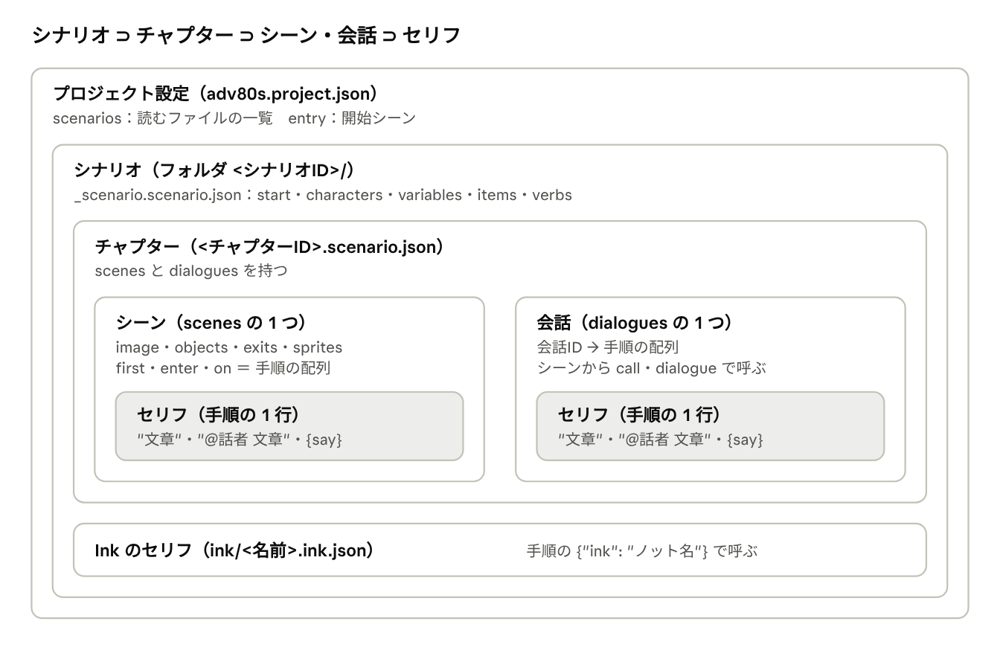

# adv80sGD：シナリオ・チャプター・シーン・セリフの仕様と関係

## 全体の関係



ゲームはプロジェクト設定の `scenarios` に並んだファイルを読み、シーンからシーンへ進みます。シナリオとチャプターは「ファイルをどう分けるか」の単位、シーンと会話は「遊ぶ人がいる場所と話」の単位、セリフは「画面に出る 1 行」の単位です。

- **シナリオ**：一つの物語のまとまり。話者・変数・持ち物など、物語全体で使うものを持つ。
- **チャプター**：シナリオを分けたファイル。シーンと会話を持つ。
- **シーン**：背景が一枚の場所。調べられるもの、出口、入ったときの手順を持つ。
- **会話**：名前の付いた手順の並び。シーンから呼ぶ。
- **セリフ**：手順の一行。地の文か話者付きの台詞。

ID はシーンも会話もゲーム全体で一つの名前の場に入ります。別のチャプターや別のシナリオのシーンへも、ファイル名を書かずに ID だけで `goto` できます。

## シナリオ

シナリオは、シナリオのフォルダ（既定 `res://game/scenario`）の下のフォルダ一つです。中に、シナリオ共通の設定 `_scenario.scenario.json` と、チャプターのファイル、Ink のセリフを置きます。

```text
res://game/scenario/
  main/                         シナリオ（ID：main）
    _scenario.scenario.json     シナリオ共通の設定
    chapter1.scenario.json      チャプター
    chapter2.scenario.json
    ink/talk.ink, talk.ink.json Ink のセリフ
```

| `_scenario.scenario.json` に書くもの  | 内容                                                          |
|---------------------------------------|---------------------------------------------------------------|
| `start`                               | 開始シーン（プロジェクト設定の `entry` があればそちらが優先） |
| `characters`                          | 話者（表示名、色など）                                        |
| `variables`、`constants`              | 変数の宣言と定数                                              |
| `items`                               | 持ち物                                                        |
| `verbs`、`nouns`、`replies`、`topics` | コマンドの言葉、言い換え、決まった返事、話題                  |
| `flow`、`chapters`                    | フローチャートと章選択（次の節）                              |
| `assets`                              | シナリオが持つ素材フォルダ                                    |

**読み込み**：ゲームはプロジェクト設定の `scenarios` に並んだファイルを順に読み、中身を一つに合わせます。シナリオエディタで作る・複写・削除すると、`scenarios` は自動で書き直されます。

- 合わせるので、シーン・会話・話者・持ち物・変数の ID は、シナリオをまたいでも一つの名前の場です。同じ ID が二つあると `DUPLICATE_ID` の警告になり、後に読んだ方が使われます。
- 「シナリオ」は作る人のための整理の単位で、ゲームの中に「いまどのシナリオか」という状態はありません。本編と外伝、本編とタイトルまわりなど、分けて管理したい大きなまとまりごとに作ります。
- フォルダに分けていない古い形の `*.scenario.json` も読めます（エディタでは「フォルダの外のファイル」として見え、右クリックでフォルダの形に移せる）。

## チャプター

「チャプター」には意味が二つあります。混ぜないように注意します。

|                    | チャプターのファイル                                  | チャプター選択の章                                  |
|--------------------|-------------------------------------------------------|-----------------------------------------------------|
| 何か               | シナリオを分けたファイル（`<ID>.scenario.json`）      | 遊ぶ人が選んで始められる区切り                      |
| 中身               | `scenes`、`dialogues`（と、そのチャプターだけの設定） | `chapters` の `{id, label, node}`                   |
| ゲームから見えるか | 見えない（読むときに一つに合わさる）                  | 見える（タイトルの「チャプター」、`chapters.open`） |
| 作るところ         | シナリオエディタのチャプターの一覧                    | `_scenario.scenario.json` の `flow` と `chapters`   |

**ファイルの分け方**：物語の段落ごと（序章・一日目・二日目…）に分けると、一つのファイルが小さくなり、編集も差分も追いやすくなります。ただしシーンの ID は全体で一つの名前の場なので、ファイルを分けても同じ ID は使えません。`ch1_hallway` のように頭を付けると迷いません。

**チャプター選択の作り方**：

1. モダン機能 `chapter_select` を入れる（既定は切）。
2. `flow` に点（`nodes`）と線（`edges`）を書く。
3. `chapters` に `{id, label, node}` を並べる。`node` はその章の始まりの点。
4. 場面の始まりの手順に `{"flow.mark": {"node": "ch2"}}` を書く。そのときの状態が残り、その章が選べるようになる。

```json
"flow": {
  "nodes": [ { "id": "ch1", "label": "じけんの よる" }, { "id": "ch2", "label": "つぎの あさ" } ],
  "edges": [ { "from": "ch1", "to": "ch2" } ]
},
"chapters": [
  { "id": "c1", "label": "だい 1 しょう", "node": "ch1" },
  { "id": "c2", "label": "だい 2 しょう", "node": "ch2" }
]
```

チャプターのファイルとチャプター選択の章は、一対一にそろえると分かりやすくなりますが、そろえなくても動きます。

## シーン

シーンはチャプターの `scenes` に「シーンID → 中身」で書きます。ID は英小文字・数字・`_`・`-` で付け、画面に出す名前は `name` に書きます。種類ごとの作り方は[シーンの作り方と目的別の準備](scenes.md)を見てください。

| 項目                                                            | 内容                                                        |
|-----------------------------------------------------------------|-------------------------------------------------------------|
| `name`、`kind`                                                  | 表示名、種類（normal・title・opening・ending・sub・system） |
| `image`、`image_transition`、`sprites`                          | 背景と、絵の上の部品                                        |
| `bgm`、`transition`                                             | 入ったときの曲と演出                                        |
| `first`、`enter`                                                | 初めて入ったとき・入ったときの手順                          |
| `objects`、`exits`                                              | 調べられるもの・人物、出口                                  |
| `on`                                                            | 対象のないコマンドへの反応                                  |
| `params`、`menu`、`ending`、`replay`、`next`、`variants`、`fin` | 種類ごとの項目                                              |

**シーンの移り方**

| 書き方                                                    | 動き                                                     | 戻るか          |
|-----------------------------------------------------------|----------------------------------------------------------|-----------------|
| 出口 `exits`                                              | 遊ぶ人が「いく」で移る                                   | 戻らない        |
| 手順の `{"goto": "room"}`                                 | そこで手順を打ち切って移る（会話の中では会話を先に探す） | 戻らない        |
| `{"scene.goto": {"scene": "room", "transition": "wipe"}}` | 演出を指定して移る                                       | 戻らない        |
| `{"call_scene": "shop", "args": {…}, "into": "変数"}`     | サブシーンを呼ぶ                                         | `return` で戻る |

- 入ったシーンは訪れた記録に残り、条件式の `visited(シーンID)` で調べられます。いまいるシーンは `scene == シーンID`。
- シーンの ID を変えるときは、シナリオエディタの「ID を変更…」を使います。すべての JSON シナリオの参照と `entry` も書き換わります（Ink の中の `goto_scene("…")` は書き換わらない）。

## セリフ

セリフは「手順の配列」の一行です。シーンの `first`・`enter`・`on`、会話の `dialogues`、選択肢の `do` など、手順を書く場所はどこでも同じ書き方です。

```json
"characters": { "ayumi": { "name": "あゆみ", "pal": 3 } },
"dialogues": {
  "ayumi_first": [
    "部屋の隅に 少女が 立っている。",
    "@ayumi はじめまして。あなたが たんていさん？",
    { "choice": { "prompt": "どう こたえる？", "options": [
        { "label": "そうだ", "do": [ "@ayumi よかった……。", { "set": { "met_ayumi": true } } ] },
        { "label": "ちがう", "do": [ "@ayumi そう……。" ], "once": true } ] } },
    { "if": "has(key)", "then": [ { "say": "ayumi", "text": "その かぎ……！", "id": "ayumi_key_01", "voice": "ayumi_key_01" } ] }
  ]
}
```

| 書き方                                 | 意味                                                  |
|----------------------------------------|-------------------------------------------------------|
| `"文章"`                               | 地の文                                                |
| `"@話者ID 文章"`                       | 話者の名前付きの台詞（行頭に `@` を出すときは `@@`）  |
| `{"say", "text", "id", "voice"}`       | ID やボイスを付けた台詞                               |
| `{"choice": {…}}`                      | 選択肢（項目の `when` で出す条件、`once` で一度きり） |
| `{"if", "then", "else"}`               | 条件分岐                                              |
| `{"set": {…}}`、`{"let": "…"}`         | 変数を変える                                          |
| `{"call": "会話ID"}`、`{"goto": "ID"}` | 別の会話を呼ぶ（戻る）、移る（戻らない）              |
| `{"ink": "ノット名"}`                  | Ink の会話へ渡し、終わったら戻る                      |
| `{"image.show": {…}}` など             | 出力イベント（絵・音・演出・システム）をそのまま書く  |

**話者**：`characters` に `name`（表示名。`{player}` のような変数も使える）、`pal`（名前の色）、`voice`（ボイス）、`names`（コマンドでの呼び方）を書きます。

**本文の飾り**（よく使うもの）：`[p]`（クリック待ち）、`[page]`（次のページ）、`[w=秒]`、`[speed=文字数]…[/speed]`、`[ruby=よみ]漢字[/ruby]`、`[em]…[/em]`（傍点）、`[pal=番号]…[/pal]`、`[se=ID]`、`[gaiji=ID]`、`{変数}`、`[if=条件]…[else]…[/if]`、`[alias=名前 引数]`。窓に入りきらない文は自動でページに分かれます。

**行の ID**：書かなければ、会話ID と本文から自動で付きます。既読スキップと条件式の `read(行ID)` はこの ID を使います。本文を直すと ID が変わって既読が外れるので、ボイス付きの行や条件で使う行は `id` を手で書きます。

## 一覧表

| 単位                   | 置き場所                                | ID の付け方                            | 他からの参照                                                                                              | 記録と条件式                   |
|------------------------|-----------------------------------------|----------------------------------------|-----------------------------------------------------------------------------------------------------------|--------------------------------|
| シナリオ               | `<シナリオのフォルダ>/<ID>/`            | フォルダ名                             | プロジェクト設定の `scenarios`（エディタが書く）                                                          | なし                           |
| チャプター（ファイル） | `<シナリオID>/<ID>.scenario.json`       | ファイル名                             | `scenarios`                                                                                               | なし                           |
| チャプター（章選択）   | `_scenario.scenario.json` の `chapters` | `id`                                   | `chapters.open`                                                                                           | `flow.mark` で到達したら選べる |
| シーン                 | チャプターの `scenes`                   | キー（全体で一意）                     | `entry`、`start`、`exits`、`goto`、`scene.goto`、`call_scene`、`opening`、`title_screen`、`system_scenes` | `visited(ID)`、`scene == ID`   |
| 会話                   | チャプターの `dialogues`                | キー（全体で一意）                     | `call`、`goto`、`dialogue`、話題の `dialogue`                                                             | `talked(ID)`                   |
| セリフ（行）           | 手順の配列の中                          | 自動（会話ID＋本文）か `id`            | なし                                                                                                      | `read(行ID)`、既読スキップ     |
| 選択肢                 | 手順の `choice`                         | `id`（省けば自動。項目は `o1`、`o2`…） | なし                                                                                                      | `chosen(選択肢ID, 項目ID)`     |
| Ink のセリフ           | `<シナリオID>/ink/<名前>.ink.json`      | ノット名                               | 手順の `{"ink": "ノット名"}`                                                                              | `talked(ink:ノット名)`         |

- 「全体で一意」は、シナリオもチャプターもまたいで同じ ID を使えないという意味です。
- 記録（訪れた・見た・読んだ・選んだ）はセーブに入ります。既読はこれとは別に、全プレイ共通でも残ります。
- 選択肢を後で `chosen(…)` で調べるときは、選択肢と項目に `id` を手で書いておきます。
